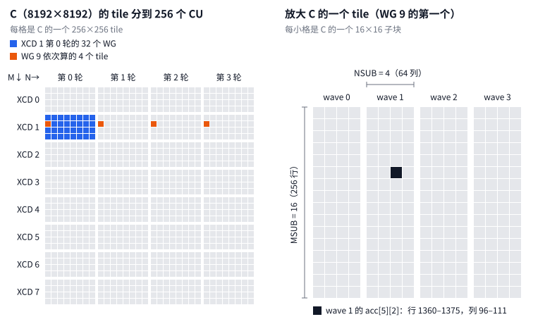
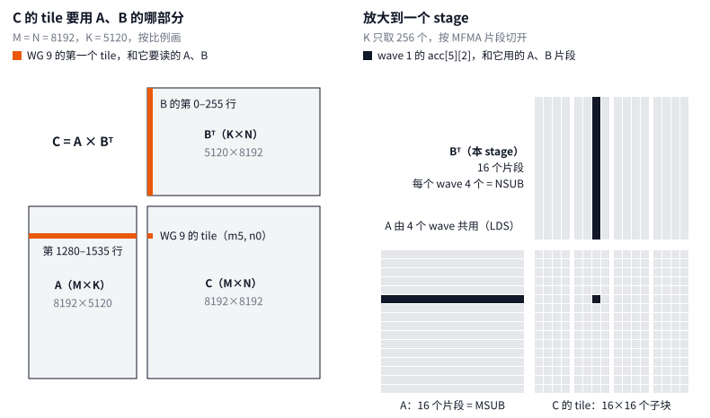
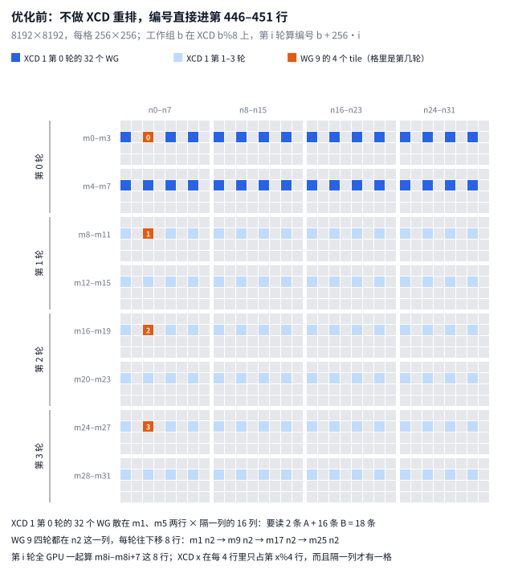
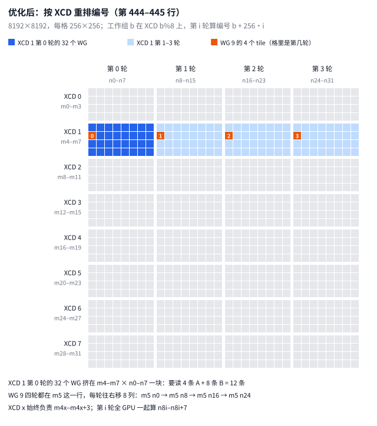
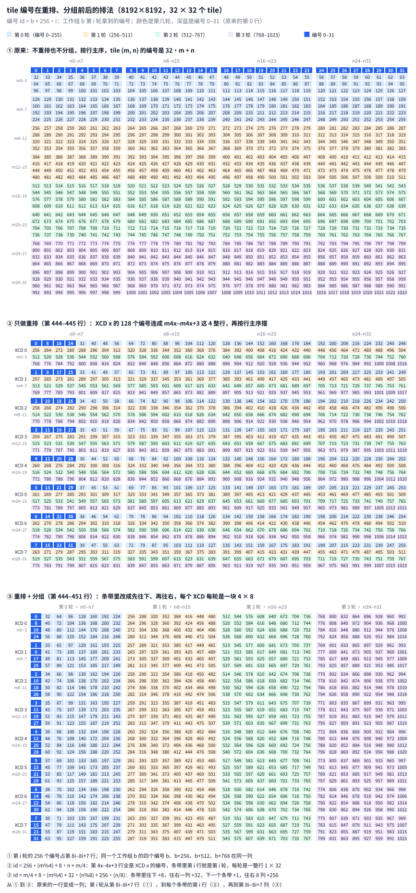
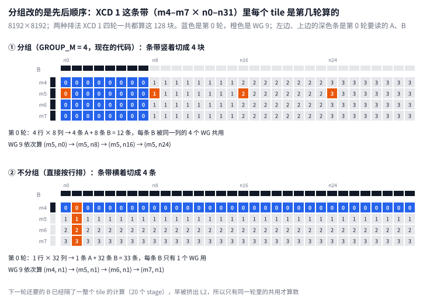
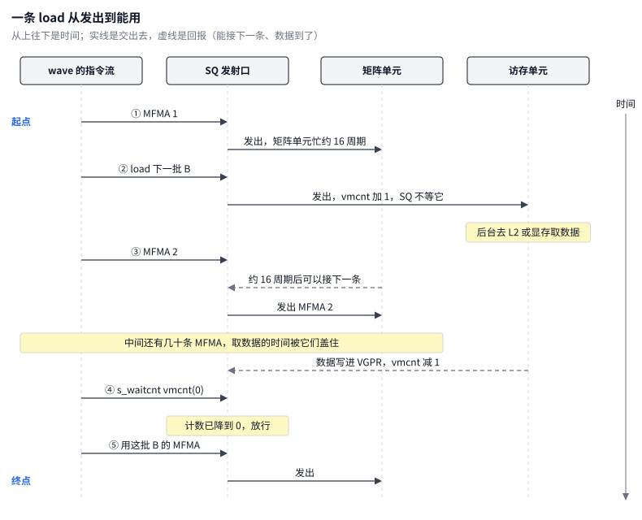

# MSUB/NSUB 与 tile 在 256 个 CU 上的分布

> 整理于 2026-10-31，针对 `kernel/gemm_a4w4.hip`（提交 `80614af`），文中行号以这个版本为准。

`MSUB` 和 `NSUB` 是一个 wave 内部的分块参数：这个 wave 在 M 方向算 `MSUB` 个 16×16 的 MFMA 子块，在 N 方向算 `NSUB` 个，所以它有 `acc[MSUB][NSUB]` 这么多个累加器。

16×16 子块不会被单独派给 CU。派给 CU 的单位是整个工作组 tile：4 个 wave 沿 N 方向并排，tile 大小是 `16·MSUB` 行 × `64·NSUB` 列。哪个工作组算哪个 tile 由 `tile_off` 决定。同一个 tile 里的所有子块都在同一个 CU 上，由这个 CU 的 4 个 SIMD 分着算。

下面以 8192×8192×5120 为例。launcher 选 `ceil(tiles/256) × (MTILE+64) × NTILE` 最小的 tile，对这个 shape 选中的是 256×256，即 `launch_wg<16, 4>`（MSUB=16，NSUB=4）。图 1 中的映射是照代码逻辑写脚本模拟出来的，1024 个 tile 每个都恰好被算一次。模拟脚本是临时文件 `/tmp/mbs_tile_map.py`，不在仓库里，用法是 `python3 /tmp/mbs_tile_map.py 8192x5120`。



图 1 两边画的都是输出矩阵 C，没有画 A 和 B：

- 左边每一格是 C 的一个 256×256 tile，32×32 格拼成整个 C。行方向是 M，列方向是 N。颜色表示这一格由哪些工作组来算。
- 右边把其中一格（WG 9 算的第一个 tile，即 C 的第 1280–1535 行、第 0–255 列）放大。它沿 N 方向分给 4 个 wave，每个小格是 C 的一个 16×16 子块。黑块对应 C 的第 1360–1375 行、第 96–111 列。

A、B 和 C 的对应关系见图 2。B 在内存里按 `[N, K]` 存放，图里画的是它的转置 Bᵀ（K×N），这样 Bᵀ 的每一列正好对着 C 的同一列。



- **左边：** C 的一个 tile 只用到 A 的对应 256 行和 B 的对应 256 行，而且都要走完整个 K。WG 9 的第一个 tile 要读 A 的第 1280–1535 行和 B 的第 0–255 行。
- **右边：** K 循环每次只取 256 个 K，叫一个 stage。这一段 A 按 16 行一片切成 16 个片段，4 个 wave 通过 LDS 共用。这一段 B 也切成 16 个片段，每个 wave 只拿自己的 4 个。子块 `acc[mi][ni]` 就是第 mi 个 A 片段乘第 ni 个 B 片段，结果累加进去。

所以从 A、B 的角度看，`MSUB` 是一个 wave 手里 A 片段的个数，`NSUB` 是它手里 B 片段的个数。这些片段两两相乘，正好得到 `MSUB×NSUB` 个子块。

## 一、四层分块

| 层级 | 谁来算 | 在 C 上的大小（M×N） | 数量 |
|---|---|---|---|
| 工作组 tile | 1 个 CU | `MTILE×NTILE` = 256×256 | 32×32 = 1024 个 |
| wave tile | 1 个 SIMD 上的 1 个 wave | `16·MSUB × 16·NSUB` = 256×64 | 每个工作组 4 个 |
| MFMA 子块 | 1 条 MFMA | 16×16 | 每个 wave `MSUB×NSUB` = 64 个 |
| 每个 lane 的那份 | 1 个 lane | 每个子块 4 个 fp32 | 每个 lane 共 256 个 AGPR |

[`kernel/gemm_a4w4.hip` 第 354–356 行](../kernel/gemm_a4w4.hip#L354-L356)：

```cpp
constexpr int MTILE   = 16 * MSUB;
constexpr int WNTILE  = 16 * NSUB;            // per-wave N extent
constexpr int NTILE   = WNTILE * WAVES;
```

M 和 N 两个方向不对称。4 个 wave 共用同样的 256 行 A（通过 LDS 共享），但各自负责不同的 64 列 B。所以从工作组的角度看，M 方向有 `MSUB` 个子块，N 方向有 `4·NSUB` 个。

## 二、tile 怎样分到 256 个 CU 上

**第一步：persistent 调度。**

- grid 只开 `min(tiles, 256)` 个工作组（第 937 行）。
- 按设计每个 CU 常驻一个工作组。256×256 tile 用满了 256 个 VGPR 和 256 个 AGPR，一个 SIMD 只放得下一个 wave，4 个 wave 正好占满一个 CU。
- 工作组只有 256 个，tile 却有 1024 个，所以每个工作组要在第 890 行的循环里连着算好几个 tile。

[`kernel/gemm_a4w4.hip` 第 868–914 行](../kernel/gemm_a4w4.hip#L868-L914)，省略了中间的 prologue 和 K 循环：

```cpp
int id      = blockIdx.x;
TileOff cur = tile_off(id);
TileOff nxt = tile_off(id + gridDim.x);
// ... prologue：先预取第一个 tile 的前两个 stage ...
for (; id < total; id += gridDim.x)
{
    // ... 当前 tile 的整个 K 循环 ...
    epilogue(cur);
    // ...
    cur = nxt;
    nxt = tile_off(id + 2 * gridDim.x);
}
```

具体分法是：先把 1024 个 tile 编号为 0–1023，也就是代码里的 `id`。工作组 `b` 从编号 `b`（`blockIdx.x`）开始，每算完一个就加 256（`gridDim.x`），编号超过 1023 就退出循环。第 i 轮处理的编号是 `b + 256·i`：

| | 第 0 轮 | 第 1 轮 | 第 2 轮 | 第 3 轮 |
|---|---|---|---|---|
| WG 0 | 0 | 256 | 512 | 768 |
| WG 1 | 1 | 257 | 513 | 769 |
| … | … | … | … | … |
| WG 255 | 255 | 511 | 767 | 1023 |

256 个工作组合起来，每个编号正好被算一次。这些编号再由 `tile_off` 换算成 tile 坐标（见第二步），比如 WG 9 的编号 9、265、521、777 对应图 1 里橙色的 4 格。

这里的"第 i 轮"指的是每个工作组自己循环的第 i 次，不是全局统一的时间段：

- kernel 里的 barrier 只有 `__syncthreads()`（第 758、884 行），它只同步同一个工作组里的 4 个 wave，管不到别的工作组。
- 所以工作组之间互不等待，算完一个 tile、发出写回指令后，马上就开始下一个。
- 下一个 tile 的数据甚至不用等到这时才读。循环里一直备着下一个 tile 的坐标 `nxt`，当前 tile 的最后一两个 stage 就已经在预取下一个 tile 开头的 A、B，所以换 tile 时流水线不断。

因此同一时刻，有的工作组可能已经进入第 1 轮，有的还在第 0 轮收尾。只是每个 tile 的计算量都一样，256 个工作组的进度差不多，整体看上去像是一轮一轮推进。

打个比方：256 个工人干 1024 件一样的活，每人有一张固定的清单（第 b 件、第 b+256 件……）。没人吹哨统一开工，谁干完谁接着干下一件。因为每件活工作量相同，大家几乎同时干完第一件，从外面看就像一轮一轮在推进；但在某个时刻，可能有人已经开始第二件，有人还在收尾第一件。

所以图 1 里"第 0 轮"到"第 3 轮"的划分是按循环次数画的，不是严格的时间段。

tile 数不是 256 的倍数时，各工作组的循环次数会不一样。比如 8192×5120 有 640 个 tile，`b < 128` 的工作组循环 3 次，其余的循环 2 次就退出了。第二步末尾说的"最后一轮不满"就是这个原因。

具体落到哪个物理 CU 由硬件派发决定，代码控制不了。代码只依赖一个事实：硬件把工作组轮流派给 8 个 XCD，所以 `b % 8` 就是它所在的 XCD。每个 XCD 有 32 个 CU 和自己私有的 L2。

**第二步：`tile_off` 把编号换算成 tile 坐标。**

[`kernel/gemm_a4w4.hip` 第 443–451 行](../kernel/gemm_a4w4.hip#L443-L451)：

```cpp
id = min(id, total - 1);  // past-the-end prefetches: any valid tile
if (id < total / NXCD * NXCD)  // ragged tail keeps its natural id
    id = (id % NXCD) * (total / NXCD) + id / NXCD;
const int group   = id / (GROUP_M * num_n);
const int first_m = group * GROUP_M;
const int gsize   = min(num_m - first_m, GROUP_M);
TileOff t;
t.m0 = (first_m + (id % (GROUP_M * num_n)) % gsize) * MTILE;
t.n0 = (id % (GROUP_M * num_n)) / gsize * NTILE + wave * WNTILE;
```

- 第 444–445 行是 XCD 重排：`id' = (id % 8)·(total/8) + id/8`。这样每个 XCD 拿到的是一段连续的逻辑编号。
- 第 446–451 行是 `GROUP_M = 4` 分组：逻辑编号在 4 行 tile 高的条带里按列走，先往下走 4 行，再往右挪一列。最后 `n0` 加上 `wave·WNTILE`，就是每个 wave 自己那 64 列。

对 8192×8192，这两步合起来可以化简。记 `x = b % 8`、`w = b / 8`，第 i 轮有：

- m-tile = `4x + w % 4`
- n-tile = `w / 4 + 8i`

也就是说，XCD x 始终负责第 4x 到 4x+3 行 tile，即输出里一个 1024 行的条带。第 i 轮全 GPU 一起算 n-tile 8i 到 8i+7，共 2048 列。每个工作组 4 轮都在同一行 tile 上，每轮往右移 8 列。

下面两张图对比这一步重排的作用。两张图都画 C 的 32 × 32 个 tile：蓝色是 XCD 1 第 0 轮的 32 个工作组，浅蓝是 XCD 1 后 3 轮的 tile，橙色是 WG 9 的 4 个 tile，格里写着第几轮。





不重排时（图 3a），编号直接进第 446–451 行。硬件把相邻的编号轮流派给 8 个 XCD，所以每个 XCD 拿到的是隔 8 取 1 的编号：XCD 1 第 0 轮的 32 个 tile 散在 m1、m5 两行 × 隔一列的 16 列上，这个 XCD 的 L2 要装 2 条 A + 16 条 B = 18 条（每条 256 行 × K）。重排后（图 3b），同样 32 个 tile 挤成 4 × 8 一块，只要 4 条 A + 8 条 B = 12 条，同一份 A、B 在 L2 里被更多工作组复用。

图 3c 把 1024 个 tile 编号在两步前后的位置都标了出来。编号就是第一步里的 `id = b + 256·i`，即工作组 b 第 i 轮拿到的编号；颜色表示第几轮，深蓝是编号 0–31。三块从上到下是：

- ① 不重排也不分组：编号按行主序铺开，tile (m, n) 的编号是 32·m + n，第 0 行是 0–31，第 1 行是 32–63，依此类推。
- ② 只做重排（第 444–445 行）：先把编号换成 `id' = (id % 8)·128 + id / 8`，再直接按行主序摆。
- ③ 重排 + 分组（第 444–451 行）：kernel 实际的排法。



对照三块，两步各做了什么就很清楚：

- **重排把每个 XCD 的编号收拢到 4 行里。** ① 里同一个 XCD 的编号（比如除以 8 余 1 的 1、9、17……）在每一行都隔 8 列出现一次，散在所有行上。② 里第 4x 到 4x+3 行的编号除以 8 都余 x，全部由 XCD x 来算；条带里第 i 行就是第 i 轮，编号是 `id = 256·(m % 4) + 8·n + m / 4`。但这时每轮是一整行 1 × 32，要读 1 条 A + 32 条 B。
- **分组把每一轮从一整行折成 4 × 8 的方块。** ③ 在每个条带里改成先往下、再往右。编号 0–31 原来是第 0 行（①），在 ② 里分到每个条带第一行的前 4 格，到 ③ 变成第 0 列：0、8、16、24 在 m0–m3，1、9、17、25 在 m4–m7，依此类推。第 i 轮的 256 个编号也从第 8i 到 8i+7 行（①）变成第 8i 到 8i+7 列（③），每个 XCD 每轮正好是一块 4 × 8，只要读 4 条 A + 8 条 B。
- **③ 的编号可以直接写出来。** `id = m / 4 + 8·(m % 4) + 32·(n % 8) + 256·(n / 8)`：同一个 4 行条带里沿列往下每次加 8，往右一列加 32；往下换一个条带加 1，即换到下一个 XCD；往右 8 列加 256，即下一轮。其中 `id % 256` 就是 `blockIdx.x`，`id / 256` 就是第几轮。比如 WG 9 的四个编号 9、265、521、777 都在 m5 这一行，依次在 n0、n8、n16、n24。

**为什么这样排对 L2 更友好。**

先看 L2 是怎么共享的。L2 是每个 XCD 私有的：一个 XCD 上的 32 个 CU 共用一块 L2，不同 XCD 之间不共享。所以能互相复用 L2 数据的，只有同一个 XCD 上同时在跑的那 32 个工作组。

再看每个工作组要读什么。对照图 2，算 C 的一个 tile，每个 stage 要读它那条 A 的 256 行 × 128 B = 32 KiB，加上它那条 B 的 32 KiB（不算 scale）。一个 XCD 上 32 个工作组，每个 stage 一共要读 32 × 64 KiB = 2 MiB。

这 2 MiB 里有多少是重复的，取决于这 32 个 tile 用到多少条不同的 A 和 B：

- 两个 tile 在同一行，读的是同一条 A；在同一列，读的是同一条 B。
- 先读的工作组把数据搬进 L2，后读的直接命中。所以每个 stage 真正要从 L2 外面（显存）搬进来的，只有"不同的 A 条数 + 不同的 B 条数"乘以 32 KiB。
- 32 个 tile 摆成 4×8 的方块时条数最少：4 条 A 加 8 条 B，共 12 条，每个 stage 只需搬 12 × 32 KiB = 384 KiB，理想情况下其余 81% 的读都命中 L2。换成别的形状都更多：2×16 要 18 条，1×32 要 33 条。最坏情况是 32 个 tile 两两既不同行也不同列，要 64 条，L2 完全帮不上忙。

图 3c 里每个 XCD 的 32 个工作组正好是一个 4×8 的方块，这是代码里两步配合的结果：XCD 重排让同一个 XCD 上的工作组拿到连续的编号，`GROUP_M = 4` 分组让连续的 32 个编号排成 4 行 × 8 列，少了哪一步都不行。下表是用脚本（临时文件 `/tmp/l2_strips.py`，用法 `python3 /tmp/l2_strips.py 8192x17408x5120`）数出来的对比，统计每个 XCD 在一轮里用到几条 A、几条 B，括号里是按上面的算法得到的理想 L2 命中率：

| tile 排法 | 8192×8192 | 8192×17408 | 8192×5120 |
|---|---|---|---|
| 现在的排法（XCD 重排 + GROUP_M=4） | 4 + 8 = 12 条（81%） | 4 + 8 = 12 条（81%） | 4 + 8 = 12 条（81%） |
| 直接按行主序，不重排也不分组 | 8 + 4 = 12 条（81%） | 约 4.7 + 17 ≈ 22 条（66%） | 约 13.3 + 5 ≈ 18 条（72%） |
| 只分组，不做 XCD 重排 | 2 + 16 = 18 条（72%） | 约 1.9 + 32 ≈ 34 条（47%） | 4 + 10 = 14 条（78%） |
| 只做 XCD 重排，不分组 | 1 + 32 = 33 条（48%） | 约 1.4 + 32 ≈ 33 条（48%） | 约 2.5 + 20 ≈ 22.5 条（65%） |

最后一行是在 `/tmp/l2_strips.py` 上加了这种排法后算的（临时文件 `/tmp/l2_strips2.py`，用法相同），前三行重新跑的结果和上面一致。

从对比里可以看出：

- 直接按行主序时，硬件轮流派发让 XCD x 拿到编号 x、x+8、x+16……。8192×8192 每行恰好 32 个 tile，这些编号正好落在 8 行 × 4 列上，也是 12 条，所以在这个 shape 上重排并不占便宜。但 N=17408 时每行 68 个 tile，不是 8 的倍数，同一个 XCD 的编号就散到了约 5 行、17 列上。
- 只分组不重排更糟。4 行高的分组被硬件轮流拆给 8 个 XCD，以 8192×8192 为例，每个 XCD 只分到 2 行，却横跨 16 列。
- 只重排不分组反而最差。重排之后每个 XCD 的编号是连续的，但不分组时连续的编号沿着一整行 tile 走，32 个工作组排成 1 行 × 32 列，B 完全没有复用。
- 现在的排法不管 N 是多少，每个 XCD 都是 4×8 的方块。

**分组改的是先后顺序。** 分不分组，每个 XCD 四轮一共算的都是同一批 tile。以 8192×8192 为例，XCD 重排后 XCD 1 拿到编号 128 到 255；不分组时直接按行排（m-tile = 编号 / 32，n-tile = 编号 % 32），这 128 个编号也正好是 m4 到 m7 这 4 整行。变的只是哪些 tile 排在同一轮里一起算。图 3d 把 XCD 1 这条带里每个 tile 是第几轮算的标了出来：



- **分组时，条带竖着切成 4 块。** 每轮算 4 行 × 8 列，第 0 轮要读 m4–m7 的 4 条 A 和 n0–n7 的 8 条 B，共 12 条，每条 B 被同一列的 4 个工作组共用。
- **不分组时，条带横着切成 4 条。** 每轮算 1 行 × 32 列，第 0 轮只要 m4 这 1 条 A，却要 n0–n31 全部 32 条 B，共 33 条，每条 B 只有 1 个工作组用。
- **为什么只看同一轮。** L2 只能在同时运行的工作组之间复用。不分组时，下一轮（m5）虽然又要用这 32 条 B，但中间隔了一整个 tile 的计算（20 个 stage），这些数据早已被挤出 L2，只能重新从显存读。
- **WG 9 的轨迹也跟着变。** 分组时它在 m5 这一行上，每轮往右移 8 列：(m5, n0) → (m5, n8) → (m5, n16) → (m5, n24)。不分组时它在 n1 这一列上，每轮往下移 1 行：(m4, n1) → (m5, n1) → (m6, n1) → (m7, n1)。

**用 tile 编号再看一遍（以 XCD 0 为例）。** 按行主序给 C 的 tile 编号，第 m 行第 n 列是 32·m + n。XCD 重排之后，XCD 0 负责连续的 128 个编号 0–127，也就是 m0–m3 这 4 行，由它的 32 个 CU 分 4 轮算完：

- **只重排、不分组：** 编号按顺序分下去，第 0 轮 32 个 CU 算 0–31 号，正好是 m0 这一整行。这一轮要读 1 条 A 和 32 条 B。A 被 32 个 CU 共用，B 却各用各的，没有复用。
- **重排加分组：** 第 0 轮 32 个 CU 算的是 0–7、32–39、64–71、96–103 号，也就是 C 左上角 4 行 × 8 列的一块（C 的第 0–1023 行、第 0–2047 列）。这一轮只要读 4 条 A 和 8 条 B，A、B 都有复用：每条 A 被同一行的 8 个 CU 共用，每条 B 被同一列的 4 个 CU 共用。

两种排法下，32 个 CU 每个 stage 要读的总量都是 32 × 64 KiB = 2 MiB。但要从 L2 外面搬进来的数据，前者是 33 条 × 32 KiB = 1056 KiB，后者只有 12 条 × 32 KiB = 384 KiB。

还有三点要说明：

- 表里的命中率是理想值，前提是同一个 XCD 上 32 个工作组读同一段数据的时间足够接近，数据被挤出 L2 之前就被别人用上了。这正是第一步说的"各工作组进度差不多"的作用。
- 不同 XCD 的 L2 互不共享。同一轮里 8 个 XCD 都要用 n8i 到 n8i+7 这 8 条 B，每个 XCD 都得自己搬一次。
- 这个 kernel 在大 shape 上主要卡在 MFMA 发射，不卡在访存，所以命中率的差别对总时间影响不大。`mbs_note.md` 记录的实测是：persistent 与否、GROUP_M 取 2、8、16，差别都在 ±2% 以内。

**这套映射的两个例外。**

- 只有 M 方向的 tile 行数是 32 的倍数时，条带才这么整齐。比如 1024×17408 选的是 160×256（MSUB=10），只有 7 行 tile。这时每个 XCD 的那段编号虽然仍是连续的，但会跨过条带边界。
- 最后一轮可能不满。8192×5120 有 640 个 tile，最后一轮是第 2 轮（处理编号 `b + 512`），只有 `b < 128` 的工作组有活，每个 XCD 有一半 CU 空着。

## 三、每一层怎么计算

K 方向每 256 个元素是一个 stage。每个 stage 内：

**工作组（一个 CU）。** A 这一段是 256 行 × 128 B，由 4 个 wave 分工 DMA 进 LDS。每个 wave 搬 64 行，即 `A_LDS_PER_WAVE = 8` 条 load，每条 8 行。之后 4 个 wave 都从 LDS 读全部 256 行。B 不共享，每个 wave 把自己那 64 列的 B 直接读进寄存器。

这里的 DMA 指带 `lds` 后缀的 load 指令，不是 GPU 上专门做拷贝的 SDMA 引擎。普通 load 把数据从显存读进 VGPR，要放进 LDS 还得再发一条 `ds_write`；带 `lds` 的 load 让硬件把读回来的数据直接写进 LDS，不经过 VGPR。对这个 kernel 有三个好处：

- 256 个 VGPR 已经用满，腾不出寄存器来中转 A。
- 少了 `ds_write`，MFMA 之间夹的指令更少。
- load 发出去后，wave 可以接着发 MFMA，到要用之前再用 `vmcnt` 等它落地。

[`kernel/gemm_a4w4.hip` 第 578–584 行](../kernel/gemm_a4w4.hip#L578-L584)：

```cpp
constexpr int j = k - KA;
asm volatile("s_mov_b32 m0, %0\n\t"
             "buffer_load_dwordx4 %1, %2, 0 offen lds"
             :
             : "s"(lds_base + lds_wave_off + j * 1024), "v"(a_voff[j]),
               "s"(rsrc_at(a_rsrc, to.a + st * 128))
             : "memory", "m0");
```

`m0` 寄存器里放 LDS 的目标地址，`a_voff[j]` 是每个 lane 在显存里的偏移。这条 asm 的输出列表是空的，也就是没有目标 VGPR。

**一次搬多少。** 指令名里的 dword 是 double word，即 4 字节、32 位，正好是一个寄存器在每个 lane 上的宽度；`dword` 每个 lane 搬 1 个，`dwordx4` 每个 lane 搬 4 个。所以一条 `buffer_load_dwordx4 … lds` 里，每个 lane 搬 16 字节（32 个 fp4），64 个 lane 一共 1 KiB。A 的一行在一个 stage 里是 128 B（K=256 个 fp4），所以一条指令正好搬 8 行：lane L 负责第 L/8 行的第 L%8 个 16 字节，硬件按 lane 顺序把它们连续写进 LDS。从显存读的时候，lane 取的其实是这一行的第 (L%8) ^ (L/8) 个 16 字节（第 434–437 行）。这个 XOR swizzle 是为了之后从 LDS 读片段时不发生 bank conflict。

**一个 stage 搬多少。** 以 256×256 tile 为例（`launch_wg<16, 4>`，每个工作组 4 个 wave），一个 stage 里从显存搬进来的数据如下：

| 数据 | 指令（每个 wave 几条） | 每条指令 | 每个 lane | 每个 wave | 整个工作组 |
|---|---|---|---|---|---|
| A | `buffer_load_dwordx4 … lds` × 8 | 1 KiB = 8 行 × 128 B | 128 B | 8 KiB = 64 行 × 128 B | 32 KiB = 256 行 × 128 B |
| A 的 scale | `buffer_load_dword … lds` × 2 | 256 B = 32 行的 scale | 8 B | 512 B = 64 行的 scale | 2 KiB = 256 行的 scale |
| B | `buffer_load_dwordx4` × 8 | 1 KiB = 16 行 × 64 B | 128 B | 8 KiB = 64 行 × 128 B | 32 KiB = 256 行 × 128 B |
| B 的 scale | `buffer_load_dword` × 2 | 256 B = 32 行的 scale | 8 B | 512 B = 64 行的 scale | 2 KiB = 256 行的 scale |
| 合计 | 20 条 | | 272 B | 17 KiB | 68 KiB |

几点说明：

- 一行 A 或 B 在一个 stage 里是 K=256 个 fp4，每个 fp4 占半字节，所以是 128 B。scale 每 32 个 K 一个字节，所以一行在一个 stage 里有 8 个 scale 字节，32 行就是 256 B。
- A 和 B 每个 wave 搬的量一样，都是 64 行 × 128 B。区别在于 A 的 64 行只是工作组那 256 行的四分之一，搬进 LDS 后 4 个 wave 共用；B 的 64 行是这个 wave 独有的，直接进它自己的寄存器。
- B 的一条指令搬的是一个 16 行子块在半个 stage（K=128）里的数据。每个 wave 有 4 个子块、2 个半段，所以是 8 条。

"一个 lane 搬 16 字节"说的是一条指令。一个 stage 里每个 wave 要发 8 条，每个 lane 一共搬 128 B。这 128 B 不在同一行，而是 8 行里各取同一个位置的 16 字节。比如 wave 1 的 lane 10，8 条指令分别搬第 65、73、81、…、121 行，每行都取第 3 个 16 字节（这个 stage 里 K 的第 96–127 个元素），写进 LDS 时放在该行第 2 个 16 字节的位置，这就是 XOR swizzle 的结果。

用乘法核对一遍：一条指令是 16 B × 64 个 lane = 1 KiB，每个 wave 每个 stage 发 8 条，4 个 wave 合起来是 16 × 64 × 8 × 4 = 32768 B = 32 KiB，正好是一个 stage 的 A：256 行 × 256 个 fp4 × 0.5 B = 32768 B。

这里说的"每个 wave 发 8 次"，要注意两点：

- 不是同一条指令跑 8 遍，而是 8 条搬不同行的指令。代码在编译期展开成 j = 0…7，第 j 条搬这个 wave 那 64 行里的第 8j 到 8j+7 行：显存偏移是 `a_voff[j] = a_lane + j * a_jstride`（第 528 行，`a_jstride = 8 * Kp`），LDS 目标地址是 `m0 = … + j * 1024`（第 582 行）。
- 这 8 条也不是连着发的。它们搬的是两个 stage 之后才用的 A（`PF = 2`），在当前 stage 的段 1 里一条一条插在 MFMA 之间。段 1 共 64 条 MFMA，8 条 A 的 DMA 分别排在第 0、5、11、16、22、28、33、39 条 MFMA 前面，第 44、50 条前面是 2 条 A 的 scale DMA。B 的 8 条 load 和 2 条 scale load 在段 0 里排在同样的位置，搬的是下一个 stage 的 B（`PF_B = 1`）。

还要注意这只是一个 stage。一个 tile 的 A 是 256 行 × 整个 K，K=5120 时要分 20 个 stage 才搬完。LDS 里只有 4 个 stage 缓冲轮流用（`RING = 4`，每个 34 KiB，含 scale），A 提前 2 个 stage 发出（`PF = 2`）。所以任何时刻，LDS 里都只放着这条 A 的几段，不是整条。

B 不用 DMA，是因为每个 wave 用的 B 各不相同，放进 LDS 也没有别的 wave 来共享，直接进寄存器更省。

**从哪来、到哪去。** 以 WG 9 的第一个 tile（C 的第 1280–1535 行、第 0–255 列）、第 s 个 stage 为例：

| 数据 | 从显存哪里读 | 写到哪 | 是否共享 |
|---|---|---|---|
| A | A 的第 1280–1535 行，每行第 128s 到 128s+127 字节，即 K 的第 256s 到 256s+255 个元素。wave w 搬其中从第 1280+64w 行起的 64 行 | LDS 的 stage 缓冲 | 4 个 wave 共用 |
| A 的 scale | 同样这 256 行、这个 stage 的 8 个 K 块 | LDS，紧跟在这个 stage 的 A 后面 | 4 个 wave 共用 |
| B | B 的第 64w 到 64w+63 行（对应 C 的第 64w 到 64w+63 列），同一段 K。preshuffle 后每 16 行一块，每块在一个 stage 里是连续的 2 KiB | wave w 自己的 VGPR | 不共享 |
| B 的 scale | 同样这 64 行、这个 stage 的 8 个 K 块 | wave w 自己的 VGPR | 不共享 |

每个 wave 只搬了 64 行 A，却要读全部 256 行，所以等自己的 DMA 落地之后，还要过一次 `__syncthreads()`（第 758 行），确保其他 wave 搬的部分也到了。之后每个 wave 从 LDS 读 32 条 `ds_read_b128`（16 个 A 片段 × 2 个 K 半段，共 32 KiB）和 8 条 scale（2 KiB）；B 已经在自己的寄存器里，不用再读。这个 wave 用这 32 个 A 片段和 8 个 B 片段发出 128 条 MFMA：每个 A 片段用 `NSUB` = 4 次，每个 B 片段用 `MSUB` = 16 次。

**这些数字在代码里的出处：**

- `STAGE_A = MTILE * 128`（第 357 行）：工作组每个 stage 的 A，256 行 × 128 B。
- `A_LDS_PER_WAVE = MTILE / 8 / WAVES`（第 358 行）：每个 wave 的 A DMA 条数，256 / 8 / 4 = 8。
- `NSB = MSUB / 2` 和 `S_LDS_PER_WAVE`（第 362–363 行）：A 的 scale 每 32 行一块，共 8 块，每个 wave 搬 2 块。
- `STAGE_B = STAGE_A + NSB * 256`（第 364 行）：一个 LDS stage 缓冲的大小，32 KiB + 2 KiB = 34 KiB。
- `NB = 2 * NSUB`（第 499 行）：每个 wave 的 B 条数，4 个子块 × 2 个 K 半段 = 8。B 的 scale 是 `NSUB / 2` = 2 条。
- `LOADS_PER_STAGE`（第 500 行）：8 + 2 + 8 + 2 = 20。
- 读的地址：第 452–455 行算出这个 tile（以及这个 wave）在 A、B 和两份 scale 里的起点。之后每个 stage 往后挪一段：A 挪 128 B（第 583 行的 `st * 128`），B 挪 2 KiB（第 558 行的 `stb * 2048`），两份 scale 各挪 256 B。

**wave（一个 SIMD）。** 一条 MFMA 只覆盖 K=128，所以每个子块要做 2 条，一个 stage 共 `2·MSUB·NSUB = 128` 条。二维寄存器分块的收益就在这里：每个 A 片段被 `NSUB` 个子块复用，每个 B 片段被 `MSUB` 个子块复用。这 128 条 MFMA 分两段发射，段 0 算 mi=0..7，段 1 算 mi=8..15，段内按 2×2 之字形排序。

段是按 M 分的，每段都覆盖这个 stage 的全部 K=256；K 的两个半段在段内分开，先发 h=0 的 32 条，再发 h=1 的 32 条。以第 s 个 stage 为例（行号是这个 tile 里的行），两段的分工如下：

| | 段 0 | 段 1 |
|---|---|---|
| 正在算 | 第 0–127 行的 A（`afr0`）× 这个 wave 的 B | 第 128–255 行的 A（`afr1`）× 同一份 B |
| 同时从 LDS 预读下一段 | stage s 的第 128–255 行 → `afr1` | stage s+1 的第 0–127 行 → `afr0` |
| 同时从显存预取 | stage s+1 的 B 和 B 的 scale → 寄存器 | stage s+2 的 A 和 A 的 scale → LDS |
| 开始前要等到 | 本段的 A 片段已读进寄存器，本 stage 的 B 已到 | 本段的 A 片段已读进寄存器；stage s+1 的 A 已全部 DMA 进 LDS（等 `vmcnt` 后再过一次 `__syncthreads()`，第 754–758 行） |

所以一段开始时，这一段要用的 16 个 A 片段和这个 stage 的 8 个 B 片段都已经在寄存器里了，接下来 64 条 MFMA 按编译期排好的顺序一条接一条发出。每个 A 片段要用 4 次（乘 4 个 B 片段），每个 B 片段在一段里要用 8 次（乘 8 个 A 片段）。MFMA 单元是流水线化的，前一条还没算完就可以发下一条，只要两条写的不是同一个累加器；按 2×2 之字形的顺序，同一个累加器要隔 32 条才会再被写一次，所以 MFMA 之间不会互相等。

**数据提前到了会不会浪费时间？** 不会。性能只看矩阵单元有没有闲着。数据在寄存器里等 MFMA，花的只是寄存器空间，也就是第五节第 9 条表里"流水多备的"那一份。真正损失时间的情况正好反过来：MFMA 停下来等数据、等上一条 MFMA 的结果，或者等其他 wave。

在 MI355X 上实测这条 fp4 MFMA（一个 wave 连续发射，临时测试程序 `/tmp/mfma_bench2.hip`）：

| 连续发射的 MFMA | 每条平均周期 |
|---|---|
| 每条都依赖上一条的结果（同一个累加器） | 约 36 |
| 4 个累加器轮流 | 约 21 |
| 16 个累加器轮流 | 约 17 |
| 64 个累加器轮流（和这个 kernel 一样） | 约 16 |

一条 MFMA 至少要占矩阵单元约 16 个周期；如果下一条要用上一条的结果，就要等到约 36 个周期才能发。这个 kernel 用 64 个互不相关的累加器，同一个累加器隔 32 条（约 500 个周期）才再写一次，所以能贴着 16 个周期的上限连续发射。

每条 MFMA 占用矩阵单元的这十几个周期里，wave 还可以发别的指令。一段 64 条 MFMA 中间夹的 20 条 LDS 读和 10 条全局 load，就是利用这些空档发出去的，本身不额外占时间。一段至少要 64 × 16 ≈ 1000 个周期，所以提前一整段从 LDS 读数据，时间绰绰有余。

真正的损失在别处：段开头等数据到齐（`s_waitcnt`）、段 1 前等其他 wave（`__syncthreads()`）、换 tile 时的 epilogue，以及非 MFMA 指令太密、和 MFMA 抢发射。代码开头的注释提到，生产版 asm kernel 的 MFMA 单元利用率大约是 56%（第 29 行）；`MBS_TIMING` 打开后统计的几项（第 61–65 行），测的就是这些等待。

**寄存器够的话，把数据全都提前放进去是不是最快？** 不是。快慢的上限是 MFMA 本身：一条约 16 个周期，一个 SIMD 一次只能做一条，总条数由矩阵大小决定。8192×8192×5120 一共有 512 × 512 × 40 ≈ 1049 万条 MFMA，分到 1024 个 SIMD 上每个约 1 万条；按峰值频率 2.4 GHz 算，光 MFMA 至少要约 68 µs。summary.md 里实测是 174 µs。这个端到端的对比受实际运行频率影响，还包含 epilogue 等开销，按周期看更准：主循环里每个 stage 只比 MFMA 地板多约 15%（见下文"MFMA 没打满，能不能多预取"）。所以要做的不是多放数据，而是消灭 MFMA 之间的空档，这也是代码开头说的"MFMA 发射密度"（第 28–31 行）。

寄存器在这件事上确实是最宝贵的资源，但它的用处是两样：

- **更多累加器，也就是更大的 tile。** 每搬一份数据能做更多条 MFMA，要发的 load 和 LDS 读就更少，挤占 MFMA 发射的指令也更少。
- **更深的预取。** 能藏住更长的访存延迟。

数据只要在 MFMA 用到之前到就够了，再提前也不会更快。而且也做不到全部提前：

- 一个 tile 的 A、B 各 640 KiB，而一个 wave 的 VGPR 加 AGPR 一共才 128 KiB。
- 就算放得下，先全部读完再算，读和算就变成串行了，反而更慢。流水的意义正是让"读后面的"和"算前面的"同时进行。
- load 也不能一次发很多。代码注释提到，二十来条 load 连着发会把顺序发射的指令流堵住（第 624–625 行），所以 load 都是一条一条撒在 MFMA 中间发的。

**为什么分两段，不分四段？** 分的段越多，提前读的反而越少，因为提前读的量就是一段的片段：

| 分几段 | 每段的 A 片段 | 两组轮换共占 VGPR | 提前量 |
|---|---|---|---|
| 2 段（现在） | 8 个 mi × 2 = 16 个 | 128 | 64 条 MFMA，约 1000 个周期 |
| 4 段 | 4 个 mi × 2 = 8 个 | 64 | 32 条 MFMA，约 500 个周期 |

所以分四段是省寄存器、减少提前量，不是多预取。用两段有三个原因：

- **和生产版 asm 的循环一样。** 一个 stage 里一段夹带 B 的 load，一段夹带 A 的 DMA，只有一个 barrier。`asm_vs_wg_kernel.md` 记录，单独换成两段式时性能持平，但后面几项优化都是在它上面做的。
- **段越多，等待点越多。** 每段开头都要 `lgkmcnt(0)` 等一次。
- **段数决定能做的 tile 高度。** A 的 scale 一个 dword 管一对子块，所以每段的 mi 数必须是偶数。两段只要 MSUB ≥ 4；分四段就要 MSUB ≥ 8，`kWgTiles` 里 64 行和 96 行的 6 种 tile（MSUB = 4、6）就做不了了。

**MFMA 没打满，能不能多预取？** 先要看没打满的时间花在哪。`asm_vs_wg_kernel.md` 在 256×256 tile（4096² × 16384）上按周期实测过，每个 wave 每个 stage：

- 完全不发 load 时是 2290 个周期，这是 MFMA 地板。
- 现在约 2710 个周期，多出约 420 个，主要在两段的 body 里，也就是 load 指令夹在 MFMA 中间的开销：段 0 夹带 B load 多约 170，段 1 夹带 A DMA 多约 230。
- 等待一共约 180 个周期，不是差距所在。

多预取只能减少等待，减少不了 load 指令本身的开销，因为要搬的数据和指令条数都不变。同一份笔记还记录了把 LDS 读的提前量 `FRAG_AHEAD` 从 2 加到 4，差别在 ±2% 以内，说明 LDS 延迟不是瓶颈。

预取深度要按实测来定，还受寄存器限制。B 的预取就是例子：256 行和 N 方向宽的 tile，每个 stage 不少于 128 条 MFMA，提前 1 个 stage 已经够藏延迟，就不再多花一套寄存器；其余 tile 实测提前 2 个 stage 更好（第 367–371 行的注释）。

[`kernel/gemm_a4w4.hip` 第 724–731 行](../kernel/gemm_a4w4.hip#L724-L731)：

```cpp
constexpr int q = t % 4, mp = (t / 4) % (MC / 2), np = (t / 2 / MC) % (NSUB / 2);
constexpr int h = t / (MC * NSUB), ml = 2 * mp + (q & 1), ni = 2 * np + (q >> 1);
constexpr int mi = MB + ml;
// Operands swapped (B first): computes the C^T subtile, so lane L
// ends up holding row L%16, columns (L/16)*4..+3 -- 4 contiguous
// outputs of one row (see the epilogue).
mfma_fp4_sel<2 * h + (ni & 1), 2 * h + (mi & 1)>(acc[mi][ni], bf[ni][h],
                                                 cf[h * MC + ml], bs[ni / 2], cs[ml / 2]);
```

**一个子块 `acc[mi][ni]`。** 它覆盖输出中从 `m0 + 16·mi` 开始的 16 行、从 `n0 + 16·ni` 开始的 16 列，`n0` 已经包含 wave 偏移。记 `row16 = L % 16`、`g = L / 16`，`h` 表示 stage 内 K 的前半段或后半段（0 或 1）。lane L 的分工如下：

- **输入：** A 片段取子块第 `row16` 行、第 `g` 个 K 块的 32 个 fp4，共 16 字节。B 片段同理，取第 `row16` 列。4 组 lane 合起来正好是一条 MFMA 的 K=128。
- **scale：** 每个 lane 的一个 dword 里有 4 个 E8M0 字节，对应"相邻两个子块"乘"K 的前后两半"。MFMA 用 `op_sel` 直接挑字节：A 的 scale 取第 `2h + (mi&1)` 个，B 的取第 `2h + (ni&1)` 个。所以 `MSUB` 和 `NSUB` 都必须是偶数，见第 353 行的 `static_assert`。
- **输出：** wg kernel 交换了两个操作数（B 在前），算出来的是 C^T。所以 lane L 拿到的是 `C[16·mi + L%16][16·ni + 4·(L/16) + 0..3]`，是同一行里连续的 4 个数，epilogue 可以直接拼成整行写回。

## 四、回退的单 wave kernel

K 不是 1024 的倍数，或者 tile 不足 64 个时，会走 `gemm_a4w4_mfma_kernel`。这里 `MSUB`/`NSUB` 的含义不变，区别有三点：

- 一个工作组只有 1 个 wave，不用 LDS，也不是 persistent。
- grid 是 `(ceil(N/NTILE), ceil(Mpad/MTILE))`，`blockIdx.x` 对应 n-tile，`blockIdx.y` 对应 m-tile（第 162–163 行）。这些工作组全部交给硬件往 256 个 CU 上排，一个 CU 可以同时驻留好几个。
- 操作数没有交换，输出布局是 `acc[i] = C[(L/16)·4 + i][L%16]`。

## 五、骨干总结

以 8192×8192×5120 为例，C 是 8192×8192：

1. **最小单位是 16×16。** MFMA 指令 `v_mfma_scale_f32_16x16x128_f8f6f4` 一次算 C 的一个 16×16 子块，同时一次只吃 K=128。
2. **派给 CU 的是工作组 tile。** 16×16 子块不会单独派给 CU。4 个 wave 沿 N 并排，C 的 tile 是 `16·MSUB` 行 × `64·NSUB` 列。
3. **MSUB=16、NSUB=4 时 tile 是 256×256。** 一个 CU 一次负责 C 的一个 256×256 tile。这个 tile 的 fp32 累加器一共 256 × 256 × 4 B = 256 KiB，正好等于 4 个 wave × 64 个 lane × 256 个 AGPR × 4 B，把 AGPR 用满。
4. **C 被切成 32×32 = 1024 个 tile。** 每个 XCD 分到 128 个，是 4 行 × 32 列的一个条带。一个 XCD 只有 32 个 CU，所以每个工作组循环 4 轮，每轮这 32 个 CU 一起算其中 4×8 的一块。
5. **K 太长，要分 stage。** 一个 tile 要用 A 的 256 行 × 5120 和 B 的 256 行 × 5120，各 640 KiB，LDS 和寄存器都放不下。分 stage 还有第二个好处：可以边算当前 stage，边预取后面的 stage。
6. **一个 stage 取 K=256。** 每个 stage 用 A 的 256×256 和 B 的 256×256，对整个 256×256 的 C tile 做一次部分累加。K=5120 一共 20 个 stage，累加完才是最终结果。每个 stage 里每个子块做 2 条 MFMA。
7. **A：DMA 进 LDS，4 个 wave 共用。** 每个 wave 发 8 条 `buffer_load_dwordx4 … lds`，每条 16 B × 64 个 lane = 1 KiB，每个 wave 8 KiB，4 个 wave 合起来 32 KiB = 256 × 256 × 0.5 B，正好是一个 stage 的 A。每个 wave 只搬了四分之一，所以要过一次 `__syncthreads()` 才能读全部。A 不是一次全部加载，而是提前 2 个 stage 预取进 4 个轮换的 LDS 缓冲（共 136 KiB）。
8. **B：直接进寄存器，每个 wave 独有。** 每个 wave 每个 stage 取 B 的 64 行 × 256 个 K，也是 8 条 `buffer_load_dwordx4`，共 8 KiB，摊到每个 lane 是 128 B，即 32 个 VGPR。
9. **寄存器是满的，其中大约一半是流水占的。** 一个 wave 的 VGPR 一共是 64 个 lane × 256 个 × 4 B = 64 KiB。编译 `gemm_a4w4_wg_kernel<16, 4, 4>` 的结果是 256 个 VGPR、256 个 AGPR 全部用满，VGPR 没有 spill。AGPR 全是累加器，和流水无关。VGPR 可以拆成"单看一个状态本身要的"和"因为流水多备的一份"两部分（每个 lane）：

| 用途 | 一个状态本身要的 | 流水多备的 | 实际 | 代码 |
|---|---|---|---|---|
| A 片段（从 LDS 读出来给 MFMA 用） | 64：正在算的这一段，8 个 mi × 2 个 K 半段 | 64：同时预读下一段 | 128 | `afr0`、`afr1`（第 667 行） |
| B | 32：当前 stage，4 个子块 × 2 个 K 半段 | 32：预取下一个 stage（`PF_B = 1`） | 64 | `bf`（第 865 行） |
| A、B 的 scale | 6 | 6 | 12 | `asc0`、`asc1`、`bs` |
| 各条 load 的地址偏移 | 14 | 0 | 14 | `a_voff`、`b_voff` 等 |
| 合计 | 116 | 102 | 218 | 其余是临时变量等 |

表里 A 片段的 64 是这样算的：

- 一个 A 片段是一条 MFMA 的 A 操作数，覆盖 A 的 16 行 × K 的 128 个元素。lane L 拿第 L%16 行、第 L/16 个 32 元素的 K 块，32 个 fp4 = 16 B = 4 个 dword，所以每个 lane 占 4 个 VGPR（一个 `i32x4`，见第 656–660 行的 `frag_at`）。
- 一个 stage 要 MSUB = 16 个 mi × 2 个 K 半段 = 32 个片段，即 128 个 VGPR。
- 128 条 MFMA 分两段。段是按 M 分的，不是按 K 分的：段 0 算 mi = 0..7，段 1 算 mi = 8..15（第 629–630 行的 `MS0 = MS1 = 8`），每段都包含两个 K 半段（第 609–611 行的注释）。所以一段要 8 × 2 = 16 个片段，16 × 4 = 64 个 VGPR。按 K 分的话也是 16 个片段，数字一样，很容易混。
- `afr0`、`afr1` 各 16 个 `i32x4`（第 667 行），一组正在算、一组从 LDS 预读下一段，合起来 128 个。算段 0 时预读的是本 stage 的段 1；算段 1 时预读的是下一个 stage 的段 0（第 761 行传进去的是 `next_lds`）。这些 `ds_read` 也是一条一条夹在 MFMA 之间发的，一段 64 条 MFMA 里夹 20 条（16 个片段加 4 个 scale）。
- 用字节核对：64 个 VGPR × 4 B × 64 个 lane = 16 KiB，正好是 A 的 128 行 × 128 B，也就是一段要用的半个 stage。B 每个 wave 只有 4 个子块 × 2 个半段 = 8 个片段，所以只要 32 个 VGPR。

所以只看一个状态，VGPR 大约用了一半，确实还有余量；用满是因为流水要同时备着下一段的 A 片段和下一个 stage 的 B。但流水是这个 kernel 的常态，不是可选项：没有这些预备的数据，每一段 MFMA 都要停下来等 load。

即使只看一个状态，寄存器里的 A 也比 B 多：每个 wave 要用全部 256 行 A，却只用自己的 64 行 B。按段算，A 片段要 64 个 VGPR；如果把整个 stage 当成一个状态一次备齐，就是 128 个，而 B 只要 32 个。

A 最终一定要进寄存器，因为 MFMA 的操作数必须在 VGPR 里，上表第一行就是。A 的路径是"显存 → LDS → VGPR → MFMA"，B 是"显存 → VGPR → MFMA"。A 不能跳过 LDS 直接从显存读进寄存器，有两个原因：

- 4 个 wave 用的是同一份 A，绕开 LDS 就得每个 wave 各读一遍，A 的读取量变成 4 倍。
- A 要提前 2 个 stage 预取。如果放在寄存器里，光 A 就要 3 个 stage × 128 = 384 个 VGPR，超过上限 256，所以预取的 A 只能放在 LDS 里。

## 六、附：指令是怎么发射和完成的

前面反复提到"load 的开销""等待""堆积"，这里集中说明一下。

**谁发射。** 每个 CU 里有一个指令调度器（SQ），负责给这个 CU 上的每个 wave 取指令、发射指令。同一个 wave 的指令严格按程序顺序发射，前一条发不出去，后面的全部等着。发出去之后，不同类型的指令交给不同的执行单元，这些单元可以同时干活：

| 指令 | 交给谁 | 结果写到哪 |
|---|---|---|
| MFMA | 矩阵单元，每条约 16 个周期 | AGPR 累加器 |
| `buffer_load` / `buffer_store` | 向量访存单元，经 L1、L2 到显存 | VGPR；带 `lds` 的写进 LDS |
| `ds_read` / `ds_write` | LDS | VGPR / LDS |
| `s_*` 标量指令 | 标量单元 | SGPR |

一般的 GPU 程序靠一个 SIMD 上同时跑多个 wave 来掩盖延迟：一个 wave 卡住了，调度器就换另一个 wave 来发。这个 kernel 每个 SIMD 只有 1 个 wave（寄存器全给了它），没有别的 wave 可换，只能靠这一个 wave 自己把指令顺序排好。这就是热循环里每条指令的位置都在编译期写死的原因。

**SQ 管什么、不管什么。** SQ 只决定"下一条什么时候能发"，不会自动等 load 完成。它发一条指令之前看四件事：

- 同一个 wave 前面的指令都发出去了没有（按顺序）。
- 这条指令要去的执行单元能不能接：矩阵单元有没有空出来，访存队列满没满。
- 如果是 `s_waitcnt`，等的条件满足了没有；如果是 `s_barrier`，别的 wave 到齐了没有。
- 有没有硬件会自动检查的依赖，比如 MFMA 依赖上一条 MFMA 的结果。

load 一发出去，SQ 就只在这个 wave 的计数器上记一笔，接着发下一条，等程序用 `s_waitcnt` 来问。

所有类型的指令共用的是同一条指令流和同一个发射口，不是同一个执行队列：在发射口之前，MFMA、load、LDS 读按程序顺序排成一列；发出去之后，各进各的执行单元。

可以想成只有一个窗口、排着一列队：MFMA、load、LDS 读都排在这一列里，从同一个窗口（SQ）按顺序一个个放出去。放出去之后去不同的柜台：MFMA 去矩阵单元，load 去访存单元，`ds_read` 去 LDS，各自排队、各自干活，可以同时进行。问题出在窗口这一段：排在最前面的人去不了他的柜台，整列队都得停下，哪怕别的柜台正空着。

**MFMA 之间为什么能夹别的指令。** 一条 MFMA 发出去后，矩阵单元要忙约 16 个周期，下一条 MFMA 要等它空出来才能发。但在这十几个周期里，wave 可以继续发后面的非 MFMA 指令，比如 load、LDS 读、标量指令。所以 MFMA 之间夹一两条别的指令，理想情况下不花额外时间（`mbs_note.md` 开头的"硬件事实"一段）。

**load 的开销从哪来。** load 发出去之后就在后台跑，wave 不用等它回来。它的开销不在"等数据"，而在会不会卡住按顺序发射的指令流：

- **发射本身要占时间。** 一条 VMEM 指令发出去至少要 1 个周期；用了非 0 的 SGPR 偏移（soffset）就要 2 个周期。
- **队列满了就发不出去。** 在途的访存请求要排队，二十来条 load 连着发会把队列塞满，这时下一条 load 发不出去，它后面的 MFMA 也只能跟着等。
- **地址要先算好。** 如果每条 load 前面都要几条指令算地址，这些指令也要占发射，还会形成依赖。这个 kernel 把每条 load 的地址偏移在开头一次算好，每个 stage 只改描述符基址。按 `mbs_note.md` 的实测，这一项改完，每个 stage 从 3011 降到 2833 个周期。

按第三节引用的实测折算，段 0 的 10 条 load 让这一段多花约 170 个周期，段 1 的 10 条 DMA 多花约 230 个周期，平均每条十几到二十几个周期，和一条 MFMA 差不多。

**一条 load 从发出到能用。**

1. 它排在 wave 的指令流里，等前面的指令都发出去。
2. SQ 把它交给访存单元，`vmcnt` 加 1，然后接着发下一条。
3. 访存单元在后台去 L2 或显存取数据，这段时间 wave 继续发后面的 MFMA，取数据的时间就被这些 MFMA 盖住了。
4. 数据写进 VGPR（带 `lds` 的写进 LDS），`vmcnt` 减 1。
5. 后面某条 `s_waitcnt` 确认它完成了，用这份数据的 MFMA 才能发。

下面的时序图把这个过程和 MFMA 的发射放在一起画：



读法：

- 从上往下是时间顺序。
- 起点是第一行：wave 的指令流把 MFMA 1 交给 SQ。
- 终点是最后一行：用到这批数据的 MFMA 发出去。
- 实线箭头表示"交出去"，虚线箭头表示回报："能接下一条了"或者"数据到了"。黄色框是说明。

关键在第 ② 步和第 ③ 步之间：load 交给访存单元之后，SQ 马上去发 MFMA 2，取数据是在后台进行的，直到第 ④ 步的 `s_waitcnt` 才真正检查数据到了没有。这个 kernel 里 load 和 `s_waitcnt` 之间隔着很多条 MFMA，所以检查的时候数据早就到了。图里为了简单写成 `vmcnt(0)`，代码里实际用的是 `vmcnt(10)`：只等要用的那批，后发的 10 条继续在路上。

**怎么知道完成了。** 硬件不会自动检查 load 的目标寄存器写好没有，要由程序自己等：

- 每个 wave 有几个计数器。`vmcnt` 记向量访存（`buffer_load`、`buffer_store`，以及带 `lds` 的 DMA）还有几条没完成；`lgkmcnt` 记 LDS 读写和标量内存读还有几条没完成。发出一条加 1，完成一条减 1。
- `s_waitcnt vmcnt(N)` 让 wave 停下来，直到在途的不超过 N 条。`vmcnt` 按发射顺序退役（第 635 行的注释），所以 `vmcnt(N)` 的意思是"除了最近发的 N 条，之前的全部完成了"。这个 kernel 每段开头的等待都是 `vmcnt(10)`，只确认要用的那批到了，后发的 10 条继续在路上。
- `vmcnt` 只有 6 位，最多同时记 63 条（第 648 行的 `static_assert`）。
- `s_waitcnt` 只管自己这个 wave。别的 wave 搬的数据要靠 `__syncthreads()`（`s_barrier`）：每个 wave 先等自己的 load 完成，再一起过 barrier。
- MFMA 没有完成计数器。有些依赖硬件会自动等，比如第三节实测的"每条都依赖上一条结果"要约 36 个周期；有些要编译器插空指令。这个 kernel 的 MFMA 是 inline asm，编译器看不到，所以代码保证同一个累加器、同一组操作数寄存器要隔很多条指令才再碰（第 292–295 行的注释）。另外，MFMA 发出去之后会在好几个周期里陆续读源寄存器，所以后面的 load 不能马上覆盖这些寄存器，这也是 B 和 A 片段都要两组轮换的原因之一（第 39 行的注释）。

**指令堆积是什么意思。** 说的是两种不同的排队，要分开看：

- **发出去还没完成的请求，在访存单元里排队。** 这是正常的，也是想要的：同时在途的越多，越能藏住延迟。只有排满了才出问题，上限是 `vmcnt` 的 63 条和硬件队列的深度。
- **还没发出去的指令，堵在发射口前面。** 这才是有害的"堆积"。因为是按顺序发射，最前面那条发不出去，后面所有指令都跟着等，包括 MFMA，矩阵单元就空了。

第二种在最前面那条指令发不出去时出现，常见的有四种情况：

- 它要去的执行单元接不了，比如访存队列已经满了。
- 它是 `s_waitcnt`，等的数据还没回来。
- 它是 `s_barrier`，别的 wave 还没到。
- 它依赖的结果还没出来，比如地址还在算，或者依赖上一条 MFMA 的结果。

用一条指令流对比一下（M 是 MFMA，L 是 load，R 是 LDS 读）：

```text
正常：  M  L  M  R  M  L  M  R  M     每两条 MFMA 中间夹一条，矩阵单元一直有活
堆积：  M  L  L  L  …  L  L  M  M     一口气发 20 条 load，访存队列满了
                    ↑ 这条 load 发不出去，后面的 M 也跟着等，矩阵单元空着
```

还有一种不在发射口、而在"完成顺序"上的堵：`vmcnt` 按发射顺序退役，前面一条请求很慢（比如 epilogue 的 store），后面的 load 即使数据先回来，`s_waitcnt` 也得等前面那条确认完。

这个 kernel 里有三个因为堆积吃过亏的例子：

- **load 连着发：** 二十来条连发会塞满 VMEM 队列，所以 load 都是一条一条撒在 MFMA 中间发的。
- **store 堵住后面的 load：** `vmcnt` 按顺序退役，epilogue 的 store 没确认，排在它后面的下一个 tile 的预取也算不上完成。实测全 GPU 同时写时，写半行的 store 要约 7.5k 个周期才被确认，写整行的约 3.0k，所以 epilogue 改成每条 store 都写整条 cache line。
- **`vmcnt(0)` 把预取排空：** 编译器看得见 LDS DMA 时，会在读 LDS 之前插 `vmcnt(0)`；寄存器 spill 回读也带 `vmcnt(0)`。这一等就把所有在路上的预取都等完了，流水断掉。所以这个 kernel 的 load 全部写成 inline asm、等待全部手写，并且保证 tile 交界处没有 spill。
