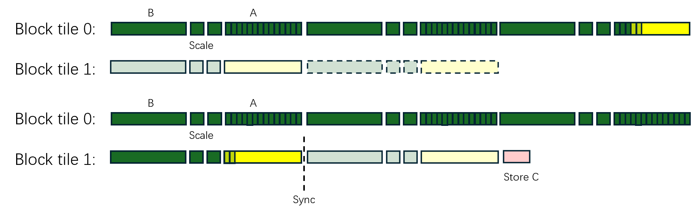

# 1. GEMM Tiling

Gemm问题的定义如下：
```
A.shape = [M, K]
B.shape = [N, K]
C = matmul(A, B)
C.shape = [M, N]
```
如下图所示:


假设block tile的shape为[Bm, Bn]，那么block tile的数量为 `(M / Bm) * (N / Bn)`，实际读取数据的量为 $MK\frac{N}{Bn} + NK\frac{M}{Bm} = MNK(\frac{1}{BM} + \frac{1}{Bn})$. block tile的数量需要越多越好，这样才能占满CU，这要求Bm和Bn小；数据读取数据的量需要越小越好，这要求Bm和Bn大。

由于我们选取的mfma shape为16x16x128，所以我们选取 Bm = 16 * MSUB, Bn = 16 * NSUB. MSUB和NSUB为超参

# 2. Persistent Wave

参考下面两种写法：
```c++
__global__ void kernel(...) {
    ...
}

void kernel_launch(...) {
    dim3 blocks = {M / Bm, N / Bn};
    int WAVES = 4;
    kernel<<<blocks, WAVES * 64, 0, 0>>>();
}
```
上述写法可能有三个个问题：
- 资源利用率可能会不高，比如一个CU有512个register，如果每个block用160个，那么一个CU上可以同时执行的block数为3(occupancy为3)，造成的register浪费为 (512 - 160 * 3) = 32个。
- 同时执行的block数量可能很大，导致需要同时touch的HBM数据更多，给L2 cache造成压力
- 每个block能使用的register和LDS资源优先可能会限制pipeline的深度。

persistent的设计逻辑是，让每个CU某个时刻只能执行一个block，让每个block用满硬件资源(register和LDS)
```c++
__global__ void kernel(int total_block_tiles, ...) {
    for (int block_tile_id = 0; block_tile_id < total_block_tiles; block_tile_id += gridDim.x) {
        // deal with one block_tile
    }
}

void kernel_launch(...) {
    int num_cus = 256;
    int WAVES = 4;
    int total_block_tiles = (M / Bm) * (N / Bn);
    kernel<<<num_cus, WAVES * 64, 0, 0>>>();
}
```

# 3. Block Id Shuffle

逻辑上我们把gemm的问题切割成了[M / Bm, N / Bn]的block tile的矩阵，那我们按照行优先的顺序一个一个调度这些block tile是不是就可以了。这里需要先介绍下AMD GPU的整体架构:


从硬件架构上，每个CU能使用的L2 cache并不是32MB，而是只有 (32 / 8) = 4MB. block id再XCD之间的调度方式是round-robin. 这样就导致同一个XCD可能需要覆盖很大的问题区域，而L2 Cache只有4MB, 如下图所示。假设蓝色框代表是的XCD0被分配到的block tiles


我们希望每个XCD分到的block tile区域是一块小的连续区域，比如:


我们假设num_blocks = 8 * 12 = 96，每个block的id为block_id, 每个block_tile的id为block_tile_id, 那么他们的映射关系为：
```c++
int num_xcds = 8;
int rows = num_blocks / num_xcds;
int block_id_row = block_id / 8;
int block_id_col = block_id % 8;
int block_tile_id = block_id_col * rows + block_id_row;
```

block_tile_id到实际问题区域还会经过一层映射:
```c++
const int group   = id / (GROUP_M * num_n);
const int first_m = group * GROUP_M;
const int gsize   = min(num_m - first_m, GROUP_M);
int residual = id - first_m * num_n;
int row = first_m + residual % gsize;
int col = residual / gsize;
```
block_tile_id到问题区域的映射如下图所示:


# 4. 一个stage的读取和计算过程

一个stage由一下几个部分组成：
- A: MSUB * 16 * 128B non-shuffled
- B: NSUB * 16 * 128B shuffled
- A Scale: (MSUB / 2) * 32 * 8B shuffled
- B Scale: (NSUB / 2) * 32 * 8B shuffled

读取和计算过程如下图所示：


注：图中黄色代表global memory -> LDS, 绿色代表global memory -> Register.

对于一个block tile来说整体的pipeline如下:


算完一个block tile以后，当前block tile的C在什么时间写回HBM呢？



# 5. 对C layout的处理


上述的C layout的问题是，要把register中的4个float32数存储在HBM中，需要issue四条global_store_dword指令。实践中，使用一个小trick，即计算 matmul(B, A), 而不是matmul(A, B). 那么C的layout就变成了：


这样，要把register中的4个float32数存入HBM，只需要一条 global_store_dwordx4指令即可

# 6. MBS算法

MBS算法大致流程如下：
- 计算per-row max
- 计算scale = 6.0 / max
- 取scale的前8位mantissa，存储为uint8，命名为factor
- 在计算时，先正常计算mxfp4 gemm
- 读取row factors和col factors
- 对每一个factor, 将8位mantissa组合成 1.xxxxx 变成float_factor
- per-row和per-col apply float factor.
