# 数据格式与三种布局

> 整理于 2026-11-01，针对 `kernel/gemm_a4w4.hip`（提交 `80614af`）。代码片段取自中文注释版 [`docs/gemm_a4w4_annotated.hip`](./gemm_a4w4_annotated.hip)，它的代码和原文件逐字相同，每段都同时给出两个文件里的行号。图由 [`scripts/draw_layout_figs.py`](../scripts/draw_layout_figs.py) 生成，图里的 lane 号和偏移都是用 kernel 里的公式算出来的。

这个 kernel 计算 `out[M, N] = dequant(A) @ dequant(B)^T`，输出 bf16。A 是激活 `[M, K]`，B 是权重 `[N, K]`，都是 MXFP4 格式：每个数 4 bit，沿 K 每 32 个数共用一个 8 bit 的 E8M0 scale。

kernel 的三个输入（A、B、scale）在显存里各用一种布局。原因是两件事互相冲突：

- 矩阵指令 MFMA 规定了每个 lane 必须拿到哪一块数据（第 3 节）；
- 显存要求一条访存指令里 64 个 lane 读的是一段连续地址，才能跑满带宽（第 2 节）。

每个张量能不能事先重排，决定了它用什么办法解决这个冲突：

| 数据 | 谁生成、什么时候 | 显存里的布局 | kernel 怎么读 | 主要代码 |
|---|---|---|---|---|
| A（激活） | 推理时在线量化 | 行主序 `[M, K/2]` | 按整行 DMA 进 LDS（带 XOR swizzle），再按 MFMA 的形状读进 VGPR | `a_lane`、`frag_at` |
| B（权重） | 离线 `shuffle_weight(layout=(16, 16))` | 16 行 × 16 字节一个小块 | 直接读进 VGPR，每条 MFMA 的操作数是连续的 1 KB | `flatB`、`b_lane` |
| scale（A、B 各一份） | 量化时 `shuffle=True` | 每 32 行 × 8 个 K 块一段 256 B | 每个 lane 读一个 dword，MFMA 用 `op_sel` 挑字节 | `flatS`、`s_lane`、`mfma_fp4_sel` |

建议按顺序读：第 1 节是数据格式，第 2 节是访存规则，第 3 节是 MFMA 要什么、kernel 每个 stage 要读哪些数据，第 4–6 节分别讲 B、A、scale 怎么放、怎么读（4.3 和 5.5 节讲 B、A 各提前几个 stage 读，即预取），第 7 节是小结和一段可以自己跑的检查代码。附录讲 tile 之间的顺序：同一时刻在算哪些 tile，以及 XCD 重排怎样让 L2 多复用数据。

## 1. MXFP4：4 bit 的数，加上每 32 个一个的 scale

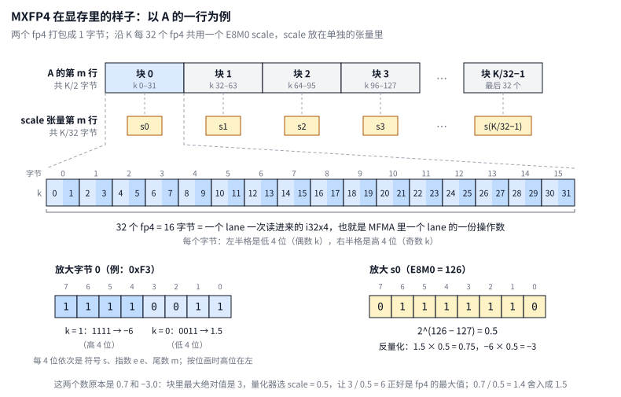

### 1.1 fp4（e2m1）

一个 fp4 有 4 位：1 位符号 s、2 位指数 e、1 位尾数 m，指数偏置为 1。e ≠ 0 时，值为 (−1)^s × 2^(e−1) × (1 + m/2)；e = 0 时是非规格数 (−1)^s × 0.5 × m。8 个非负值如下：

| 编码 | 0000 | 0001 | 0010 | 0011 | 0100 | 0101 | 0110 | 0111 |
|---|---|---|---|---|---|---|---|---|
| 值 | 0 | 0.5 | 1 | 1.5 | 2 | 3 | 4 | 6 |

最高位为 1 的 8 个编码是对应的负数。没有 inf 和 NaN，最大绝对值是 6。

两个 fp4 打包成一个字节：第 2j 个元素放在第 j 个字节的低 4 位，第 2j+1 个放在高 4 位。一行 K 个元素占 K/2 字节，所以 A 在显存里是 `[M, K/2]` 的 uint8 张量。aiter 的参考实现就是这样解包的（`aiter/utility/fp4_utils.py` 的 `mxfp4_to_f32`，节选，查找表的排版有压缩）：

```python
    x = x.repeat_interleave(2, dim=-1)
    x[..., ::2] = x[..., ::2] & 0xF
    x[..., 1::2] = x[..., 1::2] >> 4
    mxfp4_list = [
        0.0, 0.5, 1.0, 1.5, 2.0, 3.0, 4.0, 6.0,
        -0.0, -0.5, -1.0, -1.5, -2.0, -3.0, -4.0, -6.0,
    ]
```

前三行把每个字节复制成两份，偶数位置取低 4 位，奇数位置取高 4 位；再用 4 位编码查表得到数值。

kernel 本身从不拆开 fp4。它按 16 字节一块搬运，交给 MFMA 指令去解释，所以在 kernel 里，一个 lane 的一份操作数就是 32 个 fp4 = 16 字节 = 一个 `i32x4`（[注释版 109–115 行](./gemm_a4w4_annotated.hip#L109-L115)，[原文件 80–82 行](../kernel/gemm_a4w4.hip#L80-L82)）：

```cpp
// 向量类型。
//   i32x4：4 个 int = 128 bit，正好是一个 lane 的一份 fp4 操作数（32 个 fp4 = 16 字节）。
//   i32x8：本文件里没有用到。
//   f32x4：4 个 float，是一个 lane 上一个 16×16 子块的累加结果。
typedef int   i32x4 __attribute__((ext_vector_type(4)));
typedef int   i32x8 __attribute__((ext_vector_type(8)));
typedef float f32x4 __attribute__((ext_vector_type(4)));
```

读一份操作数就是一次 16 字节的读（[注释版 164–172 行](./gemm_a4w4_annotated.hip#L164-L172)，[原文件 107–113 行](../kernel/gemm_a4w4.hip#L107-L113)）：

```cpp
// 读一个 lane 的 fp4 片段：32 个 fp4 = 16 字节（地址 16 字节对齐）。FP4 的 MFMA 操作数
// 只用 128 bit（指令名义上是 256 bit 的 f8f6f4 槽位，fp4 时高 128 bit 被忽略），所以
// i32x4 就够了。valid 为假（越界的行）时返回 0。
// ...
__device__ __forceinline__ i32x4 load_frag(const uint8_t* p, bool valid)
{
    return valid ? *reinterpret_cast<const i32x4*>(p) : i32x4{0, 0, 0, 0};
}
```

### 1.2 E8M0 scale

E8M0 是一个 8 位的纯指数，没有符号位和尾数，值为 2^(e−127)：127 是 1.0，128 是 2.0，126 是 0.5，255 表示 NaN。乘一个 E8M0 只改变指数，MFMA 可以在指令内部顺带完成。

每一行沿 K 每 32 个元素（16 字节）共用一个 scale，反量化就是 `x ≈ fp4 的值 × 2^(e−127)`。所以 A 的 scale 共有 M × K/32 个字节，B 的有 N × K/32 个。

量化器这样选 e（aiter `utility/fp4_utils.py` 的 `_dynamic_mxfp4_quant_kernel_asm_layout`，节选）：

```python
    amax = tl.max(tl.abs(x), axis=1, keep_dims=True)
    amax = amax.to(tl.int32, bitcast=True)
    amax = (amax + 0x200000).to(tl.uint32, bitcast=True) & 0xFF800000
    amax = amax.to(tl.float32, bitcast=True)
    scale_e8m0_unbiased = tl.log2(amax).floor() - 2
    scale_e8m0_unbiased = tl.clamp(scale_e8m0_unbiased, min=-127, max=127)
    quant_scale = tl.exp2(-scale_e8m0_unbiased)

    # Compute quantized x
    qx = x * quant_scale

    # blockscale_e8m0
    bs_e8m0 = scale_e8m0_unbiased.to(tl.uint8) + 127
```

- 第 1 行求这 32 个数的最大绝对值 amax。
- 第 2–4 行把 amax 舍入到 2 的幂：在 fp32 的位模式上加 0x200000（尾数加 0.25）再清掉尾数，相当于尾数 ≥ 0.75 时进位、否则舍去。
- 第 5 行再减 2，因为 fp4 的最大值 6 = 1.5 × 2²。这样 amax 除以 scale 后落在 [3.5, 7) 之间，量化成 4 或 6，不会超出 fp4 的范围。
- 最后一行加上偏置 127，得到存下来的字节。

图 1 下半部分的例子是在 GPU 上用这个量化器实测的。块 0 里有 0.7 和 −3.0，最大绝对值是 3，scale 取 0.5（字节 126）。0.7 / 0.5 = 1.4，舍入到 1.5，编码 0011；−3.0 / 0.5 = −6，编码 1111。两个编码打包成 0xF3，反量化回来是 0.75 和 −3.0。同一行块 1 里有一个 10.0，scale 是 2（字节 128）。10 / 2 = 5 正好在 4 和 6 中间，按就近取偶舍入到 4，反量化回来是 8.0。fp4 很粗，误差主要出在这一步。

### 1.3 张量形状

| 张量 | 形状（uint8） | 说明 |
|---|---|---|
| A | `[M, K/2]` | 行主序，量化器直接写出 |
| B | `[N, K/2]` | 先同样量化，再用 `shuffle_weight` 重排（第 4 节），形状不变 |
| A scale | `[ceil(M/256)·256, scaleN_pad]` | `shuffle=True` 时按这个大小分配；量化器只写前 `ceil(M/32)·32` 行，M 行之后的补齐行写 0 |
| B scale | `[ceil(N/256)·256, scaleN_pad]` | 同上 |

`scaleN_pad` 是 K/32 向上取整到 8 的倍数，也就是 shuffle 后每行 scale 占的字节数，作为参数传给 kernel。kernel 的 scale 描述符范围是 `ceil(M/32)·32 × scaleN_pad` 字节，不会读到没写过的部分。

## 2. 显存访问：一条指令最好读 1 KB 连续数据

HBM 和 L2 之间以 128 B 的 cache line 为单位搬数据：哪怕只用其中一个字节，也要把整条 cache line 从 HBM 搬进 L2，再分给各个 lane。比如：

```c++
offset = threadIdx.x * 4;     // 每个 lane 读 4 B，64 个 lane 共 256 B，正好 2 条 cache line
```

一个 wave 有 64 个 lane，`threadIdx.x` 分别是 0, 1, 2, …, 63。这里的 `* 4` 是**相邻两个 lane 的地址步长**：lane 0 读 `[0, 4)`，lane 1 读 `[4, 8)`，lane 2 读 `[8, 12)`……整段连续 256 B，大约落在 2 条 128 B 的 cache line 上，条条几乎用满。

一个读取效率很低的例子：

```c++
offset = threadIdx.x * 4096;  // 同样每个 lane 读 4 B，64 个 lane 却落在 64 条不同的 cache line 上
```

这里的 `* 4096` **不是“有 4096 个线程”**，而是每个 lane 的起始地址彼此隔开 4096 字节（4 KB）：

| lane | offset | 读的 4 B 区间 |
|---|---|---|
| 0 | 0 | `[0, 4)` |
| 1 | 4096 | `[4096, 4100)` |
| 2 | 8192 | `[8192, 8196)` |
| … | … | … |
| 63 | 63×4096 | `[258048, 258052)` |

有用数据一共还是 `64 × 4 B = 256 B`，但相邻 lane 相隔 4 KB，远大于一条 cache line 的 128 B，所以几乎各撞一条不同的 line。硬件大约要搬 64 条 cache line（8 KB），每条里真正用到的只有 4 B，利用率约 `4/128 ≈ 3%`。

如果这些 cache line 的其余部分之后也会用到，提前搬进 L2 似乎不算浪费。但只有 L2 足够大时才是这样。MI355X 每个 XCD 的 L2 只有 4 MB（整卡 8 个 XCD 共 32 MB），同一时刻有成百上千个 wave 在抢它。一条 cache line 还没用完就可能被换出去，下次用到时又得从 HBM 再搬一次。

所以**访问 HBM 最高效的方式是宽位宽的连续访存**。AMD GPU 上一个 lane 一次最多读 16 B（`dwordx4`），最理想的情况是 64 个 lane × 16 B = 1 KB 连续地址，正好 8 条完整的 cache line。后面三种布局都是为了让每条访存指令尽量做到这一点。

常说的**合并访存**（coalescing）就是这个意思：一条访存指令发出后，硬件把 64 个 lane 的地址放在一起，按 cache line 归并，落在同一条 line 上的只搬一次。好坏看的是这 64 个地址合起来碰到几条 cache line、每条用了多少，不是看相邻几个 lane 连不连续。要从 L2、HBM 搬几条 cache line，只取决于这 64 个地址的集合，和哪个 lane 拿哪个地址无关。

## 3. MFMA 16×16×128：数据要以什么形状进寄存器

### 3.1 lane 分工

kernel 只用一条矩阵指令 `v_mfma_scale_f32_16x16x128_f8f6f4`：算 16×16 的输出，K = 128，fp32 累加，并乘上 E8M0 scale。指令规定了一个 wave 的 64 个 lane 各提供哪一块数据、各拿到哪几个结果，如图 2：

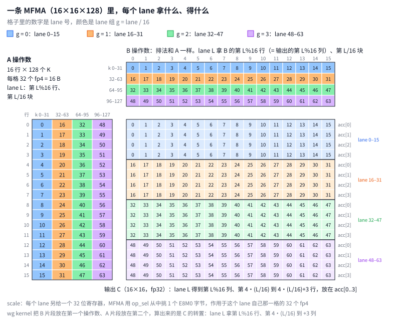

- **A 操作数**：16 行 × 128 个 K。按 K 切成 4 块，每块 32 个 fp4，即 16 B。lane L 提供第 L%16 行的第 L/16 块。图 2 左边每格里的数字就是 lane 号：第 0 列（K 0–31）是 lane 0–15，第 1 列是 lane 16–31，依此类推。
- **B 操作数**：排法和 A 一样。B 在显存里是 `[N, K]`，它的第 n 行对应输出的第 n 列。图 2 上方为了和输出对齐，把它画成转置（只有图 2 这么画；图 4 按 B 在显存里的样子画，K 朝右）。
- **scale**：每个 lane 另给一个 32 位寄存器，指令用 `op_sel` / `op_sel_hi` 从中挑出一个 E8M0 字节，作用于这个 lane 自己那一格的 32 个 fp4。第 6 节的布局就是利用了"可以挑字节"这一点。
- **输出**：每个 lane 得到 4 个 fp32，放在 `acc[0..3]`。lane L 拿到第 L%16 列、第 4·(L/16) 到 4·(L/16)+3 行。

后文统一用这些记号：`row16 = L%16`（lane 在片段里的行号），`g = L/16`（lane 组，也就是它负责的 K 块），"K 块"指 32 个 K，"子块"指一条 MFMA 算的 16×16 输出，h 指一个 stage（K = 256）里的前、后两个 128。kernel 里也是这样拆 lane 号的（[注释版 510–516 行](./gemm_a4w4_annotated.hip#L510-L516)，[原文件 395–400 行](../kernel/gemm_a4w4.hip#L395-L400)）：

```cpp
    const int lane  = threadIdx.x & 63;   // wave 内的 lane 号 0..63【例】tid 101 → lane = 37
    // ...
    const int row16 = lane & 15;   // 片段里的行号【例】lane 37 → 5
    const int g     = lane >> 4;   // 32-K 块号 0..3【例】lane 37 → 2
```

指令本身用 inline asm 发出，`cbsz:4 blgp:4` 表示两个操作数都是 fp4（[注释版 175–196 行](./gemm_a4w4_annotated.hip#L175-L196)，[原文件 115–129 行](../kernel/gemm_a4w4.hip#L115-L129)）：

```cpp
// 带 scale 的 FP4 MFMA（单 wave kernel 用）：acc += A 片段 × B 片段（各自乘上 scale）。
// 指令格式：v_mfma_scale_f32_16x16x128_f8f6f4 D, A, B, C, scaleA, scaleB
//   * D 和 C 都是 %0（acc），即原地累加；
//   * cbsz:4 / blgp:4：A、B 两个操作数的格式都是 4，即 FP4（e2m1）；
//   * op_sel_hi:[0,0,0]（op_sel 省略即为 0）：scale 取寄存器里的第 0 个字节。
// mfma_probe 实测得到的 lane 对应关系：
//   * 操作数：lane L 提供第 L%16 行、第 L/16 个 32-K 块的 32 个 fp4；
//   * scale：每个 lane 提供自己那个 (行, K 块) 的 scale 字节；
//   * 输出：acc[i] 在 lane L 上是 C[(L/16)*4 + i][L%16]。
// ...
__device__ __forceinline__ void mfma_fp4_acc(f32x4& acc, i32x4 a, i32x4 b,
                                             int sa, int sb)
{
    asm volatile(
        "v_mfma_scale_f32_16x16x128_f8f6f4 %0, %1, %2, %0, %3, %4 "
        "op_sel_hi:[0,0,0] cbsz:4 blgp:4"
        : "+a"(acc)                               // %0：累加器，读写，放在 AGPR
        : "v"(a), "v"(b), "v"(sa), "v"(sb));      // %1 A 片段，%2 B 片段，%3 / %4 两个 scale
}
```

这些对应关系是 [`kernel/mfma_probe.hip`](../kernel/mfma_probe.hip) 实测出来的（`make probe` 后运行 `./build/mfma_probe`）。它让 A、B 全是 1.0，只改 scale：

- 第 8 个用例让 lane 组 g 的 scale 为 2^g。如果 lane 组 g 负责第 g 个 K 块，每个输出都应该是 32 × (1 + 2 + 4 + 8) = 480；
- 第 9、10 个用例让 A（或 B）第 L%16 行的 scale 为 2^(L%16)，每个输出的值里就编码了它的行号（或列号），逐个 lane 打印出来，就能解出输出的排布。

wg kernel 调用 MFMA 时把两个操作数换了位置：B 片段在第一个、A 片段在第二个，算出来的是子块的转置。于是 lane L 拿到的是第 L%16 行、第 4·(L/16) 到 +3 列，即同一行里 4 个连续的输出，方便 epilogue 拼成整行写回。这只影响输出排布，输入的三种布局不受影响。

### 3.2 直接从行主序读会怎样

假设 A 是行主序，每个 lane 按 MFMA 的需要直接去显存读。第 kc 步（K 从 128·kc 到 128·kc+127），lane L 要读从 `A + (m0 + L%16)·K/2 + kc·64 + (L/16)·16` 开始的 16 B。图 3 左边画的就是这条指令碰到的地址：

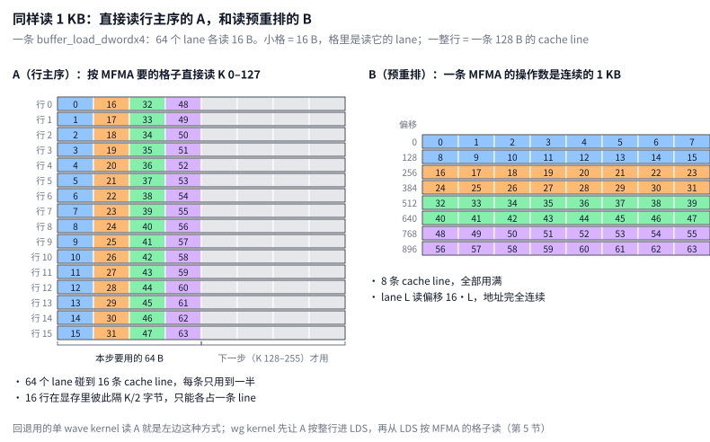

按第 2 节的标准，看这 64 个地址合起来碰到几条 cache line：

- 这条指令读的是 16 行、每行 64 B。A 是行主序，相邻两行在显存里隔着 K/2 字节，所以这 16 段落在 16 条不同的 cache line 上。
- 一条 cache line 是 128 B，每行只用了其中 64 B，另一半是相邻那一步的数据。

所以同样读 1 KB，这条指令要碰 16 条 cache line，每条只用一半；理想情况只需要 8 条。另一半会被紧接着的下一步用到，那时通常还在 cache 里，所以搬的字节数并不翻倍；代价是每条指令要处理的 cache line 多一倍，第 4 节对 B 实测过这个代价。

就算 lane 的分法能换（实际上它由硬件定死），也解决不了这个问题。比如让 lane 0–3 读第 0 行连续的 64 B、lane 4–7 读第 1 行，依此类推：每 4 个 lane 一组的内部是连续了，但整条指令读的还是这 16 行 × 64 B，碰到的还是这 16 条 cache line。问题出在布局上，只能改布局：

- B 能离线重排，把一条 MFMA 要的 1 KB 排成连续地址（第 4 节，图 4）；图 3 右边是重排后的读法预览——8 条 cache line 全部用满，lane L 读偏移 16·L——规则还没讲。
- A 是在线量化的激活，不能事先重排，只好经 LDS 换形状（第 5 节）。回退用的单 wave kernel 仍按图 3 左边直接读 A（行内偏移 `kc·64 + g·16`）；主力 wg kernel 不这么做。

### 3.3 从一条 MFMA 到一个 tile

后面几节都以主力 wg kernel 的 256×256 tile（`gemm_a4w4_wg_kernel<16, 4, 4>`）为例：

- 一个工作组有 4 个 wave，算输出的 256 行 × 256 列。4 个 wave 沿 N 并排，wave w 负责第 64w 到 64w+63 列，即 16 × 4 个子块：沿 M 记作 mi = 0..15，沿 N 记作 ni = 0..3。
- K 方向每次推进 256，叫一个 stage。一条 MFMA 只管 128 个 K，所以一个 stage 里每个子块做 2 条（h = 0、1），每个 wave 每个 stage 做 16 × 4 × 2 = 128 条。

一个 stage 要读的 A、B：

| | 整个工作组 | 每个 wave 用到的 | 切成几份 MFMA 操作数 |
|---|---|---|---|
| A | 256 行 × 256 个 K = 32 KB | 全部 256 行，4 个 wave 共用 | 16 个 mi × 2 个 h = 32 份 |
| B | 256 行 × 256 个 K = 32 KB | 只有自己的 64 行，8 KB | 4 个 ni × 2 个 h = 8 份 |

每份都是 16 行 × 128 个 K = 16 行 × 64 B = 1 KB。B 在显存里是 `[N, K]`，它的第 n 行对应输出的第 n 列，所以"wave 负责 64 列输出"就是"wave 读 B 的 64 行"：每个 wave 读 64 行 × 256 个 K（图 4 ①）。

第 4、5 节先讲一个 stage 的 B、A 怎么放、怎么读，最后再讲它们提前几个 stage 读进来（预取）。

## 4. B：离线预重排成 MFMA 的形状

B 是权重，推理前就固定了，可以离线任意重排。先说清楚 B 走哪条路：B 不经过 LDS，每个 wave 用 `buffer_load_dwordx4` 把 B 从显存直接读进 64 个 lane 的 VGPR，读进来的 16 B 就是这个 lane 的 MFMA 操作数。所以 B 没有 bank 冲突的问题，bank 冲突只出在读 LDS 的时候（第 5 节的 A）。B 要考虑的只有第 2 节说的 cache line：一条 load 最好读连续的 1 KB。

重排的目标就是：一条 MFMA 的 B 操作数（16 行 × 128 个 K = 16 行 × 64 B = 1 KB）在显存里连续，而且 lane L 那 16 B 正好在其中第 16·L 字节，也就是图 3 右边那种读法。

**B 在显存里怎么存。** 显存是一维的，地址按字节往后排。B 是 `[N, K/2]` 的 uint8 张量，一个字节放 2 个 fp4，第 n 行对应输出的第 n 列。

- **重排前是行主序：** 先放第 0 行的 K/2 个字节，再放第 1 行……第 n 行第 kp 个字节在地址 `n·K/2 + kp`。K = 5120 时一行 2560 B：第 0 行占 0–2559，第 1 行占 2560–5119，依此类推。第 s 个 stage 用到每行的第 128·s 到 128·s+127 字节，这 128 B 是连续的，正好一条 cache line；下一行的这 128 B 在 2560 B 之后。
- **重排后形状还是 `[N, K/2]`，但字节换了位置：** 每 16 行一组，一组占 16 × K/2 = 8·K 字节（K = 5120 时 40960 B）。组内按 16 B 一格来放：先放这 16 行的第 0 格（共 256 B），再放 16 行的第 1 格……所以一个 stage 在组内是从 2048·s 开始的连续 2 KB，里面依次是第 8s 到 8s+7 格，每格 16 行 × 16 B。

重排不是 kernel 做的，而是调用 kernel 之前单独做一次的 PyTorch 操作：`test_gemm_a4w4.py` 里先量化出 fp4 的 w，再 `wshuffle = shuffle_weight(w, layout=(16, 16))` 生成一份重排过的 B 存回显存，把它传给 kernel（第 116 行）。真实推理时，这一步通常在加载权重时做一次。kernel 读 B 时只是原样拷贝：lane L 把一个 1 KB 里第 16·L 字节起的 16 B 直接读进自己的 VGPR，读的过程中不再做任何重排。

**图 4 怎么看。** 三个面板的横向、纵向不一样：

- **① ②** 按 B 的逻辑形状画：一行是 B 的一行，横向是 K（每格 16 B，即 32 个 K）。② 同时也是重排前的显存样子：往右一格地址加 16 B，往下一行地址加 K/2。
- **③** 不按 B 的形状画，只按地址画：把重排后这 2 KB 从小到大排开，每 128 B（一条 cache line）折一行，往右一格地址加 16 B，往下一行加 128 B。所以 ③ 里没有"K 方向"，要看的是每一格装的是 B 哪一行的哪一块：最前面两行（256 B）是 B 第 0–15 行的块 0，第 0 行装第 0–7 行、第 1 行装第 8–15 行；接下来两行是这 16 行的块 1……左边标着每两行是第几块。

从 ② 到 ③，变的是数据在显存里的先后，不是画法：重排前同一个 B 行的 8 块连续（② 的一行），重排后同一块的 16 个 B 行连续（③ 的两行）。这就是后面 4.1 节说的"转置"。

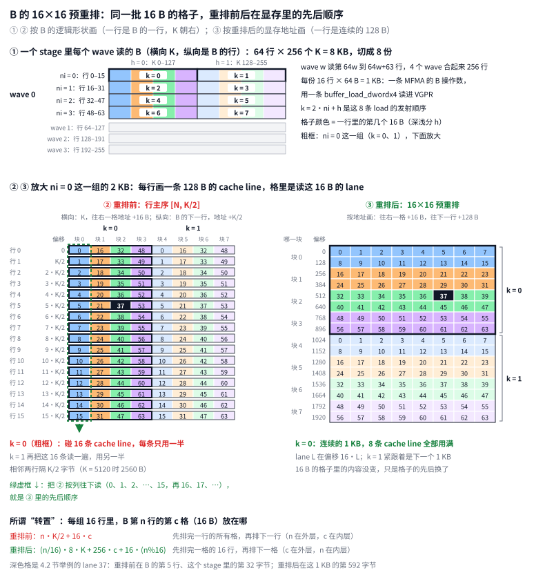

- **① 每个 wave 读哪些 B。** 一个 stage 里，wave w 读 B 的第 64w 到 64w+63 行、这个 stage 的 256 个 K，共 8 KB（3.3 节）。按 16 行一组切成 4 组（ni = 0..3），每组再按 K 切成前后两段（h = 0、1），一共 8 份。每份 16 行 × 64 B = 1 KB，是一条 MFMA 的 B 操作数，用一条 load 读。格里的 k = 2·ni + h 是这 8 条 load 的发射顺序。
- **② 重排前：B 在显存里是行主序 `[N, K/2]`。** 第 n 行的 K/2 个字节连续放，下一行紧跟在后面，所以相邻两行在显存里隔 K/2 字节。一行在一个 stage 里是 128 B，正好一条 cache line，就是 ② 的一行。格里的数字是读这 16 B 的 lane：按 MFMA 的规定（图 2），lane L 要第 L%16 行的第 L/16 个 16 B。k = 0 这条 load 要 16 行里每行的前 64 B（粗框），落在 16 条不同的 cache line 上；后一半是 k = 1 的，紧接着再把这 16 条访问一遍。
- **③ 重排后。** 还是同一批 16 B 的格子，只是在显存里的先后顺序换了：把 ② 按列往下读（绿虚框：lane 0、1、2、…、15，再 16、17、…），就是 ③ 从偏移 0 开始、按地址从左到右、从上到下的顺序。k = 0 成了连续的 1 KB，lane L 在第 16·L 字节，8 条 cache line 全部用满，k = 1 紧跟在后面。

不重排的话只能二选一：要么像 ② 那样直接按 MFMA 的格子读，每条 load 碰 16 条 cache line；要么像 A 那样先按整行 DMA 进 LDS，再从 LDS 按 MFMA 的格子读（第 5 节）。后一种还要多占 LDS：B 每个 stage 也是 32 KB，而 A 的 4 槽环已经用掉 160 KB 里的 136 KB（5.5 节）。B 能离线重排一次，两个问题都省了。

**不重排到底慢在哪（实测）。** 每条 cache line 的另一半并不浪费：k = 1 紧跟着就用它，这时它还在 cache 里。把 wg kernel 改成直接读行主序的 B 试了一下。只要改 3 处地址：lane 偏移改成 `row16·Kp + g·16`，stage 偏移改成 `128·s`，h 偏移改成 `64·h`。改完后输出和原版逐位相同。用 rocprofv3 对比两种布局：L1 到 L2 的请求、L2 的命中和未命中、L2 到 HBM 的读请求都一条不差，所以搬的字节数完全一样。多出来的只有 L1 的访问次数：每条 load 的 64 个地址落在 16 条 cache line 上，而不是 8 条，L1 要处理 2 到 2.8 倍的 cache line 访问。这部分开销让 load 变慢，M 越小、越靠访存，影响越大（MI355X，每个数是 100 次调用的平均，跑 3 次结果一致）：

| M×N×K | 预重排 | 行主序 | 行主序慢多少 |
|---|---|---|---|
| 8192×8192×5120 | 181 µs | 184 µs | 2% |
| 8192×5120×17408 | 368 µs | 384 µs | 5% |
| 8192×17408×5120 | 399 µs | 437 µs | 9% |
| 1024×17408×5120 | 61 µs | 71 µs | 17% |
| 256×17408×5120 | 22 µs | 30 µs | 38% |

所以那一半也不算"预取"：它属于同一个 stage 的 h = 1，本来就要紧接着读。真正的预取是 4.3 节说的提前一个 stage 读。

### 4.1 重排规则

以 16 B（32 个 fp4）为一格，B 的一行有 K/32 格。把 B 每 16 行分成一组，一组就是一个 16 行 × K/32 格的格子矩阵：

- **重排前（行主序）：** 先放第 0 行的所有格，再放第 1 行……第 n 行第 c 格在 `n·K/2 + 16·c`。
- **重排后：** 先放第 0 格的 16 行（256 B，第 r 行在其中偏移 16·r，这就是 `layout=(16, 16)` 说的 16 行 × 16 字节的小块），再放第 1 格的 16 行……一组共 16 × K/2 = 8·K 字节；一组放完再放下一组。

图 5 以 K = 512 为例画一组 16 行：一行 256 B = 16 格（两个 stage），16 行共 4 KB。每格写着"行.格"，颜色表示第几格，画的每一行是连续的 256 B。

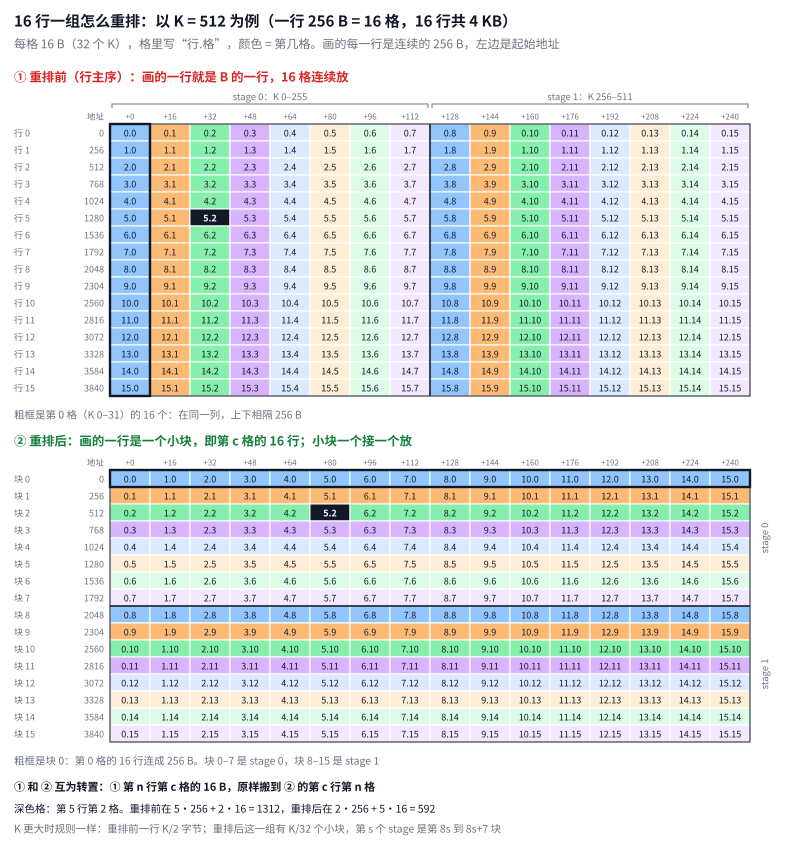

- **① 重排前：** 画的一行就是 B 的一行，16 格连续放；下一行接在 256 B 之后。同一格（同一种颜色）的 16 行在同一列里，上下相隔 256 B，粗框是第 0 格的 16 个。
- **② 重排后：** 画的一行是一个小块：第 c 格的 16 行连成 256 B，小块一个接一个放。块 0–7 是 stage 0，块 8–15 是 stage 1；stage 0 里前 4 块（1 KB）是 k = 0 这条 load 要的，后 4 块是 k = 1 的。
- ① 和 ② 正好互为转置：① 第 n 行第 c 格的 16 B，原样搬到 ② 的第 c 行第 n 格。深色格是第 5 行第 2 格：重排前在 5·256 + 2·16 = 1312，重排后在 2·256 + 5·16 = 592。

整个 B 就是一组接一组这样放。预重排的最小单位就是这个小块：16 行 × 32 个 K（16 行 × 16 B = 256 B），块内每行的 16 B 原样不动、第 r 行在 +16·r，变的只是小块之间和块内各行之间的先后。把 B 按 16 行 × 32 个 K 切成小块，小块 (g, c) 是第 16g 到 16g+15 行、第 32c 到 32c+31 个 K；重排后它在地址 `g·8·K + 256·c`，块内第 r 行在 +16·r。也就是先沿 K 排完一组的 K/32 个小块，再排下一组。图 6 用 N = 256、K = 512 画了全部 256 个小块的顺序，下半部分是一般的 N × K：

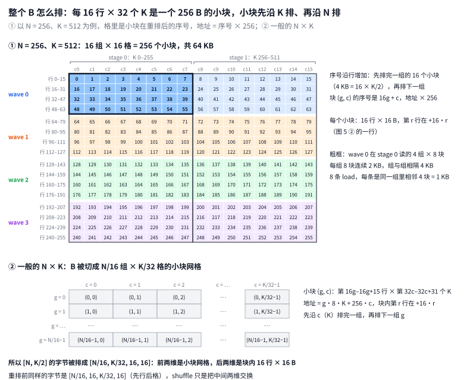

所以重排后，`[N, K/2]` 的字节按 4 维数组 `[N/16, K/32, 16, 16]` 的顺序排：前两维是小块网格（第几组、第几格），后两维是块内 16 行 × 16 B。重排前同样的字节是 `[N/16, 16, K/32, 16]`（先行后格），shuffle 就是把中间两维交换。张量的形状始终是 `[N, K/2]`，变的只是字节的先后。图 6 ① 的粗框是 wave 0 在 stage 0 读的 4 组 × 8 块：每组 8 块是连续的 2 KB，组与组相隔 16 × K/2 字节，和图 4 ① 的 8 条 load 一一对应。

换个角度，直接看重排后张量的每一行装了什么。以 N = 256、K = 1024 为例：重排仍以 16 行为一组，一行 512 B 正好装下 2 个小块。

- 重排后的第 0 行，装的是原第 0–15 行的第 0 格和第 1 格；
- 第 1 行装这 16 行的第 2、3 格，第 2 行装第 4、5 格，依此类推，第 15 行装第 30、31 格（K 960–1023）；
- 第 16 行开始是下一组，即原第 16–31 行的第 0、1 格。

这里的"格"指 16 B，也就是 32 个 K。每个小块内部按原第 0 行到第 15 行排，所以第 0 行的顺序是 `0.0 1.0 … 15.0 │ 0.1 1.1 … 15.1`（"n.c"表示原第 n 行第 c 格）。重排后张量的"行"已经不再对应 B 的行，只是把这些字节每 K/2 字节切成一行：一行装 K/512 个小块，K = 5120 时是 10 个。

对应到 kernel：用 aiter 的 `shuffle_weight` 实测 K = 1024、2048、4096、5120、8192 的每个 stage，不管 K 多大，第 s 个 stage 要的都是这一组的第 8s 到 8s+7 个小块，也就是组内从 2048·s 开始的连续 2 KB，h = 0 和 h = 1 两条 load 各读其中 1 KB。它落在重排后的哪几行，只看一行有多长（K/2 字节）：

- **K = 1024 / 2048：** 一行 512 B 或 1 KB，装不下一个 stage，所以一个 stage 占 4 行或 2 行（第 4s 到 4s+3 行，或第 2s、2s+1 行）。
- **K = 4096：** 一行正好 2 KB，第 s 个 stage 就是第 s 行一整行。
- **K = 8192：** 一行 4 KB，两个 stage 共用一行，各占一半。
- **K = 5120：** 一行 2.5 KB，等于 10 块，不是 2 KB 的整数倍，所以有的 stage 在一行内，有的跨两行：
  - stage 0 是第 0 行的第 0–7 块；
  - stage 1 是第 0 行的第 8、9 块，加上第 1 行的第 0–5 块，连它 h = 0 的那条 1 KB load 都跨了行（第 0 行第 8、9 块加第 1 行第 0、1 块）；
  - stage 4 又整个落在第 3 行（第 2–9 块）。

所以规律是：K 是 4096 的倍数时，每个 stage 都在一行内；K ≥ 4096 但不是 4096 的倍数时，会有 stage 跨行。

跨不跨行对 kernel 没有影响。重排后的张量是连续的，第 r 行的末尾紧挨着第 r+1 行的开头，"行"只是 PyTorch 显示这个 `[N, K/2]` 张量时的切法。kernel 的地址是 `t.b + ni·8·K + s·2048 + h·1024 + 16·L`，和 K 有关的只有组的跨度 8·K，没有哪一项按重排后的"第几行"来算，所以每条 load 读的都是连续的 1 KB，跨不跨行都一样。

每格里的 16 B 原样不动，变的只是格子的先后：原来"行在外层、格在内层"，现在"格在外层、行在内层"。这相当于把每组的格子矩阵转置了一下，所谓"转置"就是指这个。

写成公式，B 的第 n 行、第 kp 个字节在重排后的偏移是：

```text
flatB(n, kp) = (n/16)·8·K + (kp/16)·256 + (n%16)·16 + kp%16
```

从小到大看，这个布局放出来的是：

- **一条 MFMA 的操作数是连续的 1 KB。** 一条 MFMA 的 K 是 128，每行 64 字节，正好是同一组里沿 K 相邻的 4 个小块（图 4 ② 里每行的前 4 格）。第 g 块里第 row16 行的 16 字节，就是 lane 16·g + row16 要的数据，它在这 1 KB 里的偏移是 256·g + 16·row16 = 16·lane（图 4 ③ 的粗框）。所以 64 个 lane 读的是连续的 1 KB，lane L 在第 16·L 字节。
- **一组 16 行在一个 stage 里是连续的 2 KB。** 一个 stage 的 K = 256 是同一组里相邻的两个 1 KB（h = 0、1，图 4 ③ 整块），下一个 stage 紧接着放。
- **一个 wave 在一个 stage 里读 4 组，每组 2 KB。** wave 的 64 行是 4 个组（图 4 ① 里 ni = 0..3 这 4 组），每组出 2 KB，组与组相隔 8·K 字节。一共 8 条 load、8 KB。

aiter 的 `shuffle_weight`（`aiter/ops/shuffle.py`，`layout=(16, 16)` 走的分支，节选）：

```python
    IN, IK = layout
    BK = IK * 2
    K = 16 // x.element_size() if not use_int4 else 32
    BN = IN
    ...
    x_ = x
    x_ = x_.view(-1, x.shape[-2] // BN, BN, x.shape[-1] // BK, BK // K, K)
    x_ = x_.permute(0, 1, 3, 4, 2, 5)
    x_ = x_.contiguous()
    x_ = x_.view(*x.shape)
```

这里的 `x` 就是量化后的 B。fp4 一个数 4 bit，同一行相邻两个 K 拼成一个字节（低 4 位是前一个），所以 `x` 的形状是 `[N, K/2]`。`shuffle_weight` 先把它看成 uint8，下面都以字节为单位：`x.shape[-2]` 是 N，`x.shape[-1]` 是 K/2。代入 `layout=(16, 16)`，得到 `BN = 16`（16 行一组）、`BK = 32`（32 B 一个 K tile）、`K = 16 // 1 = 16`（16 B 一格）。这个 `K` 是 aiter 的局部变量，不是 GEMM 的 K。三步分别是：

- **`view`：** 不动数据，只是给每个字节编上 5 位下标 `[组, 行, K tile, 格, 字节]`。最前面的 `-1` 是 batch，二维的 B 为 1，MoE 的 `[E, N, K/2]` 为 E。参数是每一维的大小，所以要用除法算份数：N 行切成 N/16 组，每组 16 行；一行 K/2 字节切成 (K/2)/32 个 K tile，每个 K tile 2 格（64 个 K），每格 16 字节。以 N = 256、K = 1024 为例，就是 `view(-1, 16, 16, 16, 2, 16)`。第 n 行第 kp 个字节的下标是：组 = n/16，行 = n%16，K tile = kp/32，格 = kp%32/16，字节 = kp%16。K tile 和格合起来（2·K tile + 格 = kp/16）就是一行里的"第几格"。
- **`permute(0, 1, 3, 4, 2, 5)`：** 括号里是旧的第几维（0 是 batch，1 到 5 依次是组、行、K tile、格、字节），从外到内照着读，就是 `[batch, 组, K tile, 格, 行, 字节]`，也就是把"行"挪到"格"后面。这一步只改下标的顺序，还没有搬数据。
- **`contiguous()`：** 按新的下标顺序把数据真正搬一遍。到这里，显存里就是"格在外层、行在内层"了。

换成"读法"来说：permute 不读数据，只规定一种新的读法。先读一格里的 16 个字节；读满 16 B，就换到下一行的同一格；16 行都读完，这一格就读完了，换到这个 K tile 里的下一格；一个 K tile 的 2 格读完，换到下一个 K tile；所有 K tile 都读完（K = 1024 时是 16 个，一般是 K/64 个），这一组就读完了，再换下一组。contiguous 按这个读法把数据依次写进一块新的连续内存，最后再 view 回 `[N, K/2]`，就是重排后的 B。

### 4.2 kernel 怎么读

单 wave kernel 一步只算 K = 128，它的第 kc 步就是第 kc/2 个 stage 的 h = kc%2 那一半。它在 `load` 里用 `flatB` 算 B 的地址（[注释版 257–282 行](./gemm_a4w4_annotated.hip#L257-L282)，[原文件 177–199 行](../kernel/gemm_a4w4.hip#L177-L199)）。`kpstart` 先把「本 lane 要的那 16 字节」换算成行内字节起点，再交给 `flatB`；化简后仍是 `kc·64 + g·16`，和 A 的 `aoff` 相同，只是 B 还要按小块重排：

```cpp
    auto load = [&](int kc, i32x4 (&af)[MSUB], int (&as)[MSUB],
                    i32x4 (&bf)[NSUB], int (&bs)[NSUB]) {
        const int kblk     = 4 * kc + g;                // 整行里第几个 32-K 块：一步 4 块，本 lane 是这一步的第 g 块（查 scale 用）
        const int ktile    = 2 * kc + (g >> 1);         // 整行里第几个 K tile（64 个 K = 32 字节）：一步 2 个，本 lane 在这一步的第 g/2 个
        const int kpack    = g & 1;                     // K tile 里的前 16 字节（0）还是后 16 字节（1）
        const int kpstart  = ktile * 32 + kpack * 16;   // 行内起始字节，等于 kc*64 + g*16【例】kc = 3、g = 2 → ktile 7、kpack 0、kpstart 224
        const int64_t aoff = (int64_t)(kc * 64 + g * 16);   // A 行内的字节偏移（同一个值）
#pragma unroll
        for (int mi = 0; mi < MSUB; ++mi)
        {
            int am = m0 + mi * 16 + row16;   // 本 lane 要读的 A 行
            // 读 16 字节的片段；越界的行读成 0
            af[mi] = load_frag(A + (int64_t)am * Kp + aoff, am < M);
            // scale 逐字节读；越界时给 127（= 1.0，反正数据是 0）
            as[mi] = (am < M) ? AScale[flatS(am, kblk, scaleN_pad)] : 127;
        }
#pragma unroll
        for (int ni = 0; ni < NSUB; ++ni)
        {
            int  bn = n0 + ni * 16 + row16;   // 本 lane 要读的 B 行（即输出列）
            bool vb = bn < N;
            bf[ni] = load_frag(B + flatB(bn, kpstart, KT), vb);
            bs[ni] = vb ? BScale[flatS(bn, kblk, scaleN_pad)] : 127;
        }
    };
```

这些变量分两类：一类管 K 方向，决定一行里读哪 16 B；一类管行方向，决定读哪一行。图 7 把它们画在一起，以 K = 512 为例，深色是 lane 37 在第 kc = 1 步读的 16 B：

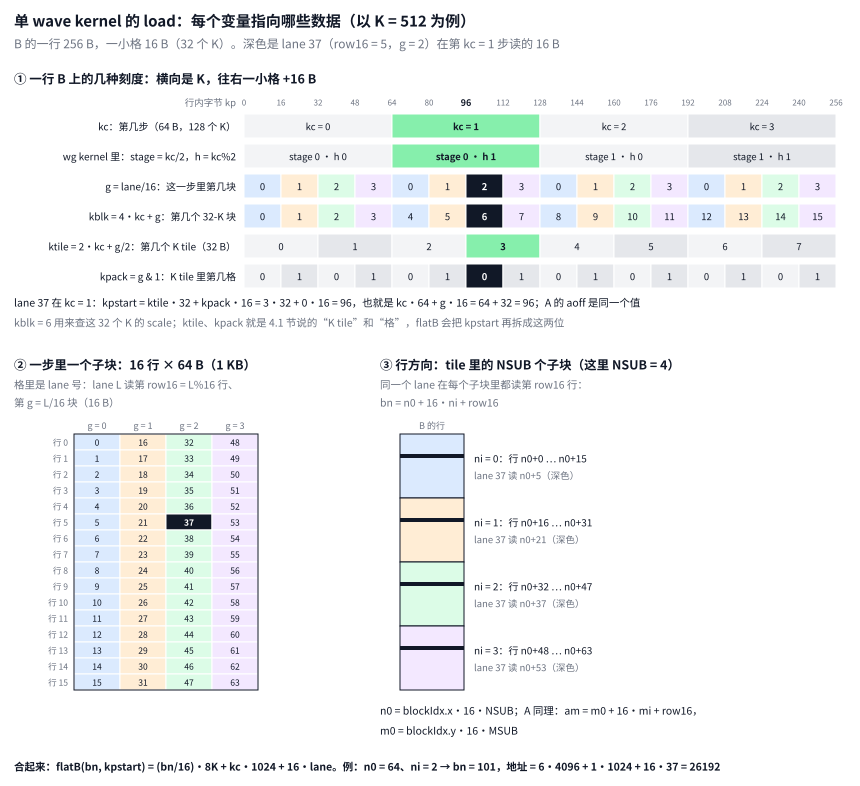

**lane 号怎么拆（图 7 ②）。** 一个工作组只有 1 个 wave，lane = 0..63。`row16 = lane & 15`（0..15）是读子块里的第几行：对 A 是 M 方向的行，对 B 是 N 方向的行，也就是输出的列。`g = lane >> 4`（0..3）是读这一步 64 B 里的第几块，每块 16 B，即 32 个 K。所以一个子块在一步里是 16 行 × 64 B = 1 KB，64 个 lane 每人读其中 16 B，例如图 4 ② 里 k = 0 那份的第 g 列、第 row16 行。

**K 方向：一行里读哪 16 B（图 7 ①）。**

| 变量 | 公式 | 取值范围 | 含义 |
|---|---|---|---|
| `kc` | 循环变量 | 0 .. K/128−1 | 第几步；一步 128 个 K，每行 64 B，正好一条 MFMA 的 K |
| stage、h | kc/2、kc%2 | — | 只用来和 wg kernel 对照：wg 的一个 stage 是 256 个 K，等于两步 |
| `kblk` | `4·kc + g` | 0 .. K/32−1 | 整行里第几个 32-K 块，用来查 scale（每 32 个 K 一个 E8M0） |
| `ktile` | `2·kc + (g>>1)` | 0 .. K/64−1 | 第几个 K tile（64 个 K = 32 B），就是 4.1 节的 K tile；一步 kc 含 2 个 |
| `kpack` | `g & 1` | 0、1 | K tile 里的前 16 B 还是后 16 B，就是 4.1 节的"格" |
| `kpstart` | `ktile·32 + kpack·16` | 0, 16, …, K/2−16 | 本 lane 那 16 B 在行内的起始字节，化简后等于 `kc·64 + g·16` |
| `aoff` | `kc·64 + g·16` | 同上 | 和 kpstart 是同一个值；A 是行主序，直接加这个偏移（图 3 左） |

**行方向：读哪一行（图 7 ③）。**

| 变量 | 公式 | 取值范围 | 含义 |
|---|---|---|---|
| `MSUB`、`NSUB` | 编译期常量 | (8,8)、(4,8)、(4,4)、(2,2)、(1,2) | tile 是 16·MSUB × 16·NSUB，由 launcher 按 shape 挑 |
| `m0` | `blockIdx.y·16·MSUB` | 16·MSUB 的倍数 | 本 tile 的第一行 A，也就是输出的第一行 |
| `n0` | `blockIdx.x·16·NSUB` | 16·NSUB 的倍数 | 本 tile 的第一行 B，也就是输出的第一列 |
| `mi` | 循环变量 | 0 .. MSUB−1 | 第几个 16 行 A 子块 |
| `ni` | 循环变量 | 0 .. NSUB−1 | 第几个 16 行 B 子块 |
| `am` | `m0 + 16·mi + row16` | — | 本 lane 在第 mi 个子块里读的 A 行 |
| `bn` | `n0 + 16·ni + row16` | — | 本 lane 在第 ni 个子块里读的 B 行 |

另外几个常量：`Kp` = K/2 是每行字节数，`KT` = K/64 是每行的 K tile 数，`Kchunks` = K/128 是总步数。

例：K = 5120、128×128 的 tile、blockIdx = (1, 0)、lane 37、kc = 3、mi = 1、ni = 2，实际算出来是：

```text
Kp=2560 KT=80 Kchunks=40  row16=5 g=2  m0=0 n0=128
kc=3: stage=1 h=1  kblk=14 ktile=7 kpack=0 kpstart=224 aoff=224
am=21  A 地址 = am*Kp + aoff = 53984
bn=165  flatB(bn, kpstart) = 413264 = (bn/16)*8K + kc*1024 + 16*lane = 413264
```

A 和 B 的同一个 lane 要的是行内同样的 32 个 K，所以 `kpstart` 和 `aoff` 相等。区别在于 A 是行主序，地址直接是 `am·Kp + aoff`；B 存的是重排后的版本，要用 `flatB(bn, kpstart)` 换算。`ktile`、`kpack` 其实是多算的：`flatB` 会把 kpstart 重新拆成 K tile（`kpstart >> 5`）和格（`(kpstart & 31) >> 4`），结果还是这两个数。代码里写出来，是为了对上 4.1 节的五位下标：组 = bn/16，行 = row16，K tile = ktile，格 = kpack，字节 = 0..15。

把 `bn = n0 + ni·16 + row16`、`kpstart = kc·64 + g·16` 代进 `flatB`，地址是「这组 16 行的起点 + kc·1024 + 16·lane」——正是图 3 右边、图 4 ③ 粗框里那样连续的 1 KB。

wg kernel 把同一个公式拆成三部分，分别放进 VGPR 偏移、描述符基址和立即数。

和 lane 有关的部分是 `b_lane = g * 256 + row16 * 16`，也就是 16·lane（[注释版 560–562 行](./gemm_a4w4_annotated.hip#L560-L562)，[原文件 438–439 行](../kernel/gemm_a4w4.hip#L438-L439)）：

```cpp
    // B 片段：一个 16 行子块的一个 K-128 段是连续的 1 KB，lane L 读其中第 L 个 16 字节
    // （g*256 + row16*16 就等于 lane*16）。【例】lane 37 → b_lane = 592
    const int b_lane = g * 256 + row16 * 16;
```

每个 wave 有 NSUB 个 16 列子块，第 ni 个再往后偏移 ni 组（[注释版 676–677 行](./gemm_a4w4_annotated.hip#L676-L677)，[原文件 529 行](../kernel/gemm_a4w4.hip#L529)）：

```cpp
    // 第 ni 个 B 子块：lane 偏移 + ni 个 16 行组
    static_for<NSUB>([&](auto ni) { b_voff[ni] = opaque(b_lane + ni * KT * 512); });
```

本 wave 在一个 tile 里的起点是 `t.b`（[注释版 584–586 行](./gemm_a4w4_annotated.hip#L584-L586)，[原文件 453 行](../kernel/gemm_a4w4.hip#L453)）：

```cpp
        // B：本 wave 第一个 16 列子块的起始字节（每个 16 行组占 KT*512 = 16 × K/2 = 8·K 字节）
        // 【例】wave 1 → n0 = 64，t.b = (64/16)·80·512 = 4·40960 = 163840
        t.b  = (t.n0 >> 4) * KT * 512;
```

发出 load 时，tile 起点加上 stage 偏移（一个 stage 的 K = 256，每组 16 行占 2 KB）进描述符基址，K 的前、后两个 128（h = 0、1）用立即数 `h * 1024` 区分（[注释版 711–719 行](./gemm_a4w4_annotated.hip#L711-L719)，[原文件 553–559 行](../kernel/gemm_a4w4.hip#L553-L559)）：

```cpp
        if constexpr (k < KBS)
        {
            // B 片段：第 ni 个子块的第 h 个 K 半段（每个 K-128 段 1 KB）。地址 = 描述符基址
            // （tile 偏移 + stage 偏移，每个 stage 2 KB）+ VGPR 偏移 b_voff[ni] + 立即数 h*1024。
            constexpr int ni = k / 2, h = k % 2;
            asm volatile("buffer_load_dwordx4 %0, %1, %2, 0 offen offset:%3"
                         : "=v"(bf[ni][h])
                         : "v"(b_voff[ni]), "s"(rsrc_at(b_rsrc, tob.b + stb * 2048)), "i"(h * 1024));
        }
```

加起来，stage s 的第 k 条 B load（ni = k/2，h = k%2）读的是 `t.b + ni·8·K + s·2048 + h·1024 + 16·lane`，和 `flatB` 一致，就是图 4 ① 里标 k 的那一份。每条指令都是连续的 1 KB，B 不经过 LDS，直接进 VGPR。

例：lane 37 的 row16 = 5、g = 2，读的是这组第 5 行的 K 块 2，即图 4 ② 第 5 行的第 2 格（深色格）：重排前它在 B 的第 5 行、这个 stage 里的第 32 字节，和第 0 行隔着 5·K/2 字节；重排后它在这 1 KB 里的偏移是 2·256 + 5·16 = 592 = 16·37（图 4 ③ 的深色格）。

代码里这个 s 写作 `stb`，tile 起点写作 `tob.b`，没有直接用"当前在算的 stage"和"当前 tile"：这条 load 读的是还没开始算的 stage，甚至可能是下一个 tile 的。下一节讲为什么。

### 4.3 预取：B 提前一个 stage 读进寄存器

一条全局 load 从发出到数据进寄存器要很久，比一条 MFMA 的约 16 个周期长得多。如果算到 stage s 才去读 stage s 的 B，MFMA 就得停下来等。所以算 stage s 的同时，先把后面 stage 的 B 读进另一套寄存器，算到那个 stage 时数据已经在了。这就是预取。

K 循环每个 stage 走一步，代码里叫 step。step s 里：

- MFMA 用第 s%4 套 B 寄存器 `bf[s%4]`，里面是 stage s 的 8 个 B 片段（图 4 ① 的 k = 0..7），2 个 B scale dword 放在 `bs[s%4]`（第 6 节）；
- 同时发出 stage s+PF_B 的 8 条 B load 和 2 条 B scale load，写进第 (s+PF_B)%4 套。这 10 条一条一条撒在本 step 前一半的 MFMA 之间（这一半叫段 0，5.5 节细讲）；
- 到 step s+PF_B 开始时，先等这 10 条到齐再用（怎么等见 5.5 节）。

256×256 tile 的 `PF_B` = 1，step s 读的是 stage s+1：

| step | MFMA 用的 B | 同时发出的 B load | 写进 |
|---|---|---|---|
| s−1 | `bf[(s−1)%4]`：stage s−1 | stage s | `bf[s%4]` |
| s | `bf[s%4]`：stage s | stage s+1 | `bf[(s+1)%4]` |
| s+1 | `bf[(s+1)%4]`：stage s+1 | stage s+2 | `bf[(s+2)%4]` |

所以同一时刻只有两套 B 寄存器是活的：正在用的和正在写的，每套 8 个 `i32x4`，即 32 个 VGPR。B 每多提前一个 stage，就要多占一套。256 行的 tile 和 N 方向宽的 tile 每个 stage 至少 128 条 MFMA，提前 1 个 stage 已经够藏住延迟，就不多花这 32 个 VGPR；其余 tile 实测提前 2 个更快（[注释版 471–479 行](./gemm_a4w4_annotated.hip#L471-L479)，[原文件 367–374 行](../kernel/gemm_a4w4.hip#L367-L374)）：

```cpp
    // LDS 环形缓冲：RING 个槽，每槽放一个 stage。
    //   PF   = A（经 LDS）提前几个 stage 发出；
    //   PF_B = B 和 B scale（直接进寄存器）提前几个 stage 发出。
    // B 每多提前一个 stage，就多占一套寄存器（2*NSUB*4 个 VGPR）。256 行的 tile 和宽 N 的
    // tile（每个 stage 2*MSUB*NSUB ≥ 128 条 MFMA）只提前 1 个 stage，其余的实测提前 2 个
    // 更好。【例】PF_B = 1
    constexpr int RING = 4;
    constexpr int PF   = 2;
    constexpr int PF_B = (NSUB <= 4 && MSUB < 16) ? 2 : 1;
```

下标在主循环里算（[注释版 1115–1136 行](./gemm_a4w4_annotated.hip#L1115-L1136)，[原文件 892–908 行](../kernel/gemm_a4w4.hip#L892-L908)）。循环每次展开 RING = 4 个 step，展开后的第 u 个就是 s%4 = u 的那一步。这样每套寄存器都有固定的名字 `bf[u]`，因为寄存器不能用运行时的下标访问：

```cpp
        for (int st = 0; st < nstages; st += RING)   // 每次展开 RING（= 4）个 step
        {
            static_for<RING>([&](auto u) __attribute__((always_inline)) {
                constexpr int nu  = (u + PF) % RING;     // 本 step 的 A DMA 写进哪个槽
                constexpr int nub = (u + PF_B) % RING;   // 本 step 的 B load 写进哪套寄存器
                const int nst     = st + u + PF;         // 本 step 发的 A 是第几个 stage
                const int nstb    = st + u + PF_B;       // 本 step 发的 B 是第几个 stage
                // 超出本 tile 的 stage 属于下一个 tile（这两个值在整个 wave 里都相同）
                const bool wrap   = nst >= nstages;
                const bool wrapb  = nstb >= nstages;
                // A DMA 的目标：本 tile 或下一个 tile 的 A / A scale 偏移
                const TileOff nto{0, 0, wrap ? nxt.a : cur.a, 0, wrap ? nxt.as : cur.as, 0};
                // B load 的目标：本 tile 或下一个 tile 的 B / B scale 偏移
                const TileOff ntob{0, 0, 0, wrapb ? nxt.b : cur.b, 0, wrapb ? nxt.bs : cur.bs};
                // 本 step：读槽 u（本 stage）和槽 u+1（下一个 stage，段 1 预读用），用第 u 套 B
                // 寄存器计算；把 A 发到槽 nu，把 B 发到第 nub 套寄存器。
                step(lds_buf(u), lds_buf(std::integral_constant<int, u + 1>{}), bf[u], bs[u], nto, wrap ? nst - nstages : nst,
                     lds_buf(std::integral_constant<int, nu>{}), ntob,
                     wrapb ? nstb - nstages : nstb, bf[nub], bs[nub],
                     u == 0 && st == 0 && after_epi, st + u);
            });
        }
```

- `step` 用 `bf[u]` 算这一步；`ntob`、`nstb`、`bf[nub]` 一路传到 `issue_one`，就是 4.2 节里的 `tob`、`stb`、`bf`。
- `nstb` 超出本 tile 的 stage 数时（`wrapb`），读的是下一个 tile 的第 nstb − nstages 个 stage，起点换成下一个 tile 的 `nxt.b`。所以一个 tile 的最后一个 step 已经在读下一个 tile 第 0 个 stage 的 B，两个 tile 之间的 epilogue 写回时，它在路上，流水不断。
- `nu`、`nst`、`wrap`、`nto` 是 A 那边的对应量，5.5 节讲。

## 5. A：保持行主序，借 LDS 换形状

### 5.1 两步走

A 是激活，推理时才量化出来。如果再加一遍重排，就要多读写一遍整个 A，不划算。所以 A 保持量化器写出的行主序 `[M, K/2]`，kernel 分两步把它变成 MFMA 要的形状：

1. **显存 → LDS，按整行搬。** 一个 stage 的 K 是 256，一行在这个 stage 里正好 128 B，即一条 cache line。一条 `buffer_load_dwordx4 … lds` 有 64 个 lane × 16 B，搬 8 行 × 128 B = 1 KB，是 8 条完整的 cache line，满足第 2 节的要求。这条指令把数据直接写进 LDS，不经过 VGPR。
2. **LDS → VGPR，按 MFMA 的形状读。** 每个 lane 用一条 `ds_read_b128` 读自己那 16 B（第 L%16 行、第 L/16 块）。LDS 没有 cache line 的问题，只需要避免 bank 冲突。

以 256×256 tile 为例：一个 stage 的 A 是 256 行 × 128 B = 32 KB，要 32 条 DMA，4 个 wave 各发 8 条；搬进来的这一份 A 由 4 个 wave 共用。相关常量（[注释版 458–462 行](./gemm_a4w4_annotated.hip#L458-L462)，[原文件 357–358 行](../kernel/gemm_a4w4.hip#L357-L358)）：

```cpp
    // 每个 stage 的 A 在 LDS 里占的字节数：K = 256 个 fp4 = 每行 128 字节【例】32 KB
    constexpr int STAGE_A = MTILE * 128;
    // A 的 DMA：每条指令搬 1 KB = 8 行 × 128 字节；一个 stage 共 MTILE/8 条，平分给 4 个
    // wave。【例】每个 wave 8 条
    constexpr int A_LDS_PER_WAVE = MTILE / 8 / WAVES;
```

**每个 wave 搬哪几行。** 4 个 wave 把一个 stage 的 256 行按行平分：wave w 搬 tile 的第 m0 + 64w 到 m0 + 64w + 63 行，8 条 DMA 每条 8 行，写进 LDS 槽里的第 w 个 8 KB。一行 128 B，8 KB 正好 64 行，所以槽里的第 r 行就是 tile 的第 r 行。对应的代码是显存起点 `t.a = (t.m0 + wave * A_LDS_PER_WAVE * 8) * Kp`、LDS 起点 `lds_wave_off = wave * A_LDS_PER_WAVE * 1024`，以及第 j 条 DMA 再往下 8 行的 `a_jstride = 8 * Kp`（[注释版 597 行](./gemm_a4w4_annotated.hip#L597)、[663–664 行](./gemm_a4w4_annotated.hip#L663-L664)，[原文件 452 行](../kernel/gemm_a4w4.hip#L452)、[503–504 行](../kernel/gemm_a4w4.hip#L503-L504)）。以 m0 = 0 为例：

| wave | 搬 A 的哪几行 | 写到槽里哪段 |
|---|---|---|
| 0 | 0–63 | 0–8 KB |
| 1 | 64–127 | 8–16 KB |
| 2 | 128–191 | 16–24 KB |
| 3 | 192–255 | 24–32 KB |

4 个 wave 都搬完、过一次 barrier 之后，每个 wave 都要读全部 256 行（5.5 节）。这一点和 B 不同：4 个 wave 沿 N 分工，各算 64 列，B 的 64 行只有自己用，各读各的，直接进寄存器；A 的 256 行 4 个 wave 都要用，所以每个 wave 只搬 1/4，放进 LDS 共享，每个工作组只从显存读一遍 A。

第 2 步要避开 bank 冲突，为此第 1 步在写入时就把数据错开（XOR swizzle）。下面先讲 LDS 怎么按 bank 取数、不错开会怎样（5.2 节，图 8），再讲写（5.3 节，图 9）和读（5.4 节）各自的代码。

### 5.2 ds_read_b128 怎么在 64 个 bank 上取数，为什么要 swizzle

图 8 从一般规则讲到 A 的片段读：


**地址。** 这一节说的地址都是 LDS 里的字节地址。LDS 是每个 CU 上一块 160 KB 的片上存储，它的每个字节从 0 开始编号，这个编号就是地址，和显存的地址（`A`、`B` 那些指针）是两套。`ds_read_b128` 读 LDS 时，每个 lane 的 VGPR 里放一个这样的编号，从这个编号开始读 16 B。`frag_at` 算的 `lds + row * 128 + chk * 16` 就是这个地址：`lds` 是这个 stage 槽的起点，后面是槽内偏移，本 stage 的槽起点、第几行、这一行里的第几个 16 B 格。下文的"偏移"都指槽内偏移。同一条指令的 64 个 lane 加的是同一个槽起点，所有 lane 的 bank 一起平移同样的量，谁和谁冲突不变，所以直接用偏移算 bank 就行。

**bank。** gfx950 的 LDS 在硬件上分成 64 个 bank，可以把它们想成 64 个各自独立的小存储体：每个 bank 每个周期只能读出 4 B，64 个一起读，整个 LDS 每周期最多供 64 × 4 B = 256 B。地址按 4 B 一格，轮流分给这 64 个 bank：把 LDS 画成一张 64 列的表，每格 4 B，一行 256 B（叫一个 bank 行），地址从左到右、一行接一行往下填：bank 号是列号，行号是第几个 bank 行。写成公式，bank = (a/4) % 64：a/4（整除）是地址 a 落在第几个 4 B 格，% 64 是这一格在第几列；行号 = a/256，是这一格在第几行。例如：

| 地址 a（字节） | a/4 | bank = (a/4) % 64 | 行号 = a/256 |
|---|---|---|---|
| 0–3 | 0 | 0 | 0 |
| 4–7 | 1 | 1 | 0 |
| 100 | 25 | 25 | 0 |
| 252–255 | 63 | 63 | 0 |
| 256–259 | 64 | 0 | 1 |
| 704 | 176 | 48 | 2 |

换成二进制看更直接：地址的最低 2 位是 4 B 格里的第几个字节，第 2–7 位（6 位，0..63）是 bank 号，第 8 位往上是行号：

```text
bank = (a >> 2) & 63      // (a/4) % 64
行号 = a >> 8             // a / 256
a    = 行号·256 + bank·4 + 格内字节
```

bank 号和行号合起来才定出一个 4 B 格。两个地址相差 256 的整数倍时，bank 相同、行号不同。

**行号管什么。** 判断冲突要看两样：同一个周期里两个 lane 落在同一个 bank 上时，如果行号也相同，读的就是同一个 4 B，硬件把它同时发给两个 lane（广播），不冲突；行号不同，这个 bank 一个周期只能供出其中一行，另一个得排队，这才是 bank 冲突。A 的片段读里 64 个 lane 读的 16 B 各不相同，不会有两个 lane 读同一格，所以落在同一个 bank 上的 lane 行号一定不同。这时只要数每个 bank 上落了几个 lane，就是冲突的路数。下面的图和计数因此只按 bank 算，行号在下面的例子表里单独列出来。

**一条 ds_read_b128 分 4 拍。** 每个 lane 读 16 B，地址 16 B 对齐，所以一个 lane 正好占 4 个相邻的 bank：bank 4q 到 4q+3，下面叫第 q 组（q = 0..15）。64 个 lane 一共 1 KB，LDS 每周期只供 256 B，所以硬件把这条指令分成 4 拍，每拍 16 个 lane。哪 16 个 lane 分在一拍是硬件定的（见 AMD 的 [CDNA4 GEMM 优化博客](https://rocm.blogs.amd.com/software-tools-optimization/cdna4-gemm-kernels/README.html)，图 8 ①）：

| 拍 | lane |
|---|---|
| 1 | 0–3、12–15、20–23、24–27 |
| 2 | 32–35、44–47、52–55、56–59 |
| 3 | 4–7、8–11、16–19、28–31 |
| 4 | 36–39、40–43、48–51、60–63 |

**什么时候冲突。** 一拍里 16 个 lane 各占一组。16 个 lane 落在 16 个不同的组上，就正好把 64 个 bank 各用一次，一个周期读完；有 k 个 lane 落在同一组（地址不同），这一拍就要分 k 个周期，叫 k 路 bank 冲突。4 拍都不冲突时，整条指令 4 个周期。所以"拍"是一段时间，不是固定的一个周期：不冲突时一拍 1 个周期，k 路冲突时拉长到 k 个周期。这里的周期指 LDS 被这条指令占用的时间，不是延迟；从发出 `ds_read_b128` 到数据进 VGPR 要久得多，kernel 靠提前一整段读片段来藏住它（5.5 节）。

最简单的读法是 lane L 读连续的 16·L。代进上面的公式：bank = (16L/4) % 64 = 4L % 64，即第 L%16 组；行号 = 16L/256 = L/16。一个 bank 行 256 B 正好放 16 个 lane 的 16 B，所以 lane 0–15 铺满第 0 行的 16 组，lane 16–31 铺满第 1 行，依此类推：L%16 是"这 16 个里的第几个"，决定第几组；L/16 是"第几个 16"，决定第几行。每一拍里 16 个 lane 的 L%16 互不相同（第 1 拍是 0–3、12–15、4–7、8–11），所以正好铺满 16 组，不冲突（图 8 ②）。

**A 的片段读。** MFMA 要的读法不是连续的：lane L 读第 L%16 行的逻辑块 4h + L/16（5.4 节的 `frag_at`）。这里的 L%16、L/16 不是算出来的，是 MFMA 规定的（3.1 节）：一份操作数是 16 行 × 4 个 32-K 块，lane 0–15 拿块 0 的第 0–15 行，lane 16–31 拿块 1 的第 0–15 行，依此类推，即 lane = 16·块 + 行。A 的一行在 LDS 里占 128 B，正好半个 256 B 的 bank 行：第 r 行从 r·128 开始，(r·128/4) % 64 = 32r % 64，偶数行从 bank 0 开始、落在 bank 0–31（第 0–7 组），奇数行从 bank 32 开始、落在 bank 32–63（第 8–15 组）。图 8 ③ 把一次片段读用到的 16 行一行一行画开，横轴是 bank。片段读的行号就是 L%16，所以由上一段的性质，每拍的 16 个 lane 正好读 16 个不同的行，只是块号不同，例如第 1 拍是块 0 的第 0–3、12–15 行和块 1 的第 4–11 行。

**不做 swizzle 时怎么读。** LDS 里也按行主序放。分四步算（h = 0、mi = 0，槽起点记作 0）：

**第 1 步，写。** A 的一行 128 B 切成 8 块，每块 16 B。一条 DMA 搬 8 行 × 8 块，一个 lane 一块：lane L 搬第 L/8 行的第 L%8 块，硬件把它写到 16·L。16·L 正好等于 (L/8)·128 + (L%8)·16，例如 lane 44 搬第 5 行块 4，写到 704 = 5·128 + 4·16。所以 LDS 里是 A 的原样拷贝：第 r 行第 c 块在 r·128 + c·16。

**第 2 步，放进 bank 表。** 一个 bank 行 256 B 放 A 的两行，偶数行在左半边，奇数行在右半边：

```text
             bank 0–3   bank 4–7   …  │ bank 32–35  bank 36–39  …
bank 行 0：  行 0 块 0  行 0 块 1  …  │ 行 1 块 0   行 1 块 1   …
bank 行 1：  行 2 块 0  行 2 块 1  …  │ 行 3 块 0   行 3 块 1   …
   …
bank 行 7：  行 14 块 0 行 14 块 1 …  │ 行 15 块 0  行 15 块 1  …
```

所有偶数行的块 0 都在 bank 0–3 这一列，只是 bank 行不同。

**第 3 步，读。** lane L 要第 L%16 行的第 L/16 块，地址 = 行·128 + 块·16，bank = (地址/4) % 64，bank 行 = 地址/256。这里的"地址"是 LDS 里的地址，"行"和"块"确实是 A 的行和块，但编号只在这个 stage 的 tile 里算。第 1 拍里的几个 lane：

| lane | 行 | 块 | 地址 | bank | bank 行 |
|---|---|---|---|---|---|
| 0 | 0 | 0 | 0 | 0–3 | 0 |
| 2 | 2 | 0 | 256 | 0–3 | 1 |
| 12 | 12 | 0 | 1536 | 0–3 | 6 |
| 14 | 14 | 0 | 1792 | 0–3 | 7 |
| 1 | 1 | 0 | 128 | 32–35 | 0 |
| 21 | 5 | 1 | 656 | 36–39 | 2 |

**第 4 步，数冲突。** lane 0、2、12、14 都要 bank 0–3，但在 4 个不同的 bank 行，一个周期只能供一行，得排 4 个周期。这一拍其余 12 个 lane 也是每 4 个挤一处：1、3、13、15 在 32–35，20、22、24、26 在 4–7，21、23、25、27 在 36–39。4 拍都这样，整条指令 16 个周期，是不冲突时的 4 倍（图 8 ③ 左）。

对应的代码和现在只差两个 XOR：

```cpp
// 不 swizzle
const int a_lane = (lane >> 3) * Kp + (lane & 7) * 16;                    // 写：物理格 = 逻辑块
const int chk    = h * 4 + g;                                             // 读：物理格 = 逻辑块
// 现在的代码（5.3、5.4 节）
const int a_lane = (lane >> 3) * Kp + (((lane & 7) ^ (lane >> 3)) * 16);
const int chk    = (h * 4 + g) ^ (row & 7);
```

原理是"按列读一个行主序的数组"。MFMA 要的是 16 行里同一个 K 块，也就是 A 的一列；行主序下，同一列在每一行里的位置都一样。A 的一行在 LDS 里是 128 B，等于 32 个 bank，每两行正好绕 64 个 bank 一圈，所以第 r、r+2、r+4……行的同一块都落在同一组 bank 上，只是 bank 行不同。一拍读的 16 行只涉及 2 个块，偶数行和奇数行各挤在 2 组上，就成了 4 路冲突。

**XOR swizzle。** 第 r 行的逻辑块 c 放到物理格 `c ^ (r & 7)`，落在第 (r%2)·8 + (c ^ (r&7)) 组。同一个逻辑块在相邻 8 行里被错开到 8 个不同的格，再加上奇偶行分在 bank 的两半，每一拍的 16 个 lane 正好落在 16 个不同的组上（图 8 ③ 右）。

拿第 1 拍里读块 0 偶数行的 4 个 lane 具体算一遍（bank 行 = 偏移/256）：

| lane | A 的行 | bank 行 | 不 swizzle：偏移 → bank | swizzle：物理格 → 偏移 → bank |
|---|---|---|---|---|
| 0 | 0 | 0 | 0 → 0–3 | 0 → 0 → 0–3 |
| 2 | 2 | 1 | 256 → 0–3 | 2 → 288 → 8–11 |
| 12 | 12 | 6 | 1536 → 0–3 | 4 → 1600 → 16–19 |
| 14 | 14 | 7 | 1792 → 0–3 | 6 → 1888 → 24–27 |

不 swizzle 时，这 4 个 lane 落在同一组 bank（0–3）的 4 个不同的 bank 行上，4 路冲突。swizzle 前后它们的 bank 行都是 0、1、6、7：swizzle 只在 A 的一行内部挪动 16 B 块，A 的第 r 行始终在第 r/2 个 bank 行，变的只是 bank 号。行号还是各不相同，但 bank 分开了，所以不冲突。h = 1（逻辑块 4–7）同理。实测 `SQ_LDS_BANK_CONFLICT` = 0（见 [asm_vs_wg_kernel.md](../asm_vs_wg_kernel.md)）。

**超过 16 行怎么办。** 只看 16 行就够了，后面每 16 行都一样：

1. 一条 `ds_read_b128` 只读一个片段的 16 行（第 mi·16 到 mi·16+15 行），一个 stage 的 256 行由 mi = 0..15 的 16 条指令分别读。只有同一条指令、同一拍里的 lane 才会抢 bank。
2. 第 mi 组从地址 mi·2048 开始，是 256 的整数倍，所以 bank 不变，只是 bank 行下移 8·mi；行号的低 3 位不变，所以 XOR 的结果也不变。例如 lane 21：mi = 0 时读第 5 行、地址 704，mi = 5 时读第 85 行、地址 10944，物理格都是 1 ^ 5 = 4，bank 都是 48–51，bank 行分别是 2 和 42。
3. 写也一样：每条 DMA 的 8 行都从 8 的倍数开始，`lane >> 3` 总等于 `row & 7`，32 条 DMA 把同一个图案往下重复。
4. XOR 只用行号的低 3 位，第 r 行和第 r+8 行错开的方式相同，但同一块的这两行从不在同一拍（块 0 的第 0 行是 lane 0，在第 1 拍；第 8 行是 lane 8，在第 3 拍），所以不冲突。这个 swizzle 是配合硬件分拍设计的：假如一拍是 lane 0–15，这两行就会撞上，变成 2 路冲突。

全部 256 行、h = 0 和 1 都用脚本验证过：每一拍的 16 个 lane 都落在 16 组不同的 bank 上。

### 5.3 写：DMA 的落点改不了，所以 swizzle 改在"读显存哪一块"上

**要得到什么。** 5.2 节的结论是：LDS 里 A 的第 r 行，物理格 p 要放逻辑块 `p ^ (r & 7)`。例如第 5 行（r & 7 = 5），8 个物理格依次放逻辑块 5、4、7、6、1、0、3、2。XOR 是自己的逆：说"逻辑块 c 放在物理格 c ^ 5"，和说"物理格 p 里放逻辑块 p ^ 5"是一回事。

**常见的做法在这里用不了。** 如果先把 A 读进 VGPR，再用 `ds_write_b128` 写进 LDS，每个 lane 写到哪里由它自己 VGPR 里的地址决定，想放哪就放哪。这时 swizzle 很直接：lane 照常从显存读第 r 行的第 c 块，写到 `r·128 + (c ^ (r & 7))·16`。这个 kernel 没这么做，它用的是 `buffer_load_dwordx4 … lds`：数据从显存直接进 LDS，不经过 VGPR。这样省了中转用的寄存器（每个 wave 每个 stage 8 KB，就是每个 lane 32 个 VGPR），每条 load 也省掉了一条 `ds_write`。代价是：LDS 的落点不能由每个 lane 自己选。

**DMA 的落点由硬件定死。** 普通的 `buffer_load_dwordx4` 把每个 lane 读到的 16 B 放进这个 lane 自己的 VGPR，用不着 LDS 地址。加上 `lds` 之后数据不进 VGPR（所以下面代码里这条 asm 没有输出操作数），那每个 lane 的 16 B 写到 LDS 的哪里？指令里每个 lane 自己的那个 VGPR 操作数已经用来给显存偏移了，LDS 地址只剩一个来源：M0。M0 是一个标量寄存器，整个 wave 共用一个值，用 `s_mov_b32 m0, …` 设置。硬件把 64 个 lane 的数据按 lane 号依次接在 M0 后面：lane L 写到 M0 + 16·L（`dwordx4` 每个 lane 16 B；6.4 节 A scale 用的 `buffer_load_dword … lds` 每个 lane 4 B，就是 M0 + 4·L）。所以一条指令写的总是从 M0 开始的连续 1 KB，程序只能选 M0 这一个起点。

换成 A 的行和格来说：一条 DMA 写 1 KB = 8 行 × 128 B，每行由 8 个相邻的 lane 写，lane 8r + p 写第 r 行的物理格 p。反过来，lane L 写第 L/8 行的物理格 L%8，这一点改不了。（这几段的"第 r 行"都是指这条 DMA 负责的 8 行里的第几行，r = 0..7。第 j 条 DMA 整体再往下移 8j 行，它的起始行是 8 的倍数，所以 r & 7 还是 r，下面的推导不变。）

在 MI355X 上可以直接验证这一点：让 lane L 故意去读显存里倒过来的第 63 − L 块，M0 设成 LDS 起点 + 256。结果 LDS 第 256 + 16·L 字节放的正好是第 63 − L 块（lane 0 → 256，lane 1 → 272，……，lane 63 → 1264），256 之前和 1280 之后都没有被写。数据落在哪只看 lane 号，和它从显存哪里读来无关。

**所以反过来：不改"谁写到哪"，改"谁读什么"。** 第 r 行的物理格 p 固定由 lane 8r + p 来写，它又必须放逻辑块 p ^ r，那就让这个 lane 去显存读第 r 行的逻辑块 p ^ r。用 lane 号写出来：lane L 读显存第 L/8 行的逻辑块 `(L%8) ^ (L/8)`。每个 lane 还是写到自己固定的那 16 B，只是带过去的是错开后的那一块，LDS 里摆出来的就是 swizzle 之后的样子。以第 5 行（lane 40–47）为例：

| lane | 40 | 41 | 42 | 43 | 44 | 45 | 46 | 47 |
|---|---|---|---|---|---|---|---|---|
| 写到 LDS 第 5 行的物理格（硬件定死，两种做法一样） | 0 | 1 | 2 | 3 | 4 | 5 | 6 | 7 |
| 不 swizzle：去显存读第 5 行的块 | 0 | 1 | 2 | 3 | 4 | 5 | 6 | 7 |
| swizzle：去显存读第 5 行的块 | 5 | 4 | 7 | 6 | 1 | 0 | 3 | 2 |

两种做法只有最后一行不同，这也是程序唯一能改的地方。swizzle 之后，物理格 p 里放的正好是逻辑块 p ^ 5。

可以把它想成 64 个快递员和 64 个柜子：快递员 L 只能把包裹放进柜子 L，这个改不了；但可以指定他去仓库取哪个包裹。想让柜子里的摆放错开，就让快递员去取错开的包裹。

**读显存这边不吃亏。** 一条 DMA 里，同一行的 8 个 lane 读的还是这一行的 8 个块，只是谁读哪块换了一下。64 个 lane 合起来仍是 8 行 × 128 B，正好 8 条完整的 cache line。第 2 节说过，要搬几条 cache line 只看这 64 个地址合起来是哪些，和哪个 lane 拿哪个地址无关。所以 swizzle 之后读显存和不 swizzle 一样高效，LDS 这边也还是从 M0 开始连续写 1 KB，swizzle 本身不多花一条指令。

图 9 画的是 wave 0 的前两条 DMA（j = 0、1），一共 16 行，正好是图 8 ③ 里一次片段读用到的那 16 行。左边是显存里的 A，格里是读这一块的 lane；右边是 LDS，格里是放进来的逻辑块：

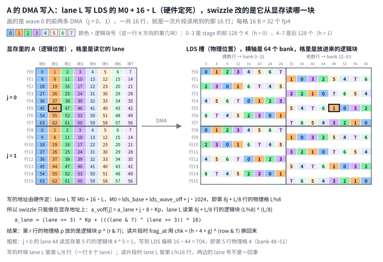

显存地址就是 `a_lane`（[注释版 552–559 行](./gemm_a4w4_annotated.hip#L552-L559)，[原文件 434–437 行](../kernel/gemm_a4w4.hip#L434-L437)）：

```cpp
    // A → LDS 的 DMA：一条指令（第 j 条）填 stage 里的 8 行。LDS 的写入位置由 lane 号固定：
    // lane 写到 (行 = lane/8, 物理块 = lane%8)，每块 16 字节。为了实现 XOR swizzle，改的是
    // “从全局读哪一块”：读逻辑块 = 物理块 ^ (行 & 7)。结果是 LDS 第 row 行的物理块 p 里放的
    // 是逻辑块 p ^ (row & 7)，读的时候按同样的异或换算回来（见 frag_at）。第 j 条指令再往下
    // 偏移 8 行（a_jstride）。
    // 【例】lane 37：行 = 37/8 = 4，物理块 = 37%8 = 5，逻辑块 = 5^4 = 1
    // → a_lane = 4·Kp + 1·16 = 4·2560 + 16 = 10256（本 wave 第 0 条 DMA 的 VGPR 偏移）
    const int a_lane = (lane >> 3) * Kp + (((lane & 7) ^ (lane >> 3)) * 16); // 这里只是stage内的行偏移(stage内第几块)
```

`(lane >> 3) * Kp` 选第 L/8 行，`((lane & 7) ^ (lane >> 3)) * 16` 选这一行的第 (L%8)^(L/8) 块。每条 DMA 覆盖的 8 行都从 8 的倍数开始，所以这里的 `lane >> 3` 就等于 `row & 7`。

这里 `lane & 7` 就是 L%8（只留最低 3 位），`lane >> 3` 就是 L/8（去掉最低 3 位），`^` 是按位异或，不是乘方。lane 是 0..63，正好 6 位：高 3 位是第几行，低 3 位是第几格，swizzle 就是把这两段 3 位异或起来，所以写成位运算最直观。例如 lane 37 = 0b100'101：行 = 0b100 = 4，格 = 0b101 = 5，逻辑块 = 0b101 ^ 0b100 = 0b001 = 1。lane 是非负数，用 `%`、`/` 写编译出来的指令完全一样。

发 DMA 时，第 j 条指令的源地址再加 j·8 行（`a_voff[j]`），描述符基址加上 tile 和 stage 的偏移（每个 stage 每行 128 B）；目的地址写进 M0，是本 wave 在 LDS 槽里那 1/4 的起点再加 j KB（[注释版 742–754 行](./gemm_a4w4_annotated.hip#L742-L754)，[原文件 576–585 行](../kernel/gemm_a4w4.hip#L576-L585)）：

```cpp
            if constexpr (k < KAS)
            {
                // A DMA 的第 j 条：搬本 wave 负责的第 j 个 8 行组（1 KB）。
                // 源地址 = 描述符基址（tile 偏移 + stage 偏移，每个 stage 每行 128 字节）+ a_voff[j]；
                // 目的地址 = 本 wave 在槽里的区域 + j KB。
                constexpr int j = k - KA;
                asm volatile("s_mov_b32 m0, %0\n\t"
                             "buffer_load_dwordx4 %1, %2, 0 offen lds"
                             :
                             : "s"(lds_base + lds_wave_off + j * 1024), "v"(a_voff[j]),
                               "s"(rsrc_at(a_rsrc, to.a + st * 128))
                             : "memory", "m0");
            }
```

**stage 偏移加在哪。** `a_lane` 里没有 stage，这是有意的：它只管"和 lane 有关、每个 stage 都一样"的那部分，kernel 开头算一次，放在 VGPR 里一直不变。tile 和 stage 的偏移加在描述符基址上：`rsrc_at(a_rsrc, to.a + st * 128)` 把基址往后挪 `to.a + st·128` 字节，范围同步缩小，越界检查照样有效。st 每加 1，地址加 128 B，也就是一行里往后 256 个 fp4。合起来，第 st 个 stage、第 j 条 DMA 里 lane L 读的地址是：

```text
A + to.a + st·128 + a_voff[j]
  = A + (m0 + 64·wave + 8·j + L/8)·Kp + 128·st + 16·((L%8) ^ (L/8))
```

例：K = 5120（Kp = 2560），wave 1、j = 2、lane 37、st = 3：163840 + 384 + 51216 = 215440 = 84·2560 + 400，即第 84 行、行内第 400 字节 = 128·3 + 16·1，正是 stage 3 的逻辑块 1（K 800–831）。这样每个 step 只改 SGPR 里的描述符，几条标量指令就够，8 条 DMA 的 VGPR 偏移不用重算。换成这种写法时实测每个 stage 从 3011 降到 2833 个周期（[asm_vs_wg_kernel.md](../asm_vs_wg_kernel.md)）。

把这两个地址代进几个 lane（wave 0 的 j = 0，`lds_wave_off` = 0，所以 M0 就是槽的起点）：

| lane | 显存（`a_lane`）：第几行、哪个逻辑块 | LDS（M0 + 16·lane）：偏移 | 第几行、物理格 | bank |
|---|---|---|---|---|
| 0 | 第 0 行，块 0 ^ 0 = 0 | 0 | 第 0 行，格 0 | 0–3 |
| 9 | 第 1 行，块 1 ^ 1 = 0 | 144 | 第 1 行，格 1 | 36–39 |
| 44 | 第 5 行，块 4 ^ 5 = 1 | 704 | 第 5 行，格 4 | 48–51 |
| 63 | 第 7 行，块 7 ^ 7 = 0 | 1008 | 第 7 行，格 7 | 60–63 |

j = 1 时 `a_voff[1]` 多加 8 行、M0 多加 1 KB：lane L 读显存第 8 + L/8 行的同一个逻辑块 (L%8) ^ (L/8)，写到 LDS 第 8 + L/8 行的物理格 L%8。图 9 左边每格里的数字就是按 `a_lane` 算出的 lane，右边每格里的数字是按 M0 + 16·lane 落进来的逻辑块。

### 5.4 读：`frag_at` 按同样的 XOR 换算回来

lane L 要第 mi 个子块、第 h 个 K 半段的片段：行 `mi·16 + row16`，逻辑块 `4h + g`，物理格 `(4h + g) ^ (row & 7)`（[注释版 828–835 行](./gemm_a4w4_annotated.hip#L828-L835)，[原文件 656–660 行](../kernel/gemm_a4w4.hip#L656-L660)）：

```cpp
    // frag_at(lds, h, mi)：从 LDS 槽里读本 lane 的 A 片段——第 mi 个 16 行子块、第 h 个 K
    // 半段。行 = mi*16 + row16，逻辑块 = h*4 + g（每行 8 个 16 字节块），再按写入时的 XOR
    // swizzle 换算成物理块。对应一条 ds_read_b128。
    auto frag_at = [&](const uint8_t* lds, int h, int mi) __attribute__((always_inline)) {
        const int row = mi * 16 + row16;
        const int chk = (h * 4 + g) ^ (row & 7);
        return *reinterpret_cast<const i32x4*>(lds + row * 128 + chk * 16);
    };
```

`row * 128 + chk * 16` 就是 5.2 节算 bank 用的地址：它落在第 (row%2)·8 + chk 组，图 8 ③ 右边每格的位置就是这样算出来的。

用一个 lane 把两头串起来：读片段时的 lane 21（row16 = 5，g = 1），取 h = 0、mi = 0，要第 5 行的逻辑块 1，物理格是 1 ^ 5 = 4，LDS 偏移 5·128 + 4·16 = 704，bank 48–51（图 8 ③ 右边的粗框）。这 16 B 是 DMA 第 0 条指令里的 lane 44（= 5·8 + 4）写进来的，它读的正是显存第 5 行的第 (44%8) ^ (44/8) = 4 ^ 5 = 1 块（图 9 的粗框）。两边对得上。

注意读和写时 lane 的角色不同：DMA 时 lane L 负责第 L/8 行，读片段时 lane L 负责第 L%16 行。

**写和读用的是同一个 XOR。**

- **写**（5.3 节）：LDS 的落点由 lane 号定死，程序能改的只是每个 lane 去显存读哪一块。结果是 LDS 第 r 行的物理格 p 里放着逻辑块 `p ^ (r & 7)`。
- **读**（本节）：要逻辑块 c，就去物理格 `c ^ (r & 7)` 取。XOR 是自己的逆，`(c ^ r) ^ r = c`，所以换算回来用的就是写入时那个式子，不用另写逆映射。
- **只在行内错开**：错开只发生在一行内部的 8 个 16 B 格之间，A 的第 r 行仍然是 LDS 的第 r 行。LDS 里从头到尾都没有一份按原样排列的 A，但 `frag_at` 每次读出的 16 B 都是要的那个逻辑块，所以 MFMA 拿到的操作数和不 swizzle 时完全一样。

**为什么读 LDS 不用 asm。** 显存访存全都写成了 asm，`frag_at`（还有 6.4 节的 `scale_at`）却只是一次普通的指针解引用。原因有三条：

1. **C++ 写法就能编出想要的指令。** `lds` 指针来自 `__shared__` 数组，编译器知道它指向 LDS。读一个 16 B 的 `i32x4` 就编译成 `ds_read_b128`，读一个 `int` 就编译成 `ds_read_b32`。前提是地址 16 B 对齐：数组声明了 `aligned(16)`，`row * 128 + chk * 16` 也是 16 的倍数。
2. **显存那边，C++ 要么写不出来，要么控制不住。** `buffer_load … lds` 要先设 M0，C++ 没有对应的写法。B 的 load 要精确控制 vmcnt 的等待阈值（5.5 节）；如果交给编译器，它会按自己的判断插等待，往往直接等到 `vmcnt(0)`，预取就白做了。asm 对编译器是黑盒，编译器不会替它插等待，所以这些 load 之后都要手写 `s_waitcnt`。
3. **LDS 读交给编译器也不会出错。** 编译器知道这条 `ds_read` 是自己生成的，会在结果第一次被用之前自动插 `s_waitcnt lgkmcnt`。每段开头已经手动等过 `lgkmcnt(0)`，编译器就不会再多插。剩下的只是位置：编译器可能把这些读挪走、堆在一起，所以代码在每条读后面放 `__builtin_amdgcn_sched_barrier(0)`，把它固定在指定的那条 MFMA 前面。

### 5.5 预取：A 提前两个 stage 搬进 4 槽 LDS 环

A 也要预取。它进的是 LDS，不占寄存器，可以提前得更多：LDS 里开 4 个槽（`RING = 4`），第 s 个 stage 放在第 s%4 个槽，每槽放一个 stage 的 A 和 A scale（256×256 tile 每槽 32 KB + 2 KB = 34 KB，4 个槽共 136 KB；gfx950 每个 CU 的 LDS 是 160 KB）。A 的 DMA 提前 `PF` = 2 个 stage 发出。

要看清 A、B 各在什么时候搬，得先看一个 step 内部：

- 128 条 MFMA 按 M 分成两段：段 0 算本 stage 的 mi = 0..7，段 1 算 mi = 8..15，每段都包含两个 K 半段，各 64 条。
- A 片段总是提前一段从 LDS 读进寄存器，`afr0`、`afr1` 两组轮换：段 0 算的时候读段 1 要的片段，段 1 算的时候读下一个 stage 段 0 要的片段。
- 全局访存也分在两段里：段 0 夹带 B 的 10 条 load（4.3 节），段 1 夹带 A 的 10 条 DMA（8 条 A、2 条 A scale）。每条 MFMA 前面最多插一条 load。

图 10 是 step s 和 step s+1 的时间线，下半部分是 step s 期间各缓冲里放的东西：

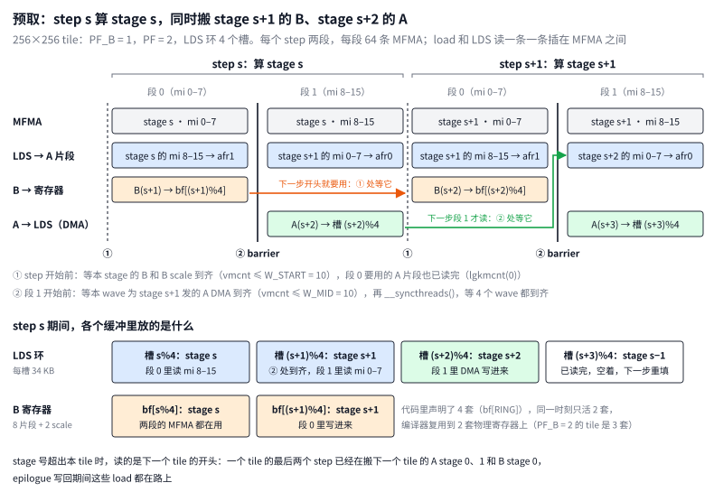

step s 期间，4 个槽的状态：

| 槽 | 放的是 | 这一步里 |
|---|---|---|
| s%4 | stage s | 段 0 里读 mi = 8..15 的片段；mi = 0..7 的已在上一步段 1 读走 |
| (s+1)%4 | stage s+1 | DMA 在上一步段 1 发出，② 处确认到齐；段 1 里读 mi = 0..7 的片段 |
| (s+2)%4 | stage s+2 | 段 1 里发 DMA 写进来 |
| (s+3)%4 | stage s−1 | 已经读完，空着；下一步才重填 |

A 要提前 2 个 stage，B 只要 1 个，是因为 A 片段还要再提前一段读：step s 的段 1 就要读 stage s+1 的 A。如果 A 也只提前 1 个 stage，stage s+1 的 DMA 要到 step s 的段 1 才发，刚发就要用。提前 2 个之后，stage s+2 的 DMA 在 step s 的段 1 发，到 step s+1 的段 1 才读，中间隔着大约一个 stage。B 直接从寄存器进 MFMA，stage s+1 的 B 在 step s 的段 0 发，到 step s+1 开头才用，中间也隔着半个到一个 stage。两边的延迟余量都在一个 stage 左右；256×256 tile 一个 stage 实测约 2700 个周期（[asm_vs_wg_kernel.md](../asm_vs_wg_kernel.md)）。

每个 step 有两处等待，就是图 10 里的 ① 和 ②（[注释版 943–968 行](./gemm_a4w4_annotated.hip#L943-L968)，[原文件 742–762 行](../kernel/gemm_a4w4.hip#L742-L762)，节选）：

```cpp
        // 等待 1：本 stage 的 B / scale 寄存器到了（vmcnt），段 0 的 A 片段也到了（lgkmcnt(0)）。
        if (after_epi)
            wait_vm_lgkm0(std::integral_constant<int, W_START + EPI_STORES>{});
        else
            wait_vm_lgkm0(std::integral_constant<int, W_START>{});
        // ...
        // 段 0：用 afr0 / asc0 计算前 MS0 个 M 片段；从本 stage 的槽读段 1 的片段，放进
        // afr1 / asc1；中间穿插 B 的 load。
        section(std::integral_constant<int, 0>{}, afr0, asc0, afr1, asc1, lds, bf, bs, nto, nst,
                nlds, ntob, nstb, nbf, nbs);
        // ...
        // 等待 2：stage s+1 的 A DMA 在本 wave 这边已经落地（vmcnt），本 wave 段 1 的片段也到了
        // （lgkmcnt(0)）。再做 barrier，保证所有 wave 的那份 DMA 都落地了——之后才能读别的 wave
        // 搬进来的数据（stage s+1 的段 0 片段）。
        if (after_epi)
            wait_vm_lgkm0(std::integral_constant<int, W_MID + EPI_STORES>{});
        else
            wait_vm_lgkm0(std::integral_constant<int, W_MID>{});
        __syncthreads();
        // ...
        // 段 1：用 afr1 / asc1 计算后 MS1 个 M 片段；从下一个 stage 的槽读它段 0 的片段，放进
        // afr0 / asc0；中间穿插 A 的 DMA。
        section(std::integral_constant<int, 1>{}, afr1, asc1, afr0, asc0, next_lds, bf, bs, nto,
                nst, nlds, ntob, nstb, nbf, nbs);
```

`wait_vm_lgkm0<n>` 等到 `vmcnt` ≤ n 且 `lgkmcnt` = 0。`vmcnt` 是这个 wave 已经发出、还没完成的全局访存条数，它们按发射顺序完成，所以"最多还剩 n 条"就说明除了最后发的 n 条，之前发的全都到了：

- ① `W_START` = 10：stage s 的 B 是 step s−1 段 0 发的，在它们之后只发过 step s−1 段 1 的 10 条 A DMA。
- ② `W_MID` = 10：stage s+1 的 A DMA 是 step s−1 段 1 发的，在它们之后只发过本 step 段 0 的 10 条 B load。等到之后还要 `__syncthreads()`：每个 wave 只搬了 1/4 的 A，却要读全部 256 行，得等 4 个 wave 都到齐。
- 紧跟在 epilogue 后面的那个 step（`after_epi`）两处都多放宽 `EPI_STORES` 条，因为 epilogue 的 store 也算在 `vmcnt` 里。

② 处的 barrier 是每个 stage 唯一的一个。它同时保证了 stage s−1 的槽已经没人读了，下一步可以重填。槽数至少要 PF + 1 = 3：只有 3 个槽时，step s 重填的是 stage s−1 的槽，它最后一批片段在 step s−1 的段 0 读，step s−1 段 1 前的 barrier 已经保证读完。取 4 个多留了一个 stage 的余量，所以段 0 不需要 barrier；另外 K 是 1024 的倍数时 stage 数是 4 的倍数，每个 tile 都从 0 号槽开始，循环按 4 展开后每个槽的地址都是编译期常量（[注释版 480–485 行](./gemm_a4w4_annotated.hip#L480-L485)，[原文件 375–381 行](../kernel/gemm_a4w4.hip#L375-L381)）。

4.3 节主循环里的 `nu`、`nst`、`wrap`、`nto` 就是 A 这边的对应量：这一步的 DMA 写进第 nu = (u+2)%4 个槽，读第 nst = s+2 个 stage，超出本 tile 时读下一个 tile 的开头。所以一个 tile 的最后两个 step 已经在搬下一个 tile 第 0、1 个 stage 的 A，加上 4.3 节说的第 0 个 stage 的 B，epilogue 写回期间这些 load 都在路上。

K 循环开始前还有一段序幕（[注释版 1092–1111 行](./gemm_a4w4_annotated.hip#L1092-L1111)，[原文件 871–888 行](../kernel/gemm_a4w4.hip#L871-L888)）：按"第 −2、−1 个 step"的样子，先发 A 的 stage 0，再发 B 的 stage 0 和 A 的 stage 1；然后等 stage 0 的 A 到齐，过一次 barrier，读 stage 0 段 0 的片段。这样进入 step 0 时，各个缓冲的状态和其他 step 完全一样。

## 6. scale：shuffle 成"每个 lane 一个 dword"

A 和 B 各有一份 scale：A scale 是 `[M, K/32]`，B scale 是 `[N, K/32]`，每行每 32 个 K 一个 E8M0 字节。两份用的是同一种 shuffle 布局（同一个 `flatS`），区别只在 kernel 怎么读：A scale 和 A 一样经 LDS 给 4 个 wave 共用，B scale 和 B 一样由每个 wave 直接读进自己的 VGPR。

### 6.1 不 shuffle 的问题

MFMA 要每个 lane 为 A、B 两个操作数各提供自己那一格（第 L%16 行、第 L/16 块）的 scale 字节。如果 scale 是普通的 `[M, K/32]` 行主序，lane L 要的字节在第 `m0 + L%16` 行、第 `4·kc + L/16` 列：分布在 16 个不同的行上，每行 4 个相邻字节，每个 lane 只读 1 个字节。寄存器是 4 B 宽，每次只读 1 B 很浪费；而且每条 MFMA 的每个操作数都要单独读一次。

按第 2 节的标准看 cache line，也很不划算。相邻两行在显存里隔一整行（scaleN_pad 字节，K = 5120 时是 160 B），比一条 128 B 的 cache line 还长，所以这 16 行落在 16 条不同的 cache line 上：一条 load 只拿 64 个有用的字节，却要碰 16 条 cache line。shuffle 做的是两件事：先把一个 lane 在一个 stage 里要的 4 个字节拼成一个 dword，再把 64 个 lane 的 dword 按 lane 号连续排好。这样一条 `buffer_load_dword` 读的是连续的 256 B，正好 2 条完整的 cache line，一次拿齐 4 条 MFMA 的 scale（6.3 节）。

单 wave kernel 就是逐字节读的（4.2 节 `load` 里的 `AScale[flatS(am, kblk, scaleN_pad)]`）。它的地址已经按 shuffle 后的布局算，但每个 lane 每次仍然只读 1 字节。

### 6.2 一个 stage 要多少 scale

一个 stage 的 K = 256，是 8 个 32-K 块，所以每一行在一个 stage 里有 8 个 scale 字节。以 256×256 tile 为例：

| | 一个 stage 要的 scale | 按 32 行切块（每块 32 行 × 8 = 256 B） | 怎么读 | 每个 lane |
|---|---|---|---|---|
| A scale | 256 行 × 8 = 2 KB | 8 块：第 p 块是第 32p 到 32p+31 行，给子块 mi = 2p、2p+1 用 | 4 个 wave 共用：wave w 用 `buffer_load_dword … lds` 搬第 w、w+4 块进 LDS 槽，4 个 wave 再各用 `ds_read_b32` 读全部 8 块 | DMA 2 × 4 B，读 8 × 4 B |
| B scale | 每个 wave 64 行 × 8 = 512 B（4 个 wave 合起来 2 KB） | 每个 wave 2 块：第 p 块是本 wave 的第 32p 到 32p+31 行，给子块 ni = 2p、2p+1 用 | 每个 wave 用 `buffer_load_dword` 把自己的 2 块直接读进 VGPR（`bs[0]`、`bs[1]`） | 读 2 × 4 B |

按 32 行切块，是因为一个 dword 的 4 个字节正好装下"相邻两个 16 行子块 × K 的前后两半"（6.3 节）。图 11 是一个 stage 的全貌：

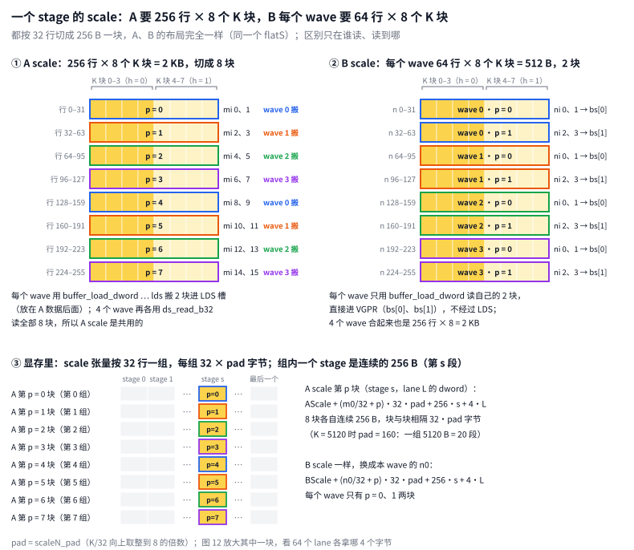

在显存里，scale 张量按 32 行一组，每组 32 × scaleN_pad 字节，组内每个 stage 占连续的 256 B。所以 A scale 第 p 块（stage s）从 `AScale + (m0/32 + p)·32·scaleN_pad + 256·s` 开始，8 块各自连续，块与块之间隔 32·scaleN_pad 字节（图 11 ③）；B scale 把 m0 换成本 wave 的 n0。K = 5120 时 scaleN_pad = 160，一组 5120 B，正好是 20 个 stage 的段。

**每个 wave 搬哪几行。** B scale 的地址从本 wave 的 n0 算起，n0 里带着 `wave * WNTILE`（即 64·wave），所以 wave w 搬 tile 里 N 方向第 64w 到 64w+63 行，也就是它自己那两个 32 行组。A scale 不是这样：起点 `t.as` 只按 tile 的 m0 算，8 块轮流分给 4 个 wave，wave w 搬第 w、w+4 块（6.4 节）。A 数据又不一样，按 `t.a` 里的 `wave * A_LDS_PER_WAVE * 8`（即 64·wave）连续分（[注释版 613–618 行](./gemm_a4w4_annotated.hip#L613-L618)，[原文件 451–452 行](../kernel/gemm_a4w4.hip#L451-L452)）。三者放在一起：

| 每个 wave 从显存搬的行（256×256 tile） | wave 0 | wave 1 | wave 2 | wave 3 |
|---|---|---|---|---|
| B scale（N 方向） | 0–63 | 64–127 | 128–191 | 192–255 |
| A scale（M 方向） | 0–31、128–159 | 32–63、160–191 | 64–95、192–223 | 96–127、224–255 |
| A 数据（M 方向） | 0–63 | 64–127 | 128–191 | 192–255 |

A scale 谁搬哪块不影响计算：不管哪个 wave 搬的，第 p 块都写进 LDS 的 `STAGE_A + p·256`，之后每个 wave 都把 8 块全读一遍。

**每个 wave 用多少。** 搬多少和用多少不一样。B scale 每个 wave 搬 512 B，也只用这 512 B。A scale 每个 wave 只搬 512 B，但 4 个 wave 算的都是全部 256 行 M，所以每个 wave 都要从 LDS 读全部 2 KB（8 条 `ds_read_b32`）。核对一下：一个 wave 每个 stage 做 16 × 4 × 2 = 128 条 MFMA，每条每个 lane 要 1 个 A scale 和 1 个 B scale。每个 lane 拿到 32 个 A scale 字节（8 个 dword），每个给 4 条 MFMA 用（4 个 ni）；拿到 8 个 B scale 字节（2 个 dword），每个给 16 条用（16 个 mi）。两边都是 128。

### 6.3 一块 256 B 里怎么排

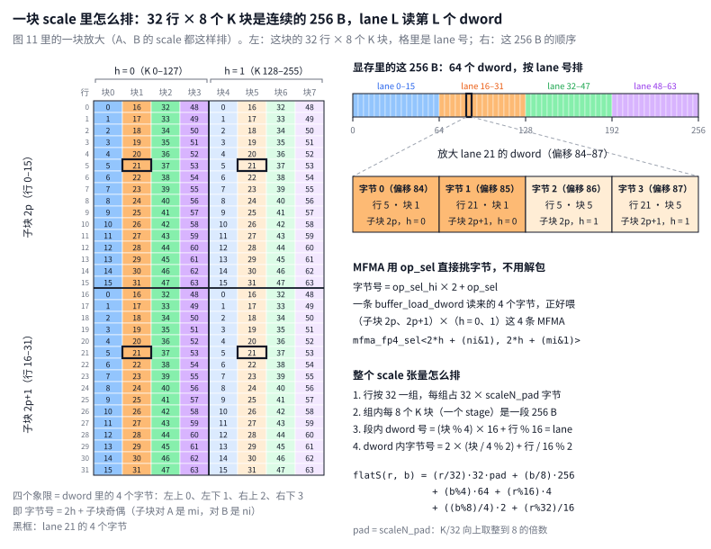

shuffle 把每 32 行 × 8 个 K 块（两个 16 行子块 × 一个 stage 的 K = 256）的 256 个 scale 字节排成连续的 256 B，也就是 64 个 dword，让第 L 个 dword 正好是 lane L 要的 4 个字节：

| dword 里的字节 | 行 | K 块 | 用在哪条 MFMA |
|---|---|---|---|
| 0 | L%16 | L/16 | 子块 2p，前 128 个 K（h = 0） |
| 1 | 16 + L%16 | L/16 | 子块 2p+1，h = 0 |
| 2 | L%16 | 4 + L/16 | 子块 2p，后 128 个 K（h = 1） |
| 3 | 16 + L%16 | 4 + L/16 | 子块 2p+1，h = 1 |

表里的 p 就是 6.2 节说的第 p 块：对 A scale，它覆盖子块 mi = 2p、2p+1；对 B scale，它覆盖本 wave 的子块 ni = 2p、2p+1。字节号 = 2h + 子块奇偶。一条指令读一块的连续 256 B，每个 lane 4 B，一次读齐 4 条 MFMA 要用的 scale（B scale 用 `buffer_load_dword`，A scale 是 DMA 进 LDS 之后的 `ds_read_b32`）。

例：lane 21 的 dword 在这一块的偏移 84–87，4 个字节依次是（第 5 行，块 1）、（第 21 行，块 1）、（第 5 行，块 5）、（第 21 行，块 5），即图 12 左边黑框的 4 格。

**一步一步看 shuffle。** 图 13 按 K = 5120 把同一块拆开来看。左边是原来按行存的排布（一行 160 个字节，只画第 0 个 stage 的 8 列），格子里写着 shuffle 之后拿走它的 lane，颜色表示它是那个 lane 的 dword 里的第几个字节；右边是 shuffle 之后的 256 B，按内存顺序每行 8 个字节、2 个 lane，每 4 格是一个 lane 的 dword。黑框是 lane 21 的 4 个字节。

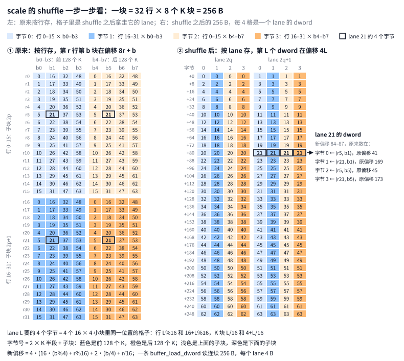

1. **原来怎么存。** 不 shuffle 时，scale 是 `[行, K/32]` 的行主序矩阵，每行每 32 个 K 一个字节，一行共 scaleN_pad 个字节（K = 5120 时是 160）。取 32 行 × 一个 stage（8 个 K 块）为一块：每行的这 8 个字节连在一起，但相邻两行隔一整行，所以一块的 256 个字节原来散在 32 行里。图 13 画的是第 0 个 stage，(r, b) 原来在 160r + b。
2. **lane L 要哪 4 个字节。** MFMA 里 lane L 负责片段的第 L%16 行、第 L/16 个 K 块。一个 stage 里它要参与 2 个子块 × 2 个 K 半段 = 4 条 MFMA，所以要 4 个 scale：第 L%16 行和第 16+L%16 行，各取第 L/16 块和第 4+L/16 块。在原来的排布里这 4 个字节是散开的：lane 21 要的 (r5, b1)、(r21, b1)、(r5, b5)、(r21, b5)，原偏移是 801、3361、805、3365。
3. **把块切成四个角。** 32 × 8 的块正好切成 4 个 16 × 4 的小块：上下是两个子块，左右是两个 K 半段。每个小块恰好 64 格，排法和 64 个 lane 的分工一样（第 L%16 行、第 L/16 列），所以 lane L 在 4 个小块里占同一个位置，从每个小块各拿 1 个字节：左上是字节 0，左下是字节 1，右上是字节 2，右下是字节 3，即字节号 = 2 × K 半段 + 子块。图 13 里蓝色是前 128 个 K，橙色是后 128 个 K；浅色是上面的子块，深色是下面的子块。
4. **按 lane 排好。** lane L 的 4 个字节放在偏移 4L 到 4L+3。lane 21 落在 84–87，即图 13 右边 +80 那一行的后一个 dword。

合起来，(r, b) 从原来的 160r + b（一般是 r·scaleN_pad + b）搬到这一块里的新偏移 `4·(16·(b%4) + r%16) + 2·(b/4) + r/16`，原来散在 32 行里的 256 个字节变成连续的 256 B。一条 `buffer_load_dword`（64 个 lane × 4 B）就读完一整块，每个 lane 正好拿到自己的 4 个 scale，MFMA 再用 `op_sel` 挑出要的字节。

整个 scale 张量这样排：

1. 行按 32 一组，每组占 32 × scaleN_pad 字节；
2. 组内每 8 个 K 块（一个 stage）是一段 256 B；
3. 段内 dword 号 = (b%4)·16 + r%16，正好是 lane 号；
4. dword 内的字节号 = 2·((b%8)/4) + (r%32)/16。

这个布局由量化 kernel 直接写出（`shuffle=True` 时走 aiter `_dynamic_mxfp4_quant_kernel_asm_layout` 的 `SHUFFLE` 分支，节选）。`bs_offs_m` 是行号 r，`bs_offs_n` 是 K 块号 b：

```python
    if SHUFFLE:
        bs_offs_0 = bs_offs_m[:, None] // 32
        bs_offs_1 = bs_offs_m[:, None] % 32
        bs_offs_2 = bs_offs_1 % 16
        bs_offs_1 = bs_offs_1 // 16
        bs_offs_3 = bs_offs_n[None, :] // 8
        bs_offs_4 = bs_offs_n[None, :] % 8
        bs_offs_5 = bs_offs_4 % 4
        bs_offs_4 = bs_offs_4 // 4
        bs_offs = (
            bs_offs_1
            + bs_offs_4 * 2
            + bs_offs_2 * 2 * 2
            + bs_offs_5 * 2 * 2 * 16
            + bs_offs_3 * 2 * 2 * 16 * 4
            + bs_offs_0 * 2 * 16 * scaleN_pad
        )
```

对一个已经量化好的 `[M, K/32]` scale，`aiter.ops.shuffle.shuffle_scale` 用 `view` + `permute` 做同样的事（节选）：

```python
        scale = scale.view(sm // 32, 2, 16, sn // 8, 2, 4)
        scale = scale.permute(0, 3, 5, 2, 4, 1).contiguous()
        return scale.view(sm, sn)
```

`view` 把行拆成（32 行组、子块奇偶、行 % 16），把 K 块拆成（stage、h、块 % 4）。`permute` 之后从外到内依次是：32 行组、stage、块 % 4、行 % 16、h、子块奇偶。最后四维正好是"dword 号 = (块%4)·16 + 行%16，字节号 = 2h + 子块奇偶"。

**shuffle 之后，形状没变，"行"变了。** 最后的 `view(sm, sn)` 只是把重排好的结果按原来的形状装回去，所以 shuffle 前后都是 `[行数, scaleN_pad]`（实测 `[256, 160]` 进、`[256, 160]` 出）。但 shuffle 之后的一行已经不对应 M 或 N 方向的某一行了，kernel 也只把它当一段平的内存，按 `flatS` 算偏移。

以 K = 5120 为例，一组 32 × 160 = 5120 B：shuffle 前切成 32 行 × 160 B，shuffle 后切成 20 个 stage × 256 B。总字节数一样，所以这一组占的地址范围不变，只是组内换了切法。一个 stage 的 256 B 比一行的 160 B 长，如果还按 32 × 160 的形状去看，第 0 个 stage 占满第 0 行，再占第 1 行的前 96 B，一行装不下。实测 shuffle 之后组 0 的前 8 行：

| 第几行（每行 160 B） | 放的是 |
|---|---|
| 0 | stage 0 的 lane 0–39 |
| 1 | 前 96 B：stage 0 的 lane 40–63；后 64 B：stage 1 的 lane 0–15 |
| 2 | stage 1 的 lane 16–55 |
| 3 | 前 32 B：stage 1 的 lane 56–63；后 128 B：stage 2 的 lane 0–31 |
| 4 | 前 128 B：stage 2 的 lane 32–63；后 32 B：stage 3 的 lane 0–7 |
| 5 | stage 3 的 lane 8–47 |
| 6 | 前 64 B：stage 3 的 lane 48–63；后 96 B：stage 4 的 lane 0–23 |
| 7 | stage 4 的 lane 24–63 |

5 × 256 = 8 × 160 = 1280，所以每 8 行正好装 5 个 stage：第 8–15、16–23、24–31 行依次是 stage 5–9、10–14、15–19，排法和上表一样。K = 256 时一行只有 8 个字节，一组正好是一个 stage，按 32 × 8 去看，第 q 行就是 lane 2q 和 2q+1，和图 13 右边一样。

跨行边界对 kernel 没有影响：stage s 读的是组内从 256s 开始的连续 256 B，不看行边界。要保证的只是一组能切成整数个 256 B 的段，所以 K/32 要补到 8 的倍数，也就是 1.3 节的 scaleN_pad；K = 5120 时 160 本来就是 8 的倍数。

kernel 的 `flatS` 是同一个公式（[注释版 154–162 行](./gemm_a4w4_annotated.hip#L154-L162)，[原文件 98–105 行](../kernel/gemm_a4w4.hip#L98-L105)）：

```cpp
__device__ __forceinline__ int64_t flatS(int r, int b, int scaleN_pad)
{
    int r32 = r & 31;   // 32 行组内的行号
    int b8  = b & 7;    // 8 块一段内的块号
    // 字节号（r32>>4、b8>>2）+ dword 号 ×4（r32&15、b8&3）+ 段偏移（b>>3）+ 行组偏移（r>>5）
    return (int64_t)(r32 >> 4) + (int64_t)(b8 >> 2) * 2 + (int64_t)(r32 & 15) * 4 +
           (int64_t)(b8 & 3) * 64 + (int64_t)(b >> 3) * 256 +
           (int64_t)(r >> 5) * 32 * (int64_t)scaleN_pad;
}
```

### 6.4 kernel 怎么读、怎么用

wg kernel 里，lane L 读一段里的第 L 个 dword，lane 偏移就是 `lane * 4`（[注释版 563–565 行](./gemm_a4w4_annotated.hip#L563-L565)，[原文件 440–441 行](../kernel/gemm_a4w4.hip#L440-L441)）：

```cpp
    // scale：shuffle 布局里，32 行 × 一个 stage 是 256 字节，lane L 读第 L 个 dword。
    // 【例】lane 37 → s_lane = 148
    const int s_lane = lane * 4;
```

tile 的起点是它所在的 32 行组（[注释版 587–590 行](./gemm_a4w4_annotated.hip#L587-L590)，[原文件 454–455 行](../kernel/gemm_a4w4.hip#L454-L455)）：

```cpp
        // scale：tile 起始的那个 32 行块（覆盖子块 2p 和 2p+1）的起始字节
        // 【例】m0 = 0 → t.as = 0；n0 = 64 → t.bs = (64/32)·32·160 = 2·5120 = 10240
        t.as = (t.m0 >> 5) * 32 * scaleN_pad;
        t.bs = (t.n0 >> 5) * 32 * scaleN_pad;
```

**B scale：直接进 VGPR。** 每个 wave 每个 stage 发 2 条（p = 0、1），写进 `bs[p]`。描述符基址加上 tile 起点和 stage 偏移（每个 stage 256 B），第 p 块再加 `p·32·scaleN_pad`：256 行的 tile 把这一项放在 soffset 里，其余 tile 放在 VGPR 偏移里（[注释版 720–735 行](./gemm_a4w4_annotated.hip#L720-L735)，[原文件 560–572 行](../kernel/gemm_a4w4.hip#L560-L572)）：

```cpp
        else if constexpr (k < KA)
        {
            // B scale：第 p 个 32 行块里本 lane 的 dword（每个 stage 256 字节）
            constexpr int p = k - KBS;
            if constexpr (SCALE_SOFF)
                // 256 行的 tile：块偏移走 soffset（%3）
                asm volatile("buffer_load_dword %0, %1, %2, %3 offen"
                             : "=v"(bs[p])
                             : "v"(bs_voff[0]), "s"(rsrc_at(bs_rsrc, tob.bs + stb * 256)),
                               "s"(__builtin_amdgcn_readfirstlane(p * 32 * scaleN_pad)));
            else
                // 其他 tile：块偏移已经算进 bs_voff[p]，soffset 为 0
                asm volatile("buffer_load_dword %0, %1, %2, 0 offen"
                             : "=v"(bs[p])
                             : "v"(bs_voff[p]), "s"(rsrc_at(bs_rsrc, tob.bs + stb * 256)));
        }
```

这里的 `tob`、`stb` 和 B 的 load 里一样：B scale 跟着 B 提前 PF_B 个 stage 读，写进同一步的那套 `bs[(s+PF_B)%4]`（4.3 节）。

**A scale：DMA 进 LDS，再 `ds_read_b32`。** A scale 被 4 个 wave 共用，所以和 A 一样 DMA 进 LDS，放在同一个槽里 A 数据的后面（偏移 `STAGE_A + p·256`），每个工作组只搬一次，也跟着 A 提前 2 个 stage（5.5 节）。8 块分给 4 个 wave：第 j 条（j = 0、1）搬第 `min(j·4 + wave, 7)` 块，即 wave w 搬第 w、w+4 块。代码里写的是 `min(j·WAVES + wave, NSB − 1)`，`min` 是给小 tile 用的：块数少于 wave 数时，多出来的 wave 重复搬最后一块，让每个 wave 发的 load 条数一样。lane L 的 4 B 按 M0 + 4·L 写进去（5.3 节），所以第 p 块里 lane L 的 dword 在 `STAGE_A + p·256 + 4·L`。DMA 在 `issue_one` 的最后一个分支（[注释版 755–775 行](./gemm_a4w4_annotated.hip#L755-L775)，[原文件 586–605 行](../kernel/gemm_a4w4.hip#L586-L605)），写法和 A 的 DMA 相同。之后每个 wave 用 `ds_read_b32` 读出全部 8 块里本 lane 的 dword：段 0 读本 stage 的第 4–7 块（给 mi = 8..15），段 1 读下一个 stage 的第 0–3 块，和 A 片段一样提前一段读（[注释版 836–839 行](./gemm_a4w4_annotated.hip#L836-L839)，[原文件 661–663 行](../kernel/gemm_a4w4.hip#L661-L663)）：

```cpp
    // scale_at(lds, p)：读第 p 个 A scale 块里本 lane 的 dword（一条 ds_read_b32）。
    auto scale_at = [&](const uint8_t* lds, int p) __attribute__((always_inline)) {
        return *reinterpret_cast<const int*>(lds + STAGE_A + p * 256 + lane * 4);
    };
```

**MFMA 挑字节。** 字节号在指令里是立即数（字节号 = op_sel_hi × 2 + op_sel），所以写成模板参数，16 种组合各展开成一条指令（[注释版 382–409 行](./gemm_a4w4_annotated.hip#L382-L409)，[原文件 296–321 行](../kernel/gemm_a4w4.hip#L296-L321)，节选）：

```cpp
#define MBS_MFMA_FP4(OS0, OS1, OH0, OH1)                                                   \
    asm volatile("v_mfma_scale_f32_16x16x128_f8f6f4 %0, %1, %2, %0, %3, %4 op_sel:[" #OS0 \
                 "," #OS1 ",0] op_sel_hi:[" #OH0 "," #OH1 ",0] cbsz:4 blgp:4"              \
                 : "+a"(acc)                                                              \
                 : "v"(a), "v"(b), "v"(sa), "v"(sb))
template <int OA, int OB>
__device__ __forceinline__ void mfma_fp4_sel(f32x4& acc, i32x4 a, i32x4 b, int sa, int sb)
{
    static_assert(OA >= 0 && OA < 4 && OB >= 0 && OB < 4, "scale byte select");
    // 下面 16 行按 (OA, OB) 展开。宏参数依次是 A 的 op_sel、B 的 op_sel、A 的 op_sel_hi、
    // B 的 op_sel_hi，即字节号的低位和高位。例如 OA = 3、OB = 0 对应 MBS_MFMA_FP4(1, 0, 1, 0)。
    if constexpr (OA == 0 && OB == 0) MBS_MFMA_FP4(0, 0, 0, 0);
    else if constexpr (OA == 1 && OB == 0) MBS_MFMA_FP4(1, 0, 0, 0);
    else if constexpr (OA == 2 && OB == 0) MBS_MFMA_FP4(0, 0, 1, 0);
    // ... 其余 13 种组合 ...
    else MBS_MFMA_FP4(1, 1, 1, 1);
}
```

调用处按 6.3 节的表算字节号：K 半段 h 贡献 2h，子块的奇偶贡献 0 或 1。第一个操作数是 B 片段，所以 OA 用 B 子块的奇偶 `ni & 1`；第二个是 A 片段，OB 用 `mi & 1`（[注释版 923–927 行](./gemm_a4w4_annotated.hip#L923-L927)，[原文件 727–731 行](../kernel/gemm_a4w4.hip#L727-L731)）：

```cpp
            // 操作数交换（B 片段放在第一个位置）：算的是子块的 C^T，于是 lane L 拿到第 L%16 行、
            // 第 (L/16)*4 .. +3 列——同一行的 4 个连续输出（见 epilogue）。
            // scale 字节号 = 2*h（哪个 K 半段）+ 子块的奇偶（ni&1 / mi&1）。
            mfma_fp4_sel<2 * h + (ni & 1), 2 * h + (mi & 1)>(acc[mi][ni], bf[ni][h],
                                                             cf[h * MC + ml], bs[ni / 2], cs[ml / 2]);
```

`bs[ni / 2]` 和 `cs[ml / 2]` 就是覆盖这两个子块的那个 dword，整个过程没有一条解包指令。

### 6.5 串起来看

以 256×256 tile、K = 5120 为例，把这一节串起来：

1. **为什么要 shuffle。** 一个 stage 里，A、B 各要 256 行 × 8 = 2 KB 的 scale，每个 wave 搬 512 B。一条 `buffer_load_dword` 是 64 个 lane × 4 B = 256 B，所以每个 wave 发 2 条，每个 lane 一次拿 4 个 scale。但 MFMA 规定了每个 lane 用哪一格：lane L 用 16 × 4 网格（16 行 × 4 个 K 块）里第 L%16 行、第 L/16 块的 scale（图 13 左边）。行主序下，同一块的 16 个 lane 分散在 16 行上，相邻两行隔 160 B，比一条 128 B 的 cache line 还长，所以一条 load 要碰 16 条 cache line，每个 lane 还只拿到 1 B。shuffle 把 lane L 在 4 个 16 × 4 小块（2 个子块 × 2 个 K 半段）里要的 4 个字节拼成一个 dword，再按 lane 号连续排好。这样一条 `buffer_load_dword` 读的是连续的 256 B，lane L 一次拿齐自己的 4 个 scale（6.1、6.3 节）。
2. **A、B 的 shuffle 一样。** A scale 和 B scale 用同一种布局：32 行一组，每组 32 × scaleN_pad = 32 × 160 字节，组内每个 stage 是连续的 256 B。重排后张量形状不变，但"行"的意思变了：按 32 × 160 去看，每组的第一行就是 stage 0 里 lane 0–39 的 dword，lane 40–63 接在第二行的前 96 B（6.3 节）。
3. **和 B 的预重排比。** 思路一样，都是把一个 lane 要的数据排到 lane 号对应的位置。B 是 16 行一组，组内按列的自然顺序，每一列依次放第 0–15 行的 16 B 小块（1 行 × 32 个 fp4），不按 stage 拆（4.1 节）。scale 在 stage 内也是"按列、每列依次放 16 行"，排出来就是 lane 号。不同的是，每条 MFMA 每个 lane 只要 1 B 的 scale，要把 4 条 MFMA 的字节拼进一个 dword，所以 scale 要 32 行一组，还要按 stage 拆出 K 的前后两半。
4. **谁搬哪几行。** B scale 按连续 64 行分：wave 0 搬 N 方向第 0–63 行。A scale 轮流分：wave 0 搬第 0、4 块，即 M 方向第 0–31 行和第 128–159 行（6.2 节）。
5. **为什么分法不同。** B scale 只给本 wave 自己用，A scale 是 4 个 wave 共用的。B scale 直接读进本 wave 的 VGPR，怎么分由"谁用"就定死了。A scale 经 LDS 共享，每个工作组只搬一次，只要 8 块都有 wave 搬、每个 wave 发的 load 条数一样，怎么分都行，代码选了轮流分（6.4 节）。

## 7. 小结和自检

| 数据 | 读到哪 | 指令 | 每条指令读什么 | 关键公式 | 提前几个 stage |
|---|---|---|---|---|---|
| A | LDS，再 `ds_read_b128` 进 VGPR | `buffer_load_dwordx4 … lds` | 8 行 × 128 B，8 条完整 cache line | lane L 读逻辑块 `(L%8)^(L/8)`；LDS 物理格 = 逻辑块 `^ (行 & 7)` | 2（4 槽 LDS 环） |
| B | VGPR | `buffer_load_dwordx4` | 连续 1 KB | lane L 在 `16·L` | `PF_B`：256×256 为 1，部分 tile 为 2 |
| B scale | VGPR | `buffer_load_dword` | 连续 256 B | lane L 在 `4·L` | 同 B |
| A scale | LDS，再 `ds_read_b32` 进 VGPR | `buffer_load_dword … lds` | 连续 256 B | lane L 在 `4·L` | 同 A |

以 256×256 tile 为例，每个 wave 每个 stage 一共发 20 条全局访存，就是代码里的 `LOADS_PER_STAGE`（[注释版 693 行](./gemm_a4w4_annotated.hip#L693)，[原文件 500 行](../kernel/gemm_a4w4.hip#L500)）：8 条 B（各 1 KB）、2 条 B scale（各 256 B）、8 条 A DMA（各 1 KB）、2 条 A scale DMA（各 256 B），合计 17 KB，4 个 wave 合起来每个 stage 68 KB（见 [mbs_note.md](../mbs_note.md)）。step s 里，B 和 B scale 的 10 条插在段 0，读 stage s+1；A 和 A scale 的 10 条插在段 1，读 stage s+2。

下面这段代码在 CPU 上就能跑，用 aiter 的实现检查 `flatB` 和 `flatS`：

```python
import torch
from aiter.ops.shuffle import shuffle_weight, shuffle_scale

def flatB(n, kp, K):
    return (n // 16) * (8 * K) + (kp // 16) * 256 + (n % 16) * 16 + kp % 16

def flatS(r, b, pad):
    return ((r // 32) * 32 * pad + (b // 8) * 256 + (b % 4) * 64 + (r % 16) * 4
            + ((b % 8) // 4) * 2 + (r % 32) // 16)

N, K = 48, 512
B = torch.randint(0, 256, (N, K // 2), dtype=torch.uint8)
n, kp = torch.meshgrid(torch.arange(N), torch.arange(K // 2), indexing="ij")
assert torch.equal(shuffle_weight(B, layout=(16, 16)).reshape(-1)[flatB(n, kp, K)], B)

M, KB = 256, 40                      # KB = K/32，已经是 8 的倍数
S = torch.randint(0, 256, (M, KB), dtype=torch.uint8)
r, b = torch.meshgrid(torch.arange(M), torch.arange(KB), indexing="ij")
assert torch.equal(shuffle_scale(S).reshape(-1)[flatS(r, b, KB)], S)
print("flatB / flatS 与 aiter 一致")
```

改图时，修改 [`scripts/draw_layout_figs.py`](../scripts/draw_layout_figs.py) 后在 `mbs` 目录下运行 `python3 scripts/draw_layout_figs.py`，会重新生成 `docs/images/kernel_intro_*.svg`。脚本在画图时会用 kernel 的公式校验每个 lane 号和偏移，算错了会直接报错。

## 附：tile 按什么顺序分给 XCD

前面几节讲的都是一个 tile 内部的数据怎么放、怎么读。这里补一个 tile 之间的问题：同一时刻在算的是哪些 tile。它决定了每个 XCD 的 L2 能复用多少数据。每个工作组的具体位置，以及几种排法在不同 shape 上的对比，见 [`M_sub_n_sub.md`](./M_sub_n_sub.md) 第二节；这里用一张图对比重排前后的差别。

先交代三个事实：

- **L2 是每个 XCD 私有的。** MI355X 的 256 个 CU 分在 8 个 XCD 上，每个 XCD 有 32 个 CU，共用一块 L2；不同 XCD 之间不共享。
- **工作组轮流派给 XCD。** 硬件把工作组 b 派到第 b % 8 个 XCD 上。
- **kernel 是 persistent 的。** grid 是 256 个工作组，工作组 b 依次处理编号 b、b + 256、b + 512……的 tile，所以同一"轮"的 256 个 tile 大致同时在算。

同一行的 tile 读同一条 A，同一列的读同一条 B。同一个 XCD 上同时在算的 32 个 tile，用到的不同 A、B 越少，L2 复用得越多。

**思路：XCD 选不了，就反过来给每个编号选 tile。** 理想情况是：同一轮里，一个 XCD 上的 32 个工作组正好算一块 4 × 8 的 tile。但工作组落在哪个 XCD，是硬件按 `blockIdx.x` 轮流派发决定的，代码改变不了。代码能决定的只有另一半：编号 `id = blockIdx.x + 256·i` 去算哪个 tile，也就是读 A、B 的哪一部分、写 C 的哪一块。因为 `gridDim.x` = 256 是 8 的倍数，编号为 id 的 tile 一定由 XCD `id % 8` 上的工作组来算。所以 `tile_off` 不按行主序把编号直接换成 tile 坐标，而是先按 `id % 8` 把编号分给各个 XCD，再把同一个 XCD 拿到的连续编号排成 4 × 8 的方块。这个换算是一一对应的，每个 tile 仍然恰好被算一次，所以它只改变处理顺序，不影响结果。

图 14 以 8192×17408、256×256 tile 为例（一共 32 × 68 = 2176 个 tile），画出第 0 轮每个 XCD 在算哪些 tile：

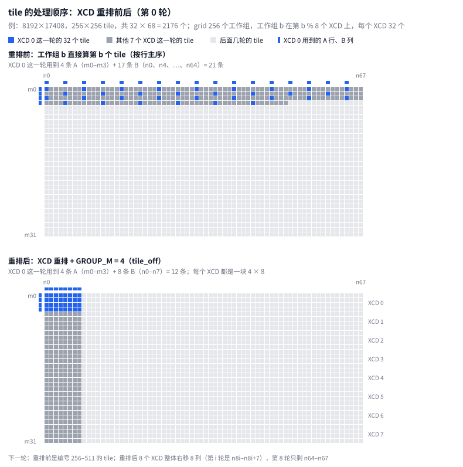

**重排前**（图 14 上半）：工作组 b 直接算第 b 个 tile，按行主序排，即第 b / 68 行、第 b % 68 列。XCD 0 拿到的是编号 0、8、16、……、248，都落在 m0–m3 这 4 行里，列号都是 4 的倍数。因为 8 和 68 有公约数 4，列号每 17 个就重复一轮，所以一共用到 17 条不同的 B。XCD 0 这一轮要读 4 条 A 加 17 条 B，共 21 条，其他 7 个 XCD 也都是这样。

**重排后**（图 14 下半）：`tile_off` 分两步把编号换算成 tile 坐标（[注释版 581–591 行](./gemm_a4w4_annotated.hip#L581-L591)，[原文件 444–451 行](../kernel/gemm_a4w4.hip#L444-L451)）：

```cpp
        // 第 1 步：把编号 id = q*8 + x（x 是 XCD 号）映射成 x*(total/8) + q，于是第 x 个 XCD
        // 处理连续的一段编号。凑不满 8 个的尾巴保持原编号。
        if (id < total / NXCD * NXCD)
            id = (id % NXCD) * (total / NXCD) + id / NXCD;
        // 第 2 步：按 GROUP_M 个 M tile 一组的“列组”展开，组内先走 M、再走 N。
        const int group   = id / (GROUP_M * num_n);        // 第几个列组
        const int first_m = group * GROUP_M;               // 这个列组的第一个 M tile
        const int gsize   = min(num_m - first_m, GROUP_M); // 最后一组可能不满 4 个
        TileOff t;
        t.m0 = (first_m + (id % (GROUP_M * num_n)) % gsize) * MTILE;
        t.n0 = (id % (GROUP_M * num_n)) / gsize * NTILE + wave * WNTILE;
```

1. **XCD 重排**：编号 `id` 换成 `(id % 8)·(total/8) + id/8`，XCD x 拿到连续的一段编号 [272x, 272x + 272)。每个 XCD 正好分到 2176 / 8 = 272 个 tile，即 m4x 到 m4x+3 这 4 行的全部 68 列。
2. **`GROUP_M = 4` 分组**：在这段编号里先往下走 4 行，再往右挪一列。所以同一轮的 32 个工作组拿到的是 4 行 × 8 列的一块。

于是 XCD 0 这一轮只用到 4 条 A 加 8 条 B，共 12 条：每条 A 被 8 个工作组共用，每条 B 被 4 个工作组共用。8 个 XCD 各占 4 行，互不重叠。之后每一轮整体右移 8 列；68 列要走 9 轮，最后一轮只剩 n64–n67 这 4 列，只有 128 个 tile。

**效果。** 每条 A 或 B 在一个 stage 里是 32 KiB（256 行或 256 列 × 128 B），所以每个 XCD 每个 stage 要从 L2 外面搬进来的数据，从 21 × 32 KiB 降到 12 × 32 KiB，少了约 43%。这里只算了第 0 轮；按所有轮平均，重排前约 22 条（见 `M_sub_n_sub.md` 第二节的对比表），重排后始终是 12 条。还有两点要注意：

- **好处取决于 shape。** N = 8192 时每行恰好 32 个 tile，不重排也正好排成 8 行 × 4 列，同样是 12 条。
- **对总时间影响很小。** `mbs_note.md` 记录的实测是：persistent 与否、`GROUP_M` 取 2、8、16，差别都在 ±2% 以内。这个 kernel 在大 shape 上卡在 MFMA 发射，不卡在访存，L2 命中率高一点，对总时间影响不大。
