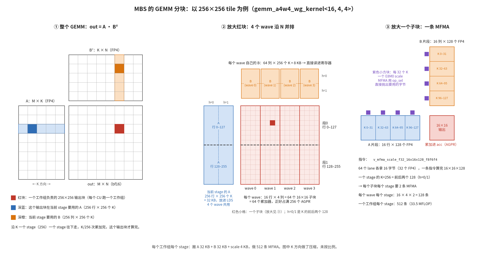
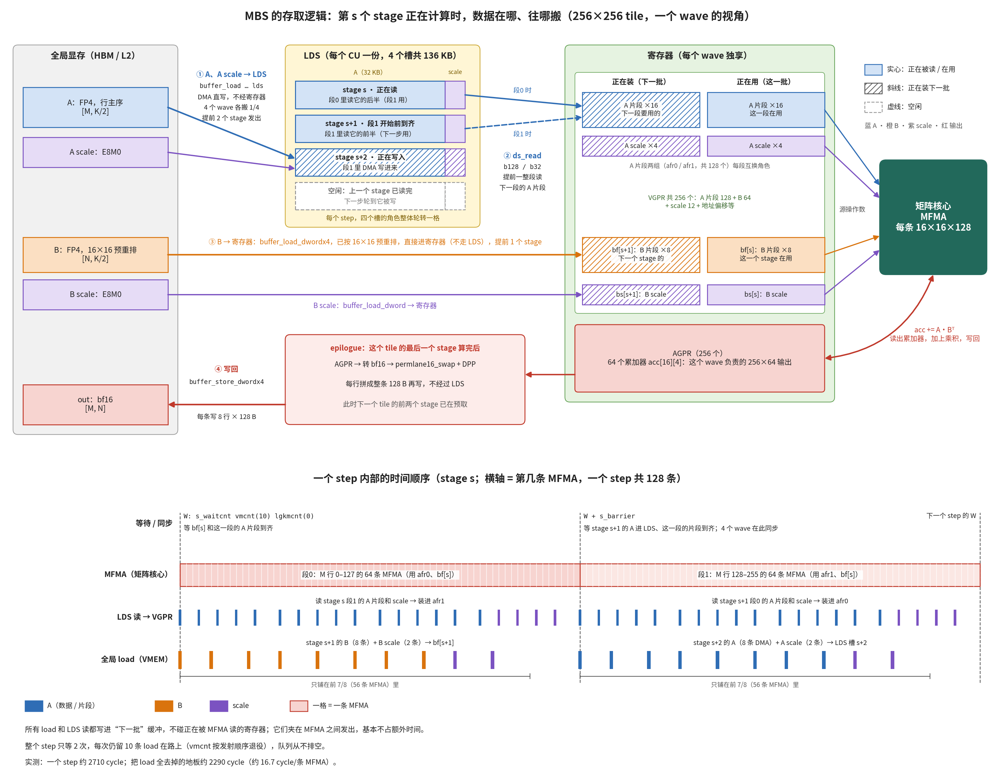

# MBS 代码梳理与优化点

> 整理于 2026-10-30，基于提交 `80614af`。结论以代码和编译产物为准；性能数字是在本机 MI355X 上重新实测的，测量方法见文末。

## 结论

mbs 是一个只面向 gfx950（MI355X）的 MXFP4 A4W4 GEMM HIP kernel。它的输入约定和 aiter 的 `gemm_a4w4_asm` 完全相同，目标是用 C++ 追平生产 asm。

主力的 `gemm_a4w4_wg_kernel` 基本做到了。在一张空闲的 MI355X 上重测 `test_gemm_a4w4.py` 里的 14 个模型 shape：13 个的速度在 asm 的 0.94–1.07 倍之间，几何平均 0.93 倍，误差全部为 0。单次测量大约有 ±3% 的波动。

它的思路可以概括为：瓶颈是 MFMA 的发射，所以用 C++ 模板在编译期把热循环里每条指令的位置排死，让矩阵核心几乎不停。

短板在主路径覆盖不到的 shape 上：

- K 不是 1024 的倍数时，只有 asm 一半的速度。
- K 不是 128 的倍数时，结果是错的，而且不报错。

## 代码组成

- **`kernel/gemm_a4w4.hip`**（1053 行）：全部 device 代码，包括两个 kernel 和分发逻辑。
- **`kernel/gemm_a4w4.h` 和 `interface/gemm_a4w4_pybind.cpp`**：前者是不依赖 torch 的 launcher 接口，后者是 torch 包装。Python 侧调用 `mbs_gemm_a4w4.gemm_a4w4(A, B, A_scale, B_scale)`，返回 bf16 的 `[M, N]`。
- **`test_gemm_a4w4.py`、`bench_one.py`**：和 torch 参考实现对精度，和 `aiter.gemm_a4w4`（asm）比速度。
- **`kernel/mfma_probe.hip`**：用实验反推 `v_mfma_scale_f32_16x16x128_f8f6f4` 的 lane 布局，以及 scale 的语义（每个 lane 一个 scale，`op_sel` 选字节）。
- **和 GEMM 构建无关的文件**：`kernel/gemm_a4w4_tmp.hip` 是上一版 wg kernel，带 hangy 的中文批注；`example.*` 和 `kernel/asm/*.amdgcn` 是访存模式实验用的脚手架。

计算是 `out = dequant(A) @ dequant(B)^T`。A、B 都是 fp4（e2m1），一个字节放两个；每 32 个 K 共享一个 E8M0 scale。A 是普通行主序，B 用 aiter 的 16×16 preshuffle 布局，scale 用 shuffle 过的布局。

## 分发：两条 kernel 路径

`gemm_a4w4_mxfp4_launch` 按 K 分两种情况：

- **K % 1024 == 0**：从 11 种工作组 tile（256×256 到 64×512）里，选 `ceil(tiles/256) × (MTILE+64) × NTILE` 最小的那个。这个式子是"轮数 × 每轮代价"。只要选中的 tile 不少于 64 个，就走 wg kernel。
- **其他情况**：回退到单 wave 的 `gemm_a4w4_mfma_kernel`。它按能否铺满 512 个工作组，在 128×128 到 16×32 之间选 tile。

测试集里的 K 只有 5120、6144、17408，全是 1024 的倍数。所以现有测试只覆盖了 wg kernel，回退路径的问题测不出来。

## 主力 wg kernel 的优化点

下面以 256×256 的 `gemm_a4w4_wg_kernel<16,4,4>` 为例，数字都和编译出来的汇编核对过。目录里的两张图和当前代码一致：





1. **大 tile、累加器钉在 AGPR、每个 SIMD 只跑 1 个 wave。** 每个 wave 算 256×64 的输出，即 64 个互不依赖的 16×16 累加器，正好占满 256 个 AGPR。
   - MFMA 用 inline asm 加 `"+a"` 约束写（`mfma_fp4_sel`），不用 builtin。用 builtin 的话，编译器会在 K 循环里把累加器来回搬。
   - 编译结果是 256 VGPR + 256 AGPR，K 循环里一条 `v_accvgpr_*` 都没有。
2. **A 经 LDS 共享，B 直接进寄存器。**
   - 4 个 wave 沿 N 并排，共用同一块 A。A 用 `buffer_load_dwordx4 ... lds` 直接 DMA 进 LDS，不经过 VGPR。
   - 防 bank conflict 的 XOR swizzle 做在全局读地址上（`a_lane` 里的 `(lane&7)^(lane>>3)`），`frag_at` 读取时按同样的 XOR 还原。
   - B 经过 preshuffle 后，一条 MFMA 的 B 操作数是连续的 1 KB，一条 `dwordx4` 就能完全合并。
3. **scale 零开销。** shuffle 后每个 lane 的一个 dword 正好装 4 个 scale 字节，对应相邻 2 个 16 行子块乘以 2 个 K-128 半段。MFMA 用 `op_sel/op_sel_hi` 直接挑字节，不需要解包。A 的 scale 每个工作组只 DMA 一次进 LDS。
4. **4 槽 LDS 环形缓冲加预取。**
   - K 每 256 为一个 stage，每槽 34 KB，共 136 KB。
   - A 提前 2 个 stage 发出，B 提前 1–2 个（由 `PF_B` 决定）。
   - 循环按 4 展开，每个缓冲都是编译期固定的变量。K % 1024 的限制就是从这里来的。
5. **编译期排定指令顺序，这是最核心的一条。** 每个 stage 分两段，分别算 M 的前后两半。`section` 用 `static_for` 和 `sched_barrier(0)` 把每条指令钉在固定位置：
   - 当前段计算时，把下一段要用的 A 片段整段从 LDS 读完。
   - 每段夹带 10 条全局 load：段 0 是下一个 stage 的 B，段 1 是再下一个 stage 的 A DMA。这些 load 一条一条撒在该段前 7/8 的 MFMA 之间（`LOAD_WIN = 7`）。
   - MFMA 采用 asm 的 2×2 之字形顺序。

   编译后，每个 stage 恰好是 128 条 MFMA、20 条全局 load、40 条 LDS 读。
6. **等待全部手写，每个 stage 只有一个 barrier。** `W_START` 和 `W_MID` 都是 `vmcnt(10)`，load 队列从不清空。epilogue 之后的第一步，会额外给 32 条 store 留出额度。
7. **load 寻址照搬 asm。**
   - 每条 load 的 VGPR 偏移只算一次，`opaque()` 防止编译器在每条 load 前重算；soffset 固定为 0。
   - tile 和 stage 的偏移加到描述符基址上（`rsrc_at`）。
   - 越界的行列交给硬件范围检查：读返回 0，写被丢弃，所以热循环里没有分支。
   - 文档实测这一项约值 6%。
8. **epilogue 不经过 LDS。**
   - MFMA 交换了两个操作数，算的是 C^T，所以每个 lane 拿到同一行的 4 个连续输出。
   - 先用 `v_cvt_pk_bf16_f32` 打包，再用 `permlane16_swap` 和 DPP `row_ror:8` 在 lane 间重组。这样每条 store 指令正好写 8 行、每行完整的 128 B。
   - 另外几处空 asm 都是为了 tile 交界处不 spill：用 `v_mbcnt` 现算 lane 号、把 AGPR 读取钉在原位、让累加器清零对编译器不透明。
9. **persistent kernel，按 XCD 重排 tile 顺序，流水线跨 tile 不中断。** 不过文档自己测过，这一项的收益在 ±2% 以内，不是主要来源。

## 文档和代码的出入

- **`asm_vs_wg_kernel.md` 第 1–5 节针对的是旧 kernel**，也就是现在的 `gemm_a4w4_tmp.hip`。那一版是一条 128 MFMA 的平铺流，用 `FRAG_AHEAD`，每个 wave 各读一份 A scale（每 stage 26 条 load），epilogue 经 LDS `sepi` 中转，等待用 `WAIT_KEEP`。只有第 6 节对应现在的代码。
- **`mbs_note.md` 和当前代码一致**，里面的数字和行号都核对过。只有"0 spill"要补一句：VGPR spill 确实为 0，但 256×256 有 18 个 SGPR spill，192×256 有 4 个。它们 spill 到 VGPR lane，全在 K 循环之外（kernel 开头写入、换 tile 时读回），影响可以忽略。

## 还能优化的地方（按优先级）

主路径之外的实测，同一张卡，用 CUDA graph 计时：

| M×N×K | 路径 | mbs (µs) | asm (µs) | asm/mbs |
|---|---|---|---|---|
| 8192×8192×5120 | wg | 174 | 167 | 0.96 |
| 8192×8192×4864 | 回退 | 334 | 162 | 0.48 |
| 1024×8192×2304 | 回退 | 41.1 | 22.8 | 0.56 |
| 1024×2880×2880 | 回退 | 22.1 | 14.4 | 结果错误，相对误差 14.9% |
| 16×17408×5120 | wg，68 个 tile | 14.3 | 10.3 | 0.72 |
| 512×5120×17408 | wg，160 个 tile | 43.6 | 32.3 | 0.74 |
| 1024×1024×5120 | wg，64 个 tile | 14.5 | 7.7 | 0.54 |

1. **K 不是 128 的倍数时结果是错的，必须修。** 回退 kernel 用 `Kchunks = K / 128`（`kernel/gemm_a4w4.hip` 第 167 行），余下的 K 被直接丢掉，也不报错。K=2880（gpt-oss 的 hidden size）实测误差 14.9%。接口只检查 K 是 32 的倍数（`interface/gemm_a4w4_pybind.cpp` 第 34 行），至少要把这行改成 `K % 128`，更好的做法是补上 K 尾处理：

   ```cpp
   TORCH_CHECK(K % 32 == 0, "gemm_a4w4: K must be a multiple of 32, got ", K);
   ```

2. **K 不是 1024 的倍数时，只有 asm 一半的速度。** 11008、13824、18944、1536 这类常见维度都会落到这条路径。从编译产物看，回退 kernel 慢在三处：
   - **最主要的一处：** 第 112 行 `load_frag` 的逐 lane 判断被编成了 `exec` 分支。编译器数不清在途的 load 数，只好在每批预取之后插 `vmcnt(0)`，双缓冲实际上没起作用。
   - scale 是逐字节的 `global_load_ubyte`。
   - epilogue 是 2 字节的 `store_short`。

   根治办法是让 wg kernel 支持 K % 256。现在的限制只来自 4 槽环的静态展开加上跨 tile 流水。跨 tile 流水本来就只值 ±2%，K 不整除时在 tile 边界排空流水即可。
3. **tile 不足 256 个时，GPU 填不满。** wg kernel 最小只有 64 行的 tile，也没有 split-K。
   - decode 类的小 M 只用到 68 个 CU，速度是 asm 的 0.72 倍。测试集里没有这类 shape。
   - M=512 的长 K 是 0.74 倍。
   - 1024×1024 只用到 1/4 的 GPU。

   可选方案有两个：一是 split-K 或 stream-K，用 fp32 存部分和；二是加 16 行或 32 行的单段循环变体。现在的两段结构在 32 行时 `MS1 = 0`，没法用。
4. **最后一轮 tile 不满。** 比如 8192×5120×K 有 640 个 tile，也就是 2.5 轮，最后一轮有一半 CU 空转。asm 也有同样的问题，所以 stream-K 在这里是反超 asm 的机会。
5. **大 shape 主路径上，离 asm 还差 2–6%。** 按文档的 cycle 分析，差距在段内 load 和 MFMA 的交错方式（段 0 多约 170 cycle，段 1 多约 230 cycle），不在等待上。可以逐条对照 asm 的 load 位置来调。
6. **工程层面：**
   - CU 数 256 和 XCD 数 8 是写死的。在 CPX 等分区模式下，tile 选择和 XCD 重排都会失准。
   - `m0` 写在 inline asm 的 clobber 列表里，编译时有 336 条"reserved register … undefined behaviour"警告，换编译器版本有风险。
   - 接口不校验 scale 张量的尺寸。偏移和描述符范围都是 32 位 int，超大张量没有检查。
   - 相比 asm，还缺 alpha、bias 和 split-K。

建议的顺序：先修第 1 条的接口检查（或补 K 尾），再改第 2 条回退 kernel 的 load。

## 测量方法

- 硬件：MI355X（gfx950，256 CU），HIP 4 号卡（amd-smi 的 7 号卡），测试时空闲。
- 输入：和 `test_gemm_a4w4.py` 相同的流程，用 `aiter.get_triton_quant(per_1x32)` 量化，用 `shuffle_weight(layout=(16, 16))` 预重排 B。
- 精度：与 torch 参考实现（fp4 和 E8M0 反量化后做 fp32 matmul）比较相对误差。
- 计时：CUDA graph 里连续调用 50 次，回放 5 次取最好的平均值，L2 是热的。对比对象是 `aiter.gemm_a4w4(..., bpreshuffle=True)`。
- 寄存器、spill、LDS 用量和指令统计：用 Makefile 的编译选项加 `--cuda-device-only -S` 生成汇编后统计。
- 当时的临时脚本在 `/tmp/mbs_check/`（`bench_cmp.py`、`tile_pick.py`），不在仓库里。
